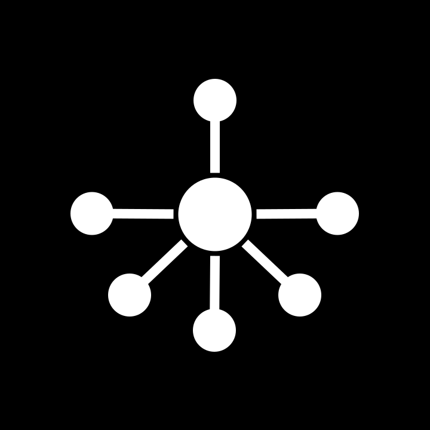

<div align="center">



# router-agent

### Say it in Feishu, get it done in Orca, close the loop in a PR.

**Feishu message → resident Router triage → Claude Code in an Orca worktree → PR tracking back to the thread.**<br>
Admission, ticketing, dispatch, follow-ups, progress sync and closure are automatic,<br>
and every ticket gets its own branch, terminal and context.

[](https://github.com/blankPen/router-agent/stargazers)


[Quick start](#quick-start) &nbsp;·&nbsp; [How it works](#how-it-works) &nbsp;·&nbsp; [Configuration](#configuration) &nbsp;·&nbsp; [Commands](#commands) &nbsp;·&nbsp; [Worker protocol](#worker-report-protocol) &nbsp;·&nbsp; [Docs](#documentation)

[简体中文](README.md) · **English**

</div>

<br>

## Is it for you?

If your day is a constant shuffle between repositories — drop a request in a chat, wait for someone to create a branch, open a terminal, get it running, then report back — that loop should belong to a machine.

router-agent (`ra`) is a resident two-layer agent system: **the Router only triages and dispatches; the Worker only works inside an isolated worktree**. It doesn't write code for you. It turns "who, which project, which base branch, what to do" into a ticket with a clear scope and context, then hands it to Claude Code running in its own Orca worktree.

- **Many repositories, many chats**: projects, branches and chat bindings live in one config, and everything is confirmed before dispatch.
- **An auditable scope**: every message passes a deterministic gate, then Pi triage; accept, ignore, ask-back and unavailable are all recorded decisions.
- **No terminal babysitting**: the Worker reports with `ra report`, the Router merges progress back into the original thread, and a merged or closed PR closes the ticket.
- **Tickets don't collide**: one ticket, one worktree, one branch, one Claude Code terminal.

It is built for everyday "message in, code out" collaboration. If you only need a one-off edit, opening Claude Code directly is faster.

It is a **clean rewrite** of dsh-superagent, with no dependency on the prototype's tmux / DSE profile.

## Quick start

**Prerequisites**

| Dependency | Notes |
|-|-|
| Node.js | `>= 22.19.0` (uses the built-in `node:sqlite`; pinned to 22.19.0 via `.node-version`) |
| pnpm | Install dependencies and build |
| Orca | Provides the `orca` CLI that creates worktrees and terminals |
| lark-cli | Feishu event consumption and messaging; needs a Feishu custom app |
| Claude Code | The actual Worker, launched by Orca inside the worktree |

**1 · Install and build**

```bash
pnpm install --registry=https://registry.npmjs.org/
pnpm build
```

`ra` is available after `pnpm link --global`, or run it directly with `node bin/ra.js <command>`.

**2 · Initialize**

```bash
ra init                 # guided: repo → bot → chat → allowed members, all in one command
```

`ra init` only asks for required fields and fills in sensible defaults. The dedicated bot, chat bindings and allowlists can all be configured in the same walkthrough.

**3 · Start**

```bash
ra start                # run in the background
ra status
ra web                  # open the dashboard
```

**4 · Self-check and simulate**

```bash
ra doctor                                              # config / Orca / Feishu / model / port — all green before going further
ra simulate --infer --text "change the README port from 3000 to 3083" --dry-run
ra simulate --text "hey, are you there" --dry-run      # verifies the reply path also goes through Pi
ra tickets                                             # simulated tickets show up here
```

For a real acceptance run, mention the bot in a chat with a small request, then confirm in order:

1. `ra logs | grep trigger:ingested` shows the message arriving;
2. `ra tickets` shows a ticket, and `ra ticket <id>` shows its scope and strength;
3. `orca worktree list --json` shows `ra-tk-<number>-<semantic slug>` with branch `ra/tk-<number>-<semantic slug>` (the directory name matches the branch, with `/` replaced by `-`), and Orca shows a Claude Code terminal;
4. after the Worker runs `ra report`, the stage in `ra ticket <id>` moves between `running → review/person`;
5. when the PR is merged or closed, the ticket becomes `closed` and Feishu gets one closure notification.

## How it works

```text
Sources (Feishu / GitHub)
        │ Trigger
        ▼
Router (AgentLoop + DecisionEngine(Pi) + HTTP API + Web)
        │ Engine (single state writer)
        ▼
Domain core (zero-dep TS: Ticket / Mandate / Assignment / Stage / Policy)
        │ Assignment
        ▼
WorkerBackend port ── OrcaAdapter (default) ── future: Codex / Headless Claude
```

A message goes through four steps:

1. **Listen**: a resident consumer reads Feishu group / direct messages, and a deterministic gate applies the allowlist and `@` rules.
2. **Decide**: candidates that weren't explicitly assigned go to Pi triage (batchable), producing one of `accept / stop / ignore / unavailable`.
3. **Dispatch**: on acceptance, the Router creates a ticket and mandate, confirms "project + base branch", then runs `orca worktree create --repo ... --base-branch ...` to open an isolated worktree with a Claude Code terminal. If the project or branch is missing it does **not** open a ticket; it asks in the conversation first (chat bindings can pin both and skip the Q&A).
4. **Follow**: the Worker reports with `ra report` (falling back to `state.json` on failure), and the Router advances the ticket. When the PR is merged or closed, the ticket closes and the requester is notified.

Key constraints:

- **Engine is the single writer**: the Router, Workers and dashboard never write SQLite directly.
- **WorkerBackend is the only extension point**: another backend is one adapter, with no changes to the core or Router.
- **All outbound notifications go through the Outbox**: idempotency key plus exponential backoff starting at 2s (capped at 60s).
- **No TUI parsing for state**: `checkIdle` only reads Orca's structured fields (`connected` / `orphaned` / `lastOutputAt`); the proactive probe reads the agent's session transcript first and falls back to `orca terminal read --screen`. Probe messages are semantic summaries: assistant text plus a one-line action digest, with tool-call echoes and status lines filtered or collapsed.
- **Triage is a DecisionEngine port**: Pi is the only implementation, and both triage and polite replies go through the same Pi channel; triage tools only produce proposals, and the Engine still writes everything.

## What it does

### Listen: only the messages that matter

- Group messages follow the config: `mode: all` receives everything and replies without a mention; `mode: mention` only receives `@bot`.
- Direct messages have their own switch; bot messages, system messages and interactive cards never enter the domain.
- A non-empty per-chat `allowed` list means only those people can trigger work in that chat; an outsider mentioning the bot is silently ignored.
- Image messages are downloaded by `image_key`, transcribed to text (including images inside quoted messages and rich-text posts), and then go through the same assessment. If transcription fails, the message falls back to the attachment notice. Other attachments (files, audio) are not downloaded or read multimodally.
- History backfill is incremental per chat cursor; the first sighting of a chat only records a baseline, so old messages aren't treated as new requests.

### Decide: gate first, Pi second

Even explicit requests go through triage (the `conversation.md` / `admission.md` prompts) — being on the allowlist doesn't mean "open a ticket blindly". Obvious greetings short-circuit without another model call.

Triage is a `DecisionEngine` port, and **Pi is the only implementation**. AgentLoop only handles the gate, applies proposals, writes state and replies; it no longer owns a tool loop.

| Channel | Description |
|-|-|
| Triage | Pi `createAgentSession`, in-memory session, Router system prompt only; tool allowlist `router_read / router_ticket / router_ticket_list / router_ticket_progress / router_ticket_close / router_workspace_remove / router_decide` |
| Reply | The same Pi engine with zero tools, generating one polite sentence for greetings / follow-up questions; falls back to fixed copy on failure |

Five constraints:

1. **Gate before Pi**: Pi only sees candidates that already passed the deterministic gate; admission is never delegated to a model.
2. **Tool allowlist**: no shell / files / MCP / general skills.
3. **Bounded writes**: query tools are read-only; cleanup tools close tickets through `Engine` and enqueue workspace reclamation in `Effects` (the service still stops terminals and removes worktrees), and only for allowlisted users who explicitly mention or DM the bot. `router_decide` only produces a `DecisionProposal`; AgentLoop calls `Engine.decide()` uniformly.
4. **Timeout and budget**: 60s and 32k tokens per call; timeout or budget overrun lands as `unavailable` and never blocks `runCycle`.
5. **Audit and replay**: `~/.router-agent/logs/decisions.jsonl` records prompts, tool sequences, proposals, latency and tokens.

Pi is fully isolated: AuthStorage / SettingsManager / SessionManager are all in-memory, extensions / skills / prompts / themes / AGENTS.md are disabled, and the user's `~/.pi` is never read or written.

### Remember: one session per conversation

Each person in a chat gets their own persisted Pi session, so Router no longer loses context between messages. The session lives until that person sends `/new`.

- **Per-person isolation**: key is `chat:<chatId>:user:<actorId>`; `/new` only resets the sender's session.
- **@ admission**: in `mode: mention` chats only @bot / DM messages enter the session; `mode: all` chats accept everything; unlisted members never enter.
- **Persistence**: sessions are written under `~/.router-agent/sessions/` and restored with `SessionManager.open` after a restart.
- **Idle eviction**: after 30 minutes the in-memory session is released; the file stays and is reopened on the next message.
- **Compaction**: Pi's native compaction keeps the recent ~20k tokens and summarizes older context.
- **`/new`**: exact-match command; old files are deleted after 7 days by a cleanup job.
- **Persona**: `router.persona.soulFile` changes tone only, never the tool whitelist or authorization.

Deterministic replies (small talk, attachment notices, closed-thread notices) are also appended to the session so the next model turn knows what happened.

### Dispatch: one worktree per ticket

Opening a ticket needs three things: **the task, the project (repo) and the base branch**. The Router only creates the ticket when all three are clear; if either is missing it **won't open a ticket** and asks in the conversation:

```text
User:  @bot change the login timeout to 30 seconds
Router: Which project, and which base branch? Available projects: router-agent, super-agent
User:  router-agent, start from release
Router: Ticket "Adjust login timeout" (tk_1) started. Progress will be updated in this thread.
```

- While waiting, the request is stored as a **dispatch draft** (per chat + per person, valid for 30 minutes); once the user fills in the gaps, the ticket opens directly without restating the task.
- Precedence for project / branch: **explicitly stated in this message > chat binding > previous draft > the sole project's `defaultBranch`**.
- The base branch is passed to `orca worktree create --base-branch <ref>`; the Worker's worktree is cut from it.
- If the project isn't in `projects` or the branch isn't in the `branches` allowlist, the Router asks again with the available options rather than guessing.

**Chat binding (no Q&A)**: one chat entry covers both "what to monitor" and "where to dispatch":

```bash
# CLI
ra config set project.router-agent "name:dsh/router-agent@main"
ra config set chatBinding.oc_xxx "router-agent@main"   # binding also means monitoring this chat
ra config set chatMode.oc_xxx mention                  # optional: only @ messages
ra config set chatSync.oc_xxx true                     # optional: backfill history on startup
```

The equivalent YAML:

```yaml
feishu:
  chats:
    - chat: oc_xxx
      mode: all
      repo: router-agent
      branch: main
```

Once bound, tickets in that chat no longer ask for project / branch; chats without `repo` / `branch` still follow the rules above.

**Per-chat allowlist**: when `allowed` is non-empty, **only those people can trigger** work in that chat — an outsider mentioning the bot is silently ignored (no triage, no reply, no ticket), and this overrides the global `feishu.allowed`.

```bash
ra config set chatAllow.oc_xxx "ou_alice,ou_bob"
ra config set chatAllow.oc_xxx ""          # clear it and fall back to the global allowed list
```

> Note: the global `feishu.allowed` only distinguishes "explicit / inferred"; someone outside the list can still be accepted after triage when they mention the bot. Use the per-chat `allowed` to strictly limit a chat.

### Follow: merged progress, unbroken follow-ups

Workers **never write state files by hand**; they report through `ra report`. The CLI POSTs to the local Router (`POST /api/reports`); if the service is unreachable it writes `~/.router-agent/workers/<ticketId>/state.json`, which the poller picks up within a second.

- `--reply` is **the complete content the user sees** (Markdown); it accepts a literal string, `@file`, or `-` (stdin).
- `--summary` is one line only; a summary without a reply is flagged as "incomplete delivery".
- The Router **sends `--reply` verbatim** — it doesn't judge the format or rewrite it: a PR link is a PR, a document link is a document.
- For long documents, the Worker runs `ra doc --title "..." --content @answer.md` and puts the returned link into `--reply`.
- Follow-ups are delivered with a `【Router 输入 in_xxx】` prefix; the Worker acknowledges with `--ack in_xxx`, otherwise the same follow-up is delivered again.
- `--state progress` replies / summaries are not sent immediately by default: the Router merges them on the `progress.syncMs` interval, de-duplicates identical content, and posts one message to the thread. Replies to a follow-up (with `--ack`) and terminal states such as ready / blocked / failed are still sent immediately.
- **No reliance on Worker reports**: when a Worker has had no new report / input for `progress.silenceMs`, the Router reads the agent's structured session transcript first (Claude Code `~/.claude/projects/.../*.jsonl`) and falls back to the rendered Orca terminal (`orca terminal read --screen`) only when unavailable. Progress is condensed into a semantic summary (assistant text plus a one-line action digest, no per-call tool noise) and posted every `progress.probeMs`, rate-limited by `progress.repeatMs`. Tickets that received a new input after `ready` are covered too.
- The Router reads incremental file changes every turn (the `state.json` fallback channel) and calls `Engine.report()` on success.
- Long terminal silence → the Router sends `status?`; still no response → the ticket is marked stale and a human is notified.
- Audit events are appended to `events.log` in the same directory.

Two ways to inject the Worker handbook (`workerSpec.mode`): `prompt` embeds it in the startup prompt; `agent` sends only the ticket and relies on the global `~/.claude/agents/router-agent-worker.md` (generated by `ra init`). Neither mode touches the project's own `CLAUDE.md`.

### Observe: replies, dashboard and audit

The Router doesn't chat; it only speaks when necessary:

| Scenario | Behavior |
|-|-|
| **Any monitored message** | Immediately adds an ack reaction (default `Typing` ⌨️), removed once the reply is sent |
| Mentioned in a group, but it's just a greeting / probe | **Pi generates** one polite reply as a **normal message**; no ticket |
| Mentioned in a group with a real request | A single **thread** message: "Ticket 'title' (id) started. Progress will be updated in this thread." No extra normal-message "I created the ticket" ack |
| Un-mentioned group message | Pi triage; casual chat is **completely silent** (no noise) |
| Direct message | Pi triage; casual chat gets a polite Pi reply (normal message) |
| Image only (no text) | Downloads `image_key`, transcribes it to text, then assesses; only replies "I can't read attachments — please describe it in text" when transcription fails |
| File / audio / other attachment only | **No ticket**: replies "I can't read attachments — please describe it in text" |
| System messages (chat created / member added / renamed) | Dropped immediately |
| Interactive card messages | Dropped (the `content` is raw card JSON, not a request) |
| Triage didn't finish (`unavailable`) | If it was addressing the bot, Pi asks a follow-up question |
| Inferred candidate with `acceptMode: off` | Fixed message: "not starting automatically right now" |
| Worker stuck / has a result / PR merged or closed | Always synced as a **thread reply** under the original message |
| Worker delivers a conclusion | Simple one-line replies go as **plain text**; Markdown goes as a **Feishu card** (normalized first) in the thread, with document / PR links |
| Worker progress (`--state progress` or Router probe) | **Not sent one by one**: reports are merged on `progress.syncMs` into one thread message (follow-up answers excepted). When the Worker goes quiet, the Router probes on `progress.probeMs` (session transcript first, terminal screen as fallback) and posts a semantic summary (assistant text plus a one-line action digest, tool-call noise filtered), rate-limited by `progress.repeatMs` |

- The ack reaction is best-effort: failures only log `feishu:reaction-failed` and never affect triage. It is added only to first-time ingested messages addressed to the bot (@ / direct), never to backfill or replay, and removed after the reply is sent (`feishu:unreact-failed` logs a removal failure). Turn it off with `ra config set feishu.reaction ""`.
- All `emoji_type` values are in the Feishu "emoji copy" document; note that they are **case-sensitive** (`Typing`, not `TYPING`).
- Outbound routing is content-based: **single-line, ≤200 characters, no Markdown syntax** goes as a `text` message; everything else is rendered as a Feishu **interactive card**, falling back to a post message if the card fails. Threading rule: an empty `threadId` means a normal message, a non-empty one means a thread reply.
- Card Markdown is normalized first (`normalizeCardMarkdown`) to downgrade syntax Card 1.0 doesn't support: `#` headings → bold lines, `>` quotes → `▍`, tables → bold header + list rows, `- [x]` → ☑ / ☐, `<br>` → newline, `` → a clickable link; code blocks are preserved verbatim.

**How far the logs can take you**: every key step is structured JSON, one event per line (`at` / `level` / `message` + business fields):

| Event | Source | Key fields | Meaning |
|-|-|-|-|
| `feishu:ready` | Event consumer | — | Event stream connected |
| `trigger:ingested` | Source | `id` `chat` `addressed` | User message entered the system |
| `trigger:dropped` | Source | `reason` `chat` `actor` | Received but filtered |
| `router:decision` | Engine | `triggerId` `decision` `strength` `reason` `ticketId` `title` `scope` | Router triage decision |
| `launch` | Service | `ticketId` `handle` `workdir` | Dispatched to an Orca worktree |
| `input:queued` | Engine | `ticketId` `seq` `text` | Content the Router is about to send to the Worker |
| `input:delivered` | Service | `ticketId` `count` `text` | Actually delivered into the Worker terminal |
| `report` | Service | `ticketId` `state` `turn` `summary` `reply` `humanAction` `pr` | Worker's `ra report` |
| `progress:synced` / `progress:dedup` | Service | `ticketId` `count` / `skipped` | Merged progress sync, or duplicate content skipped |
| `progress:probed` | Service | `ticketId` `minutes` `count` `unchanged` | Proactive probe posted a semantic summary to the thread |
| `outbox:sent` / `outbox:failed` | Outbox | `key` `text` / `error` | Outbound notification result |
| `api:input` / `api:stop` / `api:policy` | HTTP API | — | Dashboard / CLI actions |
| `idle:nudge` / `idle:stale` | Service | — | Idle nudge and stale marking |
| `pr:linked` / `pr:state` | Service | — | PR tracking |
| `recover:*` | Service | — | Restart reconciliation |

Raw terminal output **never enters the logs** (to avoid parsing TUI text); the proactive probe prefers the Claude session transcript and otherwise posts a semantic summary (assistant text plus an action digest), never a replay of tool calls. To see what a Worker did, read the `report` `summary` and `~/.router-agent/workers/<ticketId>/events.log`.

> **Only one event bus may run per bot.** If `ra logs` shows `another event bus is already connected`, stop the other consumer using that app, or give router-agent its own bot via the "dedicated bot" option in `ra init`.

### PR closure

- After dispatch, the Router tracks the PR state for that branch (`pr:linked` / `pr:state`).
- A ticket cannot close while its PR is still open.
- When the PR is merged or closed, the ticket becomes `closed` and Feishu gets one closure notification.
- No auto-merge: merging is always a human decision.

## Configuration

`~/.router-agent/config.yaml` (view with `ra config`):

```yaml
feishu:
  larkHome: ""         # isolated lark-cli config dir for a dedicated bot; empty = reuse the current profile
  appId: ""            # dedicated bot App ID (App Secret lives only in lark-cli's encrypted store)
  reaction: "Typing"   # ack reaction added on receipt (Feishu emoji_type; empty string disables)
  # Monitored chats: one entry decides "what to receive + where to dispatch + whether to backfill"
  chats:
    - chat: oc_xxx     # chat_id
      mode: all        # all=receive everything and reply without @; mention=only @bot
      repo: router-agent   # optional: project bound to this chat (name or repo selector)
      branch: main         # optional: base branch bound to this chat
      sync: false          # optional: backfill this chat's history on startup
      allowed: [ou_xxx]    # optional: only these people can act here (empty = use global allowed)
  directMessages: true
  allowed: []          # open_ids allowed to start work
  bots: []             # bots allowed to produce inferred candidates
  botOpenIds: []       # the bot's own open_id / app_id
  botNames: []         # the bot's display names
  images:              # image messages: download image_key, transcribe, then assess
    enabled: true
    maxChars: 2000     # max characters per transcribed image
    timeoutMs: 60000   # per-image transcription timeout (ms)

policy:
  acceptMode: auto     # off / observe / auto
  maxWorkers: 4
  # Admission table: one cell per "listed/unlisted × addressed/not"; values below are the defaults
  admission:
    listedNotAddressed: inferred    # listed, no @: inferred | ignore
    unlistedAddressed: inferred     # unlisted, @bot: explicit | inferred | ignore
    unlistedNotAddressed: ignore    # unlisted, no @: inferred | ignore

# Triage layer: Pi only; timeout, token budget and an isolated config dir
router:
  timeoutMs: 60000         # hard timeout per triage; lands as unavailable
  tokenBudget: 32000       # token budget per triage; 0 = unlimited
  agentDir: ""             # isolated Pi config dir; empty = ~/.router-agent/pi

  # Session reuse: one persisted Pi session per Feishu chat + user
  session:
    enabled: true          # false = create an in-memory session for every triage
    keyScope: user         # user=chat+person; thread=chat+thread+person
    dir: ""                # empty = ~/.router-agent/sessions
    idleTtlMs: 1800000     # evict idle sessions from memory (files stay)
    maxActive: 50
    retentionDays: 7       # keep superseded files after /new for 7 days
    cleanupIntervalHours: 24
    turnTimeoutMs: 180000  # includes compaction
    tokenBudget: 0         # 0 = delegate to compaction
    compaction:
      enabled: true
      reserveTokens: 16384
      keepRecentTokens: 20000

  # Persona only affects tone; tool permissions are unchanged
  persona:
    name: "A-Luo"
    soulFile: ""           # empty = built-in prompts/soul.md
    style: friendly        # friendly | concise | professional
    language: zh-CN

progress:
  # Progress polling: merges progress reports from this window into one thread message
  syncMs: 60000        # milliseconds; 0 = off (progress reports are no longer synced)
  # Proactive probe: read the Orca terminal when the Worker goes quiet
  probeMs: 120000      # probe interval in ms; 0 = off
  silenceMs: 600000    # how long without a new report / input counts as quiet
  repeatMs: 900000     # minimum gap between probe messages in the same quiet period

# Idle ticket governance: remind first, then auto-close and reclaim the workspace
retention:
  enabled: true
  idleHours: 24        # no progress for this long triggers a close reminder
  closeGraceHours: 6   # auto-close if no reply this long after the reminder
  zombieHours: 6       # running but silent (no report / output) for this long counts as a zombie
  sweepMinutes: 5      # sweep interval (minutes)

workerSpec:
  mode: prompt         # prompt | agent

# Worker tool policy: the security baseline; backend.options may not override these fields
worker:
  tools:
    fileAccess: read-write   # read-only = Read / Glob / Grep only
    shell: allowlist         # deny=no shell | allowlist=only shellAllow prefixes | allow=any shell
    shellAllow: [ra report, ra doc, git, gh, pnpm, npm, npx, node, yarn, bun,
                 python, python3, pytest, cargo, go, make, mvn, gradle]
    allowNetwork: false      # reserved: parsed but not used to restrict networking yet

backend:
  default: orca            # orca | claude-cli (claude-cli has local-path requirements, see Known limitations)
  # Backend-specific non-security options: only claude-cli.model today (mapped to claude --model).
  # allowedTools / permissionMode / sandbox / shellAllow / allowNetwork / fileAccess make startup fail.
  # options:
  #   claude-cli:
  #     model: claude-sonnet-5-5

# Projects: "which project + which base branch" must be confirmed before dispatch
projects: []
#  - name: router-agent            # name users / the model refer to
#    repo: name:dsh/router-agent   # repo selector passed to Orca
#    defaultBranch: main           # used when no branch is given; empty = ask every time
#    branches: [main, release]     # optional: allowed base branches

server:
  port: 3083
```

Everyday changes don't need the full file:

```bash
ra config set policy.acceptMode observe   # observe first, don't start work
ra config set policy.maxWorkers 2
ra config set workerSpec.mode agent
ra config edit                            # opens $EDITOR on the whole file (not --edit)
```

### Changing a single key (`ra config set`)

`ra config set <dotted path> <value>` covers the common scalar settings; an unknown path or an illegal value prints "unknown config key or illegal value":

| Path | Value |
|-|-|
| `policy.acceptMode` | `off` / `observe` / `auto` |
| `policy.maxWorkers` | 1–64 |
| `policy.admission.listedNotAddressed` / `unlistedAddressed` / `unlistedNotAddressed` | see "Admission rules" |
| `router.timeoutMs` / `router.tokenBudget` / `router.agentDir` | ms (1s–600s) / tokens (0 = unlimited) / Pi config dir |
| `progress.syncMs` / `probeMs` / `silenceMs` / `repeatMs` | ms; the first two accept 0 = off |
| `retention.enabled` / `idleHours` / `closeGraceHours` / `zombieHours` / `sweepMinutes` | see the `retention` block above |
| `workerSpec.mode` | `prompt` / `agent` |
| `backend.default` | `orca` / `claude-cli` |
| `server.port` | 1–65535 |
| `feishu.larkHome` / `appId` / `reaction` / `directMessages` / `allowed` / `bots` / `botOpenIds` / `botNames` | string, boolean or comma-separated list |
| `feishu.chats` | comma-separated chat_ids; existing entries keep mode / bindings / sync, new ones default to `all` |
| `llm.baseUrl` / `llm.model` / `llm.apiKey` | model connection info |

Chats and projects are composite, so they get dedicated forms that register and bind in one call:

| Form | Example | Notes |
|-|-|-|
| `project.<name>` | `ra config set project.router-agent "name:dsh/router-agent@main"` | `@` may carry the default base branch |
| `chatBinding.<chatId>` | `ra config set chatBinding.oc_xxx "router-agent@main"` | binds the chat's project and base branch |
| `chatMode.<chatId>` | `ra config set chatMode.oc_xxx mention` | `all` / `mention` |
| `chatSync.<chatId>` | `ra config set chatSync.oc_xxx true` | backfill this chat's history on startup |
| `chatAllow.<chatId>` | `ra config set chatAllow.oc_xxx ou_a,ou_b` | empty = use the global `feishu.allowed` |

`router.session.*`, `router.persona.*` and `feishu.images.*` are not in the `config set` allowlist — use `ra config edit` or the web dashboard; `worker.tools.*` and `backend.options.*` are not exposed in the dashboard and need `ra config edit`.

### Environment variables

| Variable | Effect |
|-|-|
| `RA_HOME` | state directory, same as the global `--home` option; defaults to `~/.router-agent` |
| `RA_PORT` | port `ra report` posts to, overriding `server.port` |
| `RA_LARK_HOME` | overrides `feishu.larkHome` |
| `RA_LLM_BASE_URL` / `RA_LLM_API_KEY` / `RA_LLM_MODEL` | override the triage model (highest precedence) |
| `RA_LLM_IMAGE_BASE_URL` / `RA_LLM_IMAGE_API_KEY` / `RA_LLM_IMAGE_MODEL` | override the image-transcription model |

### Dedicated bot (recommended)

The "Feishu bot" step in `ra init` offers two ways to get a dedicated bot, without touching `lark-cli` by hand. The walkthrough uses interactive selectors (arrow keys, space to multi-select, password input hidden):

| Option | Behavior |
|-|-|
| 2) Existing App ID / App Secret | `ra init` runs `lark-cli config init --app-id ... --app-secret-stdin` and writes into the isolated directory in `feishu.larkHome`; the secret goes through stdin, never argv or `config.yaml` |
| 3) Create a new app now | `ra init` runs `lark-cli config init --new`; after the browser flow it reads back the appId |

If a user identity is needed later (searching chats / members by name), `ra init` detects it and offers to run `lark-cli auth login`.

Commands and options are parsed by `commander`: `ra --help`, `ra init --help`, `ra tickets --help` show usage.

Bot credentials are managed by lark-cli's encrypted store; `router-agent` keeps only `larkHome` and `appId`. At runtime every lark-cli subprocess (event consumption, sending, backfill, chat-name refresh) gets `HOME=<larkHome>`, fully isolated from other agents' lark-cli profiles.

### Projects and repo selectors

Each `projects[].repo` decides the target of `orca worktree create --repo`. See what Orca has registered:

```bash
orca repo list --json | jq -r '.result.repos[] | "\(.displayName)\t\(.path)\t\(.kind)"'
```

All three forms are supported:

| Form | Example | Notes |
|-|-|-|
| displayName | `teamwork-repos` | Matches by `name:` by default; most common |
| `name:` | `name:teamwork-repos` | Explicit name match |
| `id:` | `id:3ee11f05-...` | Exact id match when names collide |
| `path:` | `path:/Users/admin/du/teamwork-repos` | Absolute path |

Note: only `kind: git` repos can create worktrees; `kind: folder` (plain folder projects) fail at `orca worktree create`.

Also, the old global `repo` config has been removed (`ra` no longer reads it). Migrate existing configs to `projects`; `ra doctor` errors out and prints the command when no project is configured.

### Model configuration

The model config automatically reuses the `llm` section of `~/.trove/config.json` (`baseUrl` / `model` / `apiKey`). You can also add an `llm:` section to this file, or override with `RA_LLM_BASE_URL` / `RA_LLM_API_KEY` / `RA_LLM_MODEL`.

Precedence: **environment variables > `config.yaml` > `.trove`**.

Image transcription reuses the same model by default. If the main model is text-only, point the image path at a vision model (it does not affect assessment):

```yaml
llm:
  imageModel: qwen3-vl-plus
  imageBaseUrl: https://dashscope.aliyuncs.com/compatible-mode/v1
  imageApiKey: sk-xxx
```

`RA_LLM_IMAGE_MODEL` / `RA_LLM_IMAGE_BASE_URL` / `RA_LLM_IMAGE_API_KEY` override these. Set `feishu.images.enabled: false` to turn image transcription off.

`llm.temperature` only affects image transcription (default `0.1`); triage ignores it.

### Worker tool policy

`worker.tools` is the tool baseline handed to the worker (read/write plus an allowlisted shell):

| Field | Values | Notes |
|-|-|-|
| `fileAccess` | `read-only` / `read-write` | read-only grants `Read` / `Glob` / `Grep` only; read-write adds `Write` / `Edit` |
| `shell` | `deny` / `allowlist` / `allow` | with `allowlist`, prefixes in `shellAllow` are allowed (e.g. `git` allows `git ...`) |
| `shellAllow` | prefix array | only used when `shell: allowlist` |
| `allowNetwork` | `true` / `false` | reserved: parsed but not used to restrict networking yet |

It only applies to `backend.default: claude-cli` (mapped to Claude's `allowedTools`); with the `orca` backend the worker's permissions come from the Claude Code launched inside Orca. Security fields are decided here and by the adapter's built-in baseline only — the same keys under `backend.options` make startup fail.

### Worker spec injection

`workerSpec.mode` has two values:

- `prompt`: embeds the Worker handbook in the startup prompt (default, verified).
- `agent`: sends only the ticket and relies on the global `~/.claude/agents/router-agent-worker.md` (generated by `ra init`).

Neither mode modifies the project's own `CLAUDE.md`.

## Commands

| Command | Description |
|-|-|
| `ra init` | Interactive setup (`--yes` skips questions) |
| `ra doctor` | Preflight: config / Orca / Feishu / model / port (`--json` for machines) |
| `ra simulate` | Simulate a local message to verify gate + Pi triage, without dispatch (`--infer` runs Pi triage, `--dry-run` doesn't persist) |
| `ra start [--foreground]` | Start the resident service (background by default) |
| `ra stop` | Stop the service |
| `ra status` | Service status + ticket overview |
| `ra web` | Open the web dashboard |
| `ra tickets [--stage]` | List tickets |
| `ra ticket <id>` | Ticket details (stage / assignment / reports / inputs) |
| `ra logs` | Last 50 log lines |
| `ra config` | View config; `config set <key> <value>` changes one key (including `project.<name>` / `chatBinding.<chat>` / `chatMode.<chat>` / `chatSync.<chat>` / `chatAllow.<chat>` / `progress.syncMs` / `progress.probeMs`); `config edit` edits the whole file |

The global option `--home <dir>` switches the state directory (for tests and multiple instances).

## Admission rules

| Scenario | off | observe | auto |
|-|-|-|-|
| On the list, @bot / direct | Ticket explicitly | Ticket explicitly | Ticket explicitly |
| On the list, no @ | Reply only | Triage but no ticket | Ticket if triage accepts |
| Off the list, @bot | Reply only | Triage but no ticket | Ticket if triage accepts |
| Off the list, no @ | Ignore | Ignore | Ignore |

The table is tuned cell by cell under `policy.admission` in `config.yaml`:

| Key | Scenario | Values | Default |
|-|-|-|-|
| `policy.admission.listedNotAddressed` | listed, no @ | `inferred` / `ignore` | `inferred` |
| `policy.admission.unlistedAddressed` | unlisted, @bot | `explicit` / `inferred` / `ignore` | `inferred` |
| `policy.admission.unlistedNotAddressed` | unlisted, no @ | `inferred` / `ignore` | `ignore` |

`inferred` goes to triage (then `acceptMode` decides whether `observe` actually starts work), `explicit` opens a ticket straight away, `ignore` drops it. These are `policy.*` keys: saving in the web dashboard applies immediately; `ra config set` only writes the file, so restart the service to pick it up.

## Ticket numbering and branch naming

- Ticket numbers are globally increasing short ids: `tk-1`, `tk-2`, … They continue from the last value after a restart, and legacy `tk_<uuid>` rows still resolve.
- Orca worktree name: `ra-tk-<number>-<semantic slug>`, one-to-one with the work branch, only replacing `/` with `-`, so directory and branch line up at a glance.
- Work branch: `ra/tk-<number>-<semantic slug>`, generated from the ticket title; enough English in the title means an English slug, while a pure-Chinese title keeps Chinese (git supports UTF-8 branch names):
  - `ra/tk-12-fix-login-timeout`
  - `ra/tk-13-调整登录超时`
- The ticket's `branch` is the **base branch**; the work branch is passed separately via `orca worktree create --branch` and no longer gets Orca's user prefix and UUID.

## Ticket stages

`draft → accepted → assigned → running → review → closed`, moving back and forth between `person` (waiting on someone) and `idle` (idle). A ticket cannot close while its PR is still open.

## Worker report protocol

Workers **never write state files by hand**; they report through `ra report`. The CLI POSTs to the local Router (`POST /api/reports`); if the service is unreachable it writes `~/.router-agent/workers/<ticketId>/state.json`, which the poller picks up within a second.

```bash
ra report \
  --ticket tk-12 \
  --state progress|waiting|ready|blocked|failed|dropped \
  --summary "one-line summary" \
  --reply @answer.md \
  --pr-number 12 --pr-url "https://github.com/o/r/pull/12" \
  --human-action "what a human must do when blocked" \
  --ack in_xxx
```

| Option | Description |
|-|-|
| `--summary` | One-line summary, for logs and lists only |
| `--reply` | The complete content the user sees (Markdown); accepts a literal, `@file`, or `-` (stdin) |
| `--pr-number` / `--pr-url` | Attach the PR number and URL for code deliveries |
| `--human-action` | What a human must do when `blocked` |
| `--ack` | Acknowledge a follow-up (`in_xxx`), otherwise it is delivered repeatedly |

States:

| State | Meaning |
|-|-|
| `progress` | Mid-flight progress; merged on the `progress.syncMs` interval instead of being forwarded one by one |
| `waiting` | Waiting on an external condition |
| `ready` | This round is delivered (conclusion / PR / document) |
| `blocked` | Blocked and needs a human; pair with `--human-action` |
| `failed` | Execution failed |
| `dropped` | Abandoned on purpose |

## HTTP API

| Method | Path | Description |
|-|-|-|
| GET | `/api/status` | Service and ticket overview |
| GET | `/api/tickets?stage=&limit=` | Ticket list |
| GET | `/api/tickets/:id` | Ticket details |
| POST | `/api/tickets/:id/input` | Deliver a follow-up |
| POST | `/api/tickets/:id/stop` | Stop a ticket |
| POST | `/api/tickets/:id/assignment` | Bind an assignment manually |
| POST | `/api/reports` | Worker state and reply reports (the `ra report` entry) |
| GET / PUT | `/api/policy` | Read / write policy |
| GET | `/api/sources/feishu/chats` | Feishu source configuration |

## Development

```bash
pnpm test        # 466 tests pass (5 skipped by default, including the live Pi check; covers the Pi triage / reply path)
pnpm typecheck
pnpm build       # tsc + esbuild (web dashboard and Markdown assets)
pnpm check       # typecheck + test
RA_PI_VERIFY=1 npx vitest run tests/verify-pi-live.test.ts   # real Pi + real model (skipped by default)
```

Source layout:

```text
src/core/     domain core (model / stage / policy / engine / effects)
src/store/    SQLite (node:sqlite)
src/worker/   WorkerBackend port, OrcaAdapter, state.json polling (CLI fallback), worker handbook
src/sources/  Feishu events, history backfill, GitHub PR tracking
src/router/   AgentLoop, tool contracts, prompts, HTTP API
src/web/      React dashboard
src/cli/      ra commands
```

## Known limitations

- macOS only for now (bare `orca` collides with the GNOME screen reader on Linux; `orca-ide` is required there).
- No auto-merge; PRs are tracked and reported, not merged.
- The GitHub source is only used for PR state tracking; it does not consume issues or comments.
- Reporting goes through `ra report`; `state.json` is only the fallback when the service is unreachable.
- Images are downloaded and transcribed by a multimodal model; files / audio and other attachments are only recognized as "this is an attachment message".
- Image transcription requires a model with image input. If the main model is text-only, configure a vision model via `llm.imageModel`, otherwise images fall back to the attachment notice.
- History backfill is incremental per chat cursor: the first sighting of a chat only records a baseline (the newest message time), so old messages aren't treated as new requests.
- Measured Orca behavior: `lastOutputAt` is a millisecond number, and CLI-created terminals may report `orphaned=true` while still usable. The adapter normalizes the former and only treats `connected=false` as dead.
- `workerSpec.mode: agent` depends on whether the claude launched by Orca loads the global `~/.claude/agents/`; that premise is not yet verified, so the verified `prompt` mode is the default.
- Dispatch drafts are stored per "chat + person" and valid for 30 minutes; multiple incomplete requests in the same chat overwrite each other (the later question replaces the earlier one).
- The Pi SDK is still evolving; this repo pins `@earendil-works/pi-coding-agent@1.5.0`. Run the `RA_PI_VERIFY=1` live check before upgrading.
- Pi is the only triage engine and there is no fallback switch; when Pi is unavailable, candidates land as `unavailable` rather than being silently retried.

## Documentation

| Document | Contents |
|-|-|
| [docs/COMPARISON.md](docs/COMPARISON.md) | Gap analysis against the dsh-superagent prototype and transferable mechanisms |
| [docs/VERIFICATION.md](docs/VERIFICATION.md) | Real-environment verification records and remaining manual steps |
| [docs/show-me-router-flow.html](docs/show-me-router-flow.html) | Visual flow: message → triage → dispatch → report → closure |
| [README.md](README.md) | 简体中文版 |

The design reference is the Feishu document "router-agent（ra）技术设计方案".

---

Questions, suggestions, or a new WorkerBackend? Open an issue.