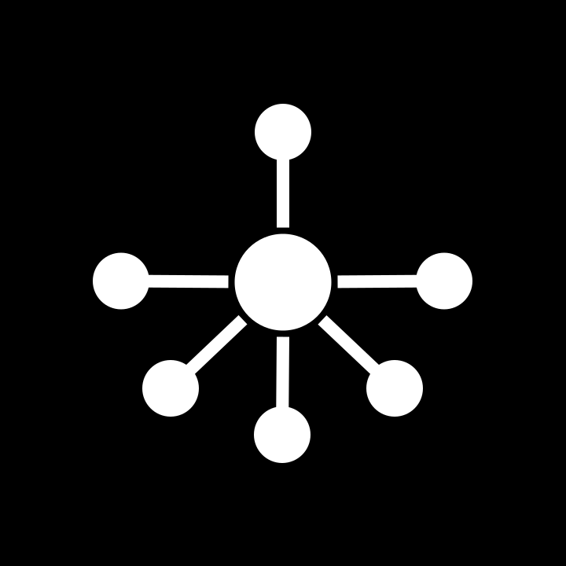
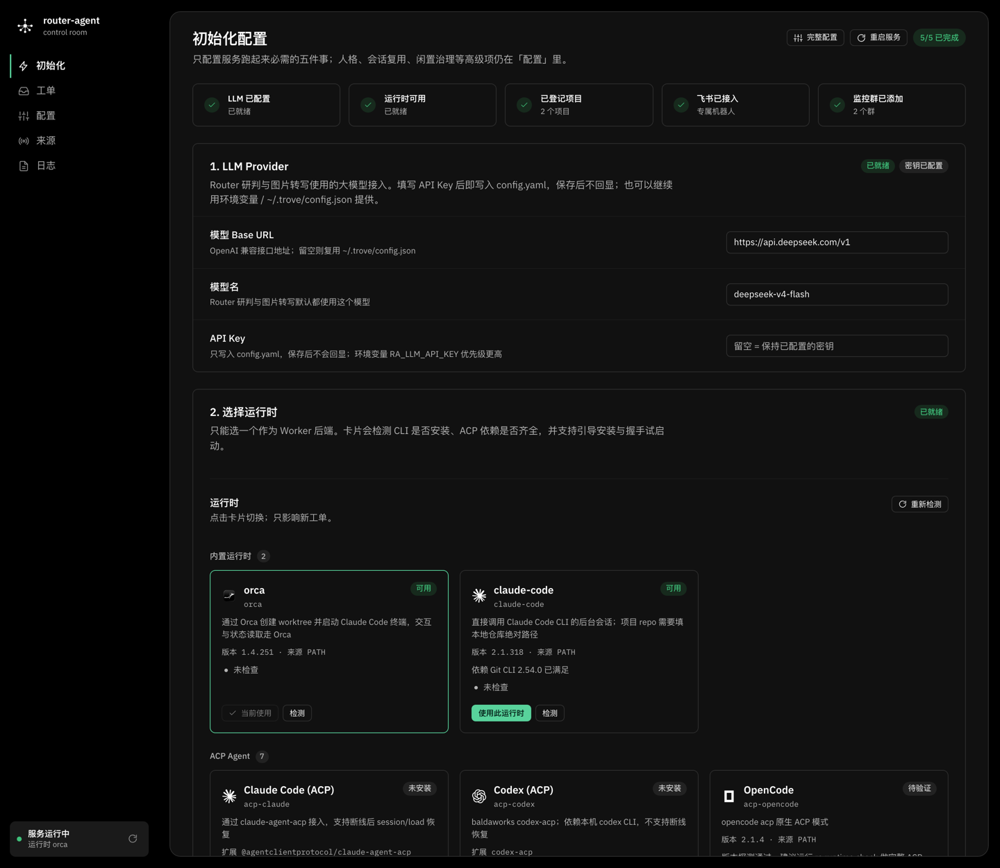

<div align="center">



# router-agent

### 在飞书说一句，在 Agent 里干完，在 PR 里闭环。

**飞书消息 → 常驻 Router 研判 → 派发到独立 worktree 里的编码 Agent → PR 跟踪回群。**<br>
准入、开单、派工、追问、进展同步、闭环全自动，<br>
每张工单都有自己的分支、终端和上下文。支持 Orca、Claude Code 与各类 ACP Agent。

[](https://github.com/blankPen/router-agent/stargazers)
[](https://www.npmjs.com/package/router-agent)


[](./LICENSE)

[快速开始](#快速开始) &nbsp;·&nbsp; [它怎么工作](#它怎么工作) &nbsp;·&nbsp; [核心机制](#核心机制) &nbsp;·&nbsp; [配置](#配置) &nbsp;·&nbsp; [命令](#命令) &nbsp;·&nbsp; [文档](#文档)

**简体中文** · [English](README.en.md)

</div>

<br>

## 它适合你吗？

如果你每天要在多个仓库之间来回切：在群里丢一句需求，等人开分支、开终端、跑起来，再回来汇报结果——这段流程本来就该由机器接管。

router-agent（`ra`）是一个常驻的双层 Agent 系统：**Router 只做研判与调度，Worker 只在独立 worktree 里干活**。它不替你写代码，它负责把「谁、在哪个项目、从哪个分支、做什么」变成一张有边界、有上下文、可追踪的工单，然后交给 Orca、Claude Code 或任一 ACP Agent 在各自的独立 worktree 中执行。

- **多个仓库、多个群**：项目、分支、群绑定集中在一份配置里，开工前先确认清楚再派工。
- **需求边界要留痕**：每条消息都过确定性 Gate，再交 Pi 研判；接单、忽略、追问、不可用都有结论可查。
- **不想盯终端**：Worker 用 `ra report` 上报，Router 把进展合并后同步回原话题，PR 合并或关闭自动闭环。
- **每个工单互不打扰**：一个工单一个 worktree、一条分支、一个 Agent 终端，做完即隔离。

它面向的是「消息进来、代码出去」的日常研发协作。如果你只是偶尔让 AI 改一个文件，直接打开你常用的编码 Agent 会更快。

它是对 dsh-superagent 的**绿色重写**，不依赖原型的 tmux / DSE profile。

## 快速开始

**前置条件**

| 依赖 | 说明 |
|-|-|
| Node.js | `>= 22.19.0`（自带 npm；使用内置 `node:sqlite`；项目根目录 `.nvmrc` 已固定 22.19.0） |
| 编码 Agent | 任选其一：Orca（`orca` 运行时，提供 worktree 与终端）、Claude Code（`claude-code` / `acp-claude` 运行时）或其它 ACP Agent（Codex / Gemini / OpenCode 等） |
| lark-cli | 飞书事件消费、发消息；需提前安装并确保在 `PATH` 中，`ra doctor` 会检查是否可用；需要一个飞书自建应用 |
| gh / glab（可选） | PR / MR 状态跟踪：GitHub 用 `gh`，GitLab 用 `glab`；对应平台需已登录。不需要跟踪 PR / MR 时可不装 |
| pnpm | 仅从源码运行或参与开发时需要（见本节末尾） |

**1 · 安装**

```bash
npm install -g router-agent   # 从 npm 全局安装，装完直接用 ra
ra --help                     # 确认命令可用
```

升级到最新版用 `ra update`：检查 npm 上的最新版、执行 `npm install -g`，服务在跑时自动重启；只想看有没有新版用 `ra update --check`。等价于手动 `npm install -g router-agent@latest` 后 `ra stop && ra start`。Web 面板侧栏发现新版本时会显示「更新并重启」；在飞书里直接说「更新版本」，Router 也会调用更新工具并在回复后自动重启服务。

<details>
<summary>需要从源码运行或参与开发？</summary>

```bash
git clone https://github.com/blankPen/router-agent.git
cd router-agent
pnpm install --registry=https://registry.npmjs.org/
pnpm build
pnpm link --global      # 之后可直接用 ra；不 link 时用 node bin/ra.js <command>
```

</details>

**2 · 初始化：两种方式，任选一种**

初始化的结果是一份 `~/.router-agent/config.yaml`（`ra init` 还会顺带写入全局 worker 规范）。下面两种方式写的是同一份配置，可以混用，也可以重复运行。

| 方式 | 适合 | 入口 |
|-|-|-|
| **Web 初始化页**（推荐） | 第一次接入；想边填边看到检测结果 | `ra start` 自动打开 `#setup` |
| **CLI 交互式** | 远程机器 / 无图形界面；想一次配完群与成员 | `ra init` |

**方式 A · Web 初始化页**

```bash
ra start              # 后台常驻；就绪后自动打开 http://127.0.0.1:3083/#setup
ra status
ra web                # 之后想再打开面板
```

页面只放「服务跑起来必需的五件事」，顶部是完成度清单：

1. **LLM Provider**：Base URL / 模型 / API Key，三项必填。密钥只写入 `config.yaml`，保存后不回显；环境变量 `RA_LLM_*` 可覆盖。
2. **选择运行时**：Orca / Claude Code / ACP Agent 卡片平铺，自动检测 CLI、版本、ACP 依赖与登录状态，支持安装引导和真实握手试启动。
3. **登记项目**：添加本地项目（系统目录选择 + 自动识别 Git）或 Git 项目（自动 clone 到 `~/.router-agent/repos`，可用 `RA_HOME` 改根目录）。
4. **飞书机器人**：填 App ID / App Secret（Secret 只写入 lark-cli 加密存储），固定使用 `~/.router-agent-lark` profile；保存后可检查授权状态并完成 Device Flow 授权。
5. **群与绑定**：至少添加一个监控群；可把群固定到某个项目，之后开工不再追问。



保存后页面会提示需要重启，点「保存并重启」即可热重启 daemon（浏览器页面不刷新）。远程机器或没有图形界面时用 `ra start --no-open`，只打印面板地址。

**方式 B · CLI 交互式**

```bash
ra init
```

按提示依次完成：**仓库**（Orca 运行时从 `orca repo list` 里挑 git 仓库；其它运行时填本地绝对路径）→ **飞书机器人**（已有 App ID+Secret 现在写入 / 浏览器新建应用 / 跳过稍后在 Web 配置页补填）→ **用户授权**（可选，用于按名字搜索群与成员）→ **监控群** → **授权成员** → **机器人身份** → **群绑定**。只问必填项，其余留默认；`ra init --yes` 只写默认配置，适合脚本化。

两种方式可以接力：先 `ra init` 配好机器人与群，再用 Web 页补齐 LLM / 项目 / 绑定；页面只提交改动过的字段，不会覆盖 CLI 写好的其它配置。

**3 · 自检与模拟**

```bash
ra doctor                                              # 配置 / 运行时 / 飞书 / 模型 / 端口，全绿再往下
ra simulate --infer --text "把 README 的端口从 3000 改成 3083" --dry-run   # 只看 Gate + 研判结论，不落库
ra simulate --text "你好，在吗" --dry-run               # 验证回复通道也走 Pi
ra simulate --text "把 README 的端口从 3000 改成 3083"  # 去掉 --dry-run 才落库；仍不派工
ra tickets                                             # 模拟产生的工单会出现在这里
```

真实验收时，在群里 @机器人 提一个小需求，然后依次确认：

1. `ra logs | grep trigger:ingested` 能看到消息进入；
2. `ra tickets` 出现工单，`ra ticket <id>` 能看到授权范围与强度；
3. `orca worktree list --json`（`orca` 运行时；其它运行时用 `git worktree list`）出现 `ra-tk-<编号>-<语义slug>`，分支名为 `ra/tk-<编号>-<语义slug>`（目录名与分支名一一对应，只把 `/` 换成 `-`），对应运行时里出现 Agent 会话（Orca 为 Claude Code 终端）；
4. Worker 执行 `ra report` 后，`ra ticket <id>` 的阶段在 `running → review/blocked` 之间变化；
5. 合并或关闭 PR / MR 后，工单变 `done`，飞书收到一次闭环通知。

## 它怎么工作

```text
Sources（飞书 / GitHub / GitLab）
        │ Trigger
        ▼
Router（AgentLoop + DecisionEngine(Pi) + HTTP API + Web）
        │ Engine（唯一状态写入口）
        ▼
领域内核（TS 零依赖：Ticket / Mandate / Assignment / Stage / Policy）
        │ Assignment
        ▼
WorkerRuntime 端口 ── OrcaRuntime（默认）/ ClaudeCodeRuntime / AcpRuntime（acp 与 7 个 acp-*）
```

一条消息会依次经过四步：

1. **听**：常驻消费飞书群 / 私聊消息，按名单与 `@` 规则做确定性准入。
2. **判**：未被直接指派的候选交给 Pi 研判，输出 `accept / stop / ignore / unavailable` 四类决定。
3. **派**：接单后创建工单与授权（Mandate），确认「项目 + 起始分支」后按运行时派工；缺信息时先在会话里追问。
4. **跟**：Worker 用 `ra report` 上报，Router 刷新阶段、同步进展；PR 合并 / 关闭后闭环。

三条设计约束：

- **Engine 是唯一状态写入口**：Router、Worker、面板都不直接写 SQLite。
- **WorkerRuntime 是唯一扩展点**：换运行时只加一个 adapter，内核与 Router 一行不改。
- **所有对外通知走 Outbox**：幂等 key + 2s 起步的指数退避（上限 60s）。

完整的分层、研判边界、会话机制与工单生命周期见 [docs/ARCHITECTURE.md](docs/ARCHITECTURE.md)。

## 核心机制

- **听**：`mode: all` 收全部消息，`mode: mention` 只收 @机器人；群级 `allowed` 严格限制可触发的人；图片消息原图落盘并透传给 Worker。
- **判**：确定性 Gate 在前，Pi 研判在后；研判工具只读，写操作统一走 Engine，超时 / 超预算落 `unavailable`。
- **记**：同一群内按人各一个落盘 session，重启可恢复，30 分钟空闲释放内存，靠 Pi 原生 compaction 自动压缩，`/new` 只清自己的上下文。
- **派**：开单必须明确「任务 + 项目 + 起始分支」；信息不全时记成派工草稿并追问，群绑定可免问答。
- **跟**：`--reply` 原文回群，进展按 `progress.syncMs` 合并；Worker 静默时 Router 主动读会话记录巡检。
- **看**：寒暄走 Pi 礼貌回复，真需求只开一个话题；PR 合并 / 关闭后自动闭环并通知。

逐项细节：[听 / 判 / 记 / 派 / 跟](docs/ARCHITECTURE.md) · [回复策略、面板与日志](docs/OPERATIONS.md)

## Runtime：Worker 运行时

Worker 不在 Router 进程里跑。Router 按 `runtime.default` 选择适配器，由它创建 workspace、拉起 Agent、投递工单并接住追问：

| runtime id | 拉起方式 | 适用场景 |
|-|-|-|
| `orca`（默认） | Orca 创建 worktree + Claude Code 终端 | 本机已用 Orca 管仓库，想同时看到终端 |
| `claude-code` | `git worktree` + `claude --bg` 后台会话 | 不用 Orca，直接跑 Claude Code |
| `acp` / `acp-*` | ACP 子进程（Claude / Codex / Gemini / OpenCode 等） | 想接其它 ACP Agent |

项目清单按运行时分开维护：Orca 用仓库选择器，其它运行时用本地仓库绝对路径。切换默认运行时只影响新工单。完整的运行时对比、ACP Agent 目录、工具策略与规范注入见 [docs/RUNTIME.md](docs/RUNTIME.md)。

## 配置

配置文件是 `~/.router-agent/config.yaml`。最小可用配置只需要四段：

```yaml
llm:
  baseUrl: https://api.example.com/v1
  model: claude-sonnet-5-5
  apiKey: sk-xxx

feishu:
  appId: cli_xxx
  allowed: [ou_xxx]       # 允许发起工作的成员 open_id
  botOpenIds: [ou_bot]    # 机器人自己的 open_id，用于识别 @；也可写 botNames
  chats:
    - chat: oc_xxx
      mode: mention

policy:
  acceptMode: auto

projects:
  - name: router-agent
    repo: name:dsh/router-agent
    defaultBranch: main
```

`mode: mention` 的群必须配置 `botOpenIds`（或 `botNames`），否则识别不到「@机器人」，消息会被当作未 @ 丢弃；`allowed` 为空时 `ra doctor` 也会报必填缺失。

常用调整不必编辑整份文件：

```bash
ra config set policy.acceptMode observe          # 先观察，不开工
ra config set project.router-agent "name:dsh/router-agent@main"
ra config set chatBinding.oc_xxx "router-agent@main"
ra config set runtime.default claude-code
ra config edit                                   # 用 $EDITOR 编辑全文
```

完整字段、`ra config set` 白名单、环境变量、模型 / 飞书机器人 / 项目清单、准入矩阵与闲置治理见 [docs/CONFIGURATION.md](docs/CONFIGURATION.md)。

## 命令

| 命令 | 说明 |
|-|-|
| `ra init` | 交互式初始化（`--yes` 跳过提问） |
| `ra doctor` | 启动前自检：配置 / 运行时 / 飞书 / 模型 / 端口（`--json` 机器可读） |
| `ra simulate` | 本地模拟一条消息，验证 Gate + Pi 研判，不派工（`--infer` 走 Pi 研判，`--dry-run` 不落库） |
| `ra start [--foreground]` | 启动常驻服务（默认后台），就绪后自动打开 Web 初始化页；`--no-open` 只打印地址 |
| `ra stop` | 停止服务 |
| `ra status` | 服务状态 + 工单概览 |
| `ra web` | 重新打开 Web 面板 |
| `ra tickets [--stage <stage>]` | 列出工单；`--stage` 可选 `todo` / `running` / `review` / `blocked` / `done` |
| `ra ticket <id> [--stop]` | 工单详情（状态 / 派工 / 上报 / 输入）；`--stop` 停止该工单并关闭 worker 终端 |
| `ra logs [--follow]` | 最近 50 行日志；`--follow` 持续跟踪 |
| `ra update [--check]` | 检查并升级到 npm 最新版：默认执行 `npm install -g router-agent@latest`，服务在跑时自动重启；`--no-restart` 只安装、`--registry` 指定源、`--force` 在源码 / link 运行时仍装全局版、`--json` 机器可读 |
| `ra runtime [list]` | 探测本机 ACP Agent：状态、版本、来源；`--json` 机器可读 |
| `ra runtime install <id>` | 按需安装 ACP 适配器到 `~/.router-agent/runtimes/<agent>` |
| `ra runtime uninstall <id>` | 卸载 ra 托管的 ACP 适配器 |
| `ra runtime check <id>` | 完整 ACP 握手（`initialize` + `session/new`） |
| `ra runtime login <id>` | 交互式登录（由 Agent 自己提供：`acp-claude` 走 `claude`，`acp-codex` 走 `codex-acp login`） |
| `ra config` | 查看配置；`config set <key> <value>` 改单项（含 `project.<名>` / `chatBinding.<群>` / `chatMode.<群>` / `chatAllow.<群>` / `progress.syncMs` / `progress.probeMs`）；`config edit` 编辑全文 |
| `ra report` | Worker 侧上报：状态、摘要、`--reply`（字面量 / `@文件` / `-`）、PR 链接与 `--ack` |
| `ra doc` | Worker 侧创建飞书文档并输出链接，长结论写进 `--reply` |

全局选项 `--home <dir>` 可切换状态目录（测试与多实例用）。上报协议与字段细节见 [docs/ARCHITECTURE.md](docs/ARCHITECTURE.md#上报协议)。

## 开发

```bash
pnpm test        # 740 个测试通过（4 个默认跳过，其中包含真实 Pi 验证）
pnpm typecheck
pnpm build       # tsc + esbuild（Web 面板与 Markdown 资产）
pnpm check       # typecheck + test
RA_PI_VERIFY=1 npx vitest run tests/verify-pi-live.test.ts   # 真实 Pi + 真实模型（默认跳过）
```

发布 npm 包由 GitHub Actions 自动完成：合并到 `main` 后自动升 patch 并发布（只改文档 / 测试 / CI
时跳过；需要 minor / major 时在 PR 里手动改版本号），也支持推送 `v*` tag 或手动触发。
配置与发版流程见 [docs/PUBLISHING.md](docs/PUBLISHING.md)。

代码结构：

```text
src/core/     领域内核（model / stage / policy / engine / effects）
src/store/    SQLite（node:sqlite）
src/worker/   WorkerRuntime 端口、RuntimeRegistry、OrcaRuntime、ClaudeCodeRuntime、AcpRuntime、state.json 轮询、worker 手册
src/sources/  飞书事件、GitHub / GitLab PR / MR 跟踪
src/router/   AgentLoop、工具契约、提示词、HTTP API
src/web/      React 面板
src/cli/      ra 命令
```

## 已知限制

- 第一版只支持 macOS（Orca 运行时在 Linux 上需要 `orca-ide`）。
- 不做自动合并 PR / MR，只跟踪与通知。
- GitHub / GitLab Source 只用于 PR / MR 状态跟踪，不消费 Issue / 评论。
- 各运行时的行为差异、附件与模型限制、Pi 版本约束等完整清单见 [docs/OPERATIONS.md](docs/OPERATIONS.md#已知限制)。

## 文档

| 文档 | 内容 |
|-|-|
| [docs/ARCHITECTURE.md](docs/ARCHITECTURE.md) | 分层、一条消息的四步、研判 / 会话 / 派工机制、工单阶段与 `ra report` 协议 |
| [docs/RUNTIME.md](docs/RUNTIME.md) | Worker 运行时对比、ACP Agent 目录、Worker 工具策略与规范注入 |
| [docs/CONFIGURATION.md](docs/CONFIGURATION.md) | 完整 `config.yaml`、`ra config set`、环境变量、模型与飞书接入、准入矩阵、闲置治理 |
| [docs/OPERATIONS.md](docs/OPERATIONS.md) | 回复策略、Web 面板、日志事件表与排查、已知限制 |
| [docs/API.md](docs/API.md) | 本地 HTTP API |
| [docs/COMPARISON.md](docs/COMPARISON.md) | 与 dsh-superagent 原型的差距分析与可迁移机制 |
| [docs/AGENT-ADAPTER-DESIGN.md](docs/AGENT-ADAPTER-DESIGN.md) | Agent 工具适配器接口设计：Orca / Claude Code / Codex 的契约与迁移方案 |
| [docs/VERIFICATION.md](docs/VERIFICATION.md) | 真实环境验证记录与需要人工执行的剩余步骤 |
| [docs/show-me-router-flow.html](docs/show-me-router-flow.html) | 消息 → 研判 → 派工 → 上报 → 闭环的可视化流程 |
| [README.en.md](README.en.md) | English version |

设计蓝本见飞书文档《router-agent（ra）技术设计方案》。

---

问题、建议或想接入新的 WorkerRuntime，欢迎提 Issue。
