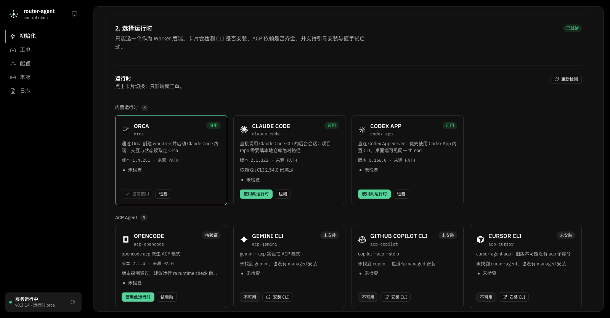
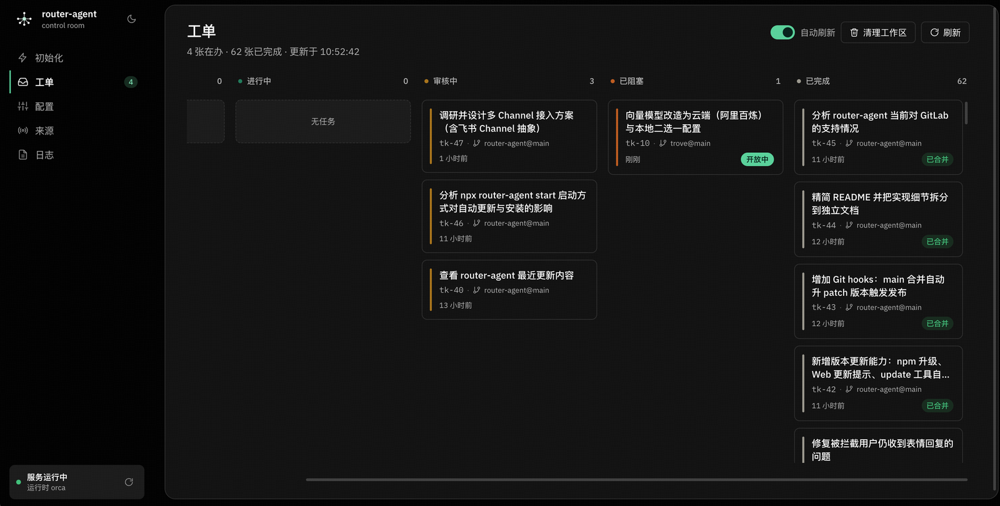
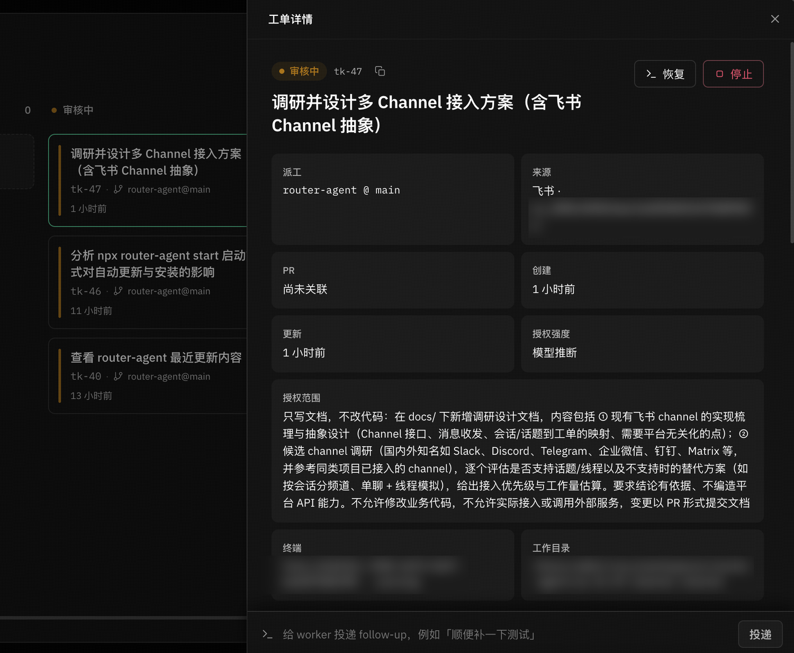
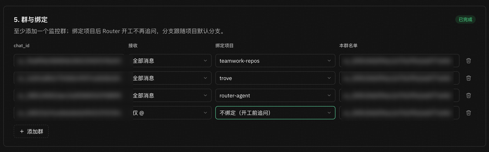
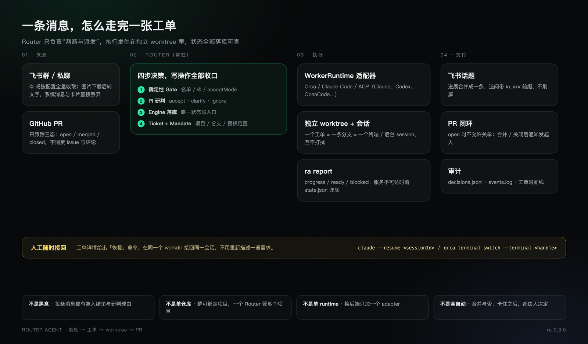

<div align="center">


# router-agent

### 把活派出去，盯住，再把结果带回来。

**飞书里说一句 → Router 研判开单 → 独立 worktree 里的编码 Agent 干活 → PR 合并后回群同步进展。**<br>
只做工单派发：开单、追问、记录、通知。<br>
写代码、做技术决策、合并 PR，这些它都不碰。

[](https://github.com/blankPen/router-agent/stargazers)
[](https://www.npmjs.com/package/router-agent)


[](./LICENSE)

[快速开始](#快速开始) &nbsp;·&nbsp; [核心能力](#核心能力) &nbsp;·&nbsp; [它怎么工作](#它怎么工作) &nbsp;·&nbsp; [配置](#配置) &nbsp;·&nbsp; [命令](#命令) &nbsp;·&nbsp; [文档](#文档)

**简体中文** · [English](README.en.md)

</div>

<br>

## 为什么是工单

模型决定单个任务的上限，**人的注意力决定多任务的上限**。

单一 Session 的工作方式里，并行推进多项工作就得手动切换、记住每段上下文；一个人通常同时只能跟进 3~5 个活跃 Session。router-agent 把这部分负担搬走：需求丢进群里，它负责开单、派工、追问、汇报，人只跟 Router 对话、看工单进展。

它把「谁、在哪个项目、从哪个分支、做什么」固化成一张有边界的工单，交给独立的 Agent 在独立 worktree 里执行。每条消息都有结论可查，每张工单都有自己的分支、终端与上下文。

这个项目本身就在用这套流程开发：需求在飞书里提，Worker 开 PR，合并后回群同步进展。

## 它做什么，不做什么

| 它做 | 它不做 |
|-|-|
| 听消息，按名单与 `@` 规则做确定性准入 | 不写代码，不实现需求 |
| 开单：锁定项目、起始分支与授权范围 | 不做技术决策，不替你想方案 |
| 派工：独立 worktree + Agent 终端，缺信息先追问 | 不合并 PR / MR，合不合由人决定 |
| 记录：工单阶段、Worker 上报、原始会话 | 不替代你现有的编码 Agent 与工作流 |
| 通知：进展合并回群，PR 合并 / 关闭后同步进展、工单保持开放 | 不盯代码质量，只盯流程闭环 |

它面向「消息进来、代码出去」的日常研发协作。如果只是偶尔让 AI 改一个文件，直接用你惯用的编码 Agent 会更快。

它是对 dsh-superagent 的绿色重写，不依赖原型的 tmux / DSE profile。

## 适合谁

如果你正被这几件事困住：

- 有个长期维护的项目，零碎需求一直冒出来；
- 反复新建分支、创建 worktree、管理 workspace；
- 开了一堆 Agent 会话，回头找不到要跟进的那一个。

那 router-agent 值得一试。它特别适合开源项目、技术平台这类「需求碎、历史包袱少」的场景。

## 快速开始

```bash
npm install -g router-agent   # 安装
ra start                      # 启动，就绪后自动打开 http://127.0.0.1:3083/#setup
```

打开面板后按五步完成配置：LLM Provider → 运行时 → 项目 → 飞书机器人 → 群与绑定。保存后服务自动重启，之后在群里 @机器人 提需求即可。

<details>
<summary>前置条件</summary>

| 依赖 | 说明 |
|-|-|
| Node.js | `>= 22.19.0`（自带 npm；使用内置 `node:sqlite`；项目根目录 `.nvmrc` 已固定 22.19.0） |
| 编码 Agent | 任选其一：Orca（`orca` 运行时，提供 worktree 与终端）、Claude Code（`claude-code` / `acp-claude` 运行时）、Codex（`codex-app` 运行时，优先使用 Codex App 内置 CLI）或其它 ACP Agent（Codex / Gemini / OpenCode 等） |
| lark-cli | 飞书事件消费、发消息；需提前安装并确保在 `PATH` 中，`ra doctor` 会检查是否可用；需要一个飞书自建应用 |
| gh / glab（可选） | PR / MR 状态跟踪：GitHub 用 `gh`，GitLab 用 `glab`；对应平台需已登录。不需要跟踪 PR / MR 时可不装 |
| pnpm | 仅从源码运行或参与开发时需要（见本节末尾） |

</details>

<details>
<summary>Web 初始化页：五步分别在配什么</summary>

页面只放「服务跑起来必需的五件事」，顶部是完成度清单：

1. **LLM Provider**：Base URL / 模型 / API Key，三项必填；OpenAI 兼容与 Anthropic 兼容协议都支持。密钥只写入 `config.yaml`，保存后不回显；环境变量 `RA_LLM_*` 可覆盖。右上角「从本地配置导入」会打开选择弹窗，从 Claude Code、CCSwitch、Pi、OpenCode、Magpie 的已有 Provider 里选一份导入（只读原配置，密钥不回显）。
2. **选择运行时**：Orca / Claude Code / ACP Agent 卡片平铺，自动检测 CLI、版本、ACP 依赖与登录状态，支持安装引导和真实握手试启动。运行时自己的选项在卡片的「设置」弹窗里改（例如 Orca 的「执行 Agent」：默认 Claude Code，也可指定 codex 等）。
3. **项目配置**：扫描本地项目（读 Claude Code / Codex / OpenCode 的会话日志列出候选目录，默认勾选最近活跃的 5 个）、添加本地项目（系统目录选择 + 自动识别 Git）或 Git 项目（自动 clone 到 `~/.router-agent/repos`，可用 `RA_HOME` 改根目录）。
4. **飞书机器人**：填 App ID / App Secret（Secret 只写入 lark-cli 加密存储），固定使用 `~/.router-agent-lark` profile；保存后可检查授权状态并完成 Device Flow 授权。
5. **群与绑定**：至少添加一个监控群；可把群固定到某个项目，之后开工不再追问。


保存后页面会提示需要重启，点「保存并重启」即可热重启 daemon（浏览器页面不刷新）。远程机器或没有图形界面时用 `ra start --no-open`，只打印面板地址；之后用 `ra web` 重新打开。

</details>

<details>
<summary>备选：命令行交互式初始化（ra init）</summary>

`ra init` 和 Web 页写的是同一份 `~/.router-agent/config.yaml`，可以混用，也可以重复运行。

```bash
ra init
```

按提示依次完成：**仓库**（Orca 运行时从 `orca repo list` 里挑 git 仓库；其它运行时填本地绝对路径）→ **飞书机器人**（已有 App ID+Secret 现在写入 / 浏览器新建应用 / 跳过稍后在 Web 配置页补填）→ **用户授权**（可选，用于按名字搜索群与成员）→ **监控群** → **授权成员** → **机器人身份** → **群绑定**。只问必填项，其余留默认；`ra init --yes` 只写默认配置，适合脚本化。

两种方式可以接力：先 `ra init` 配好机器人与群，再用 Web 页补齐 LLM / 项目 / 绑定；页面只提交改动过的字段，不会覆盖 CLI 写好的其它配置。

</details>

<details>
<summary>升级到最新版</summary>

升级到最新版用 `ra update`：检查 npm 上的最新版、执行 `npm install -g`，服务在跑时自动重启；只想看有没有新版用 `ra update --check`。等价于手动 `npm install -g router-agent@latest` 后 `ra stop && ra start`。Web 面板侧栏发现新版本时会显示「更新并重启」；在飞书里直接说「更新版本」，Router 也会调用更新工具并在回复后自动重启服务。

</details>

<details>
<summary>自检、模拟与真实验收</summary>

```bash
ra doctor                                              # 配置 / 运行时 / 飞书 / 模型 / 端口，全绿再往下
ra simulate --infer --text "把 README 的端口从 3000 改成 3083" --dry-run   # 只看 Gate + 研判结论，不落库
ra simulate --text "你好，在吗" --dry-run               # 验证回复通道也走 Pi
ra simulate --text "把 README 的端口从 3000 改成 3083"  # 去掉 --dry-run 才落库；仍不派工
ra tickets                                             # 模拟产生的工单会出现在这里
```

真实验收时，在群里 @机器人 提一个小需求，然后依次确认：

1. `ra logs | grep trigger:ingested` 能看到消息进入；
2. `ra tickets` 出现工单，`ra ticket <id>` 能看到授权范围与强度；
3. `orca worktree list --json`（`orca` 运行时；其它运行时用 `git worktree list`）出现 `ra-tk-<编号>-<语义slug>`，分支名为 `ra/tk-<编号>-<语义slug>`（目录名与分支名一一对应，只把 `/` 换成 `-`），对应运行时里出现 Agent 会话（Orca 为 Agent 终端）；
4. Worker 执行 `ra report` 后，`ra ticket <id>` 的阶段在 `running → review/blocked` 之间变化；
5. 合并或关闭 PR / MR 后，工单变 `done`，飞书收到一次闭环通知；对应 workspace 保留 24 小时后由定时任务回收（人工停止工单会立即回收）。

</details>

<details>
<summary>需要从源码运行或参与开发？</summary>

```bash
git clone https://github.com/blankPen/router-agent.git
cd router-agent
pnpm install --registry=https://registry.npmjs.org/
pnpm build
pnpm link --global      # 之后可直接用 ra；不 link 时用 node bin/ra.js <command>
```

</details>

## 核心能力

### 运行时随你挑

Worker 不在 Router 进程里跑。Router 按 `runtime.default` 选择适配器，由它创建 workspace、拉起 Agent、投递工单并接住追问：

| runtime id | 拉起方式 | 适用场景 |
|-|-|-|
| `orca`（默认） | Orca 创建 worktree + Agent 终端（默认 Claude Code，可用选项改成 codex 等） | 本机已用 Orca 管仓库，想同时看到终端 |
| `claude-code` | `git worktree` + `claude --bg` 后台会话 | 不用 Orca，直接跑 Claude Code |
| `codex-app` | `git worktree` + `codex app-server`，优先用 Codex App 内置 CLI | 用 Codex，且希望 Router 创建的 thread 在 Codex 桌面端可见 |
| `herdr` | ra 用 git worktree 建检出，Herdr 开终端窗口跑 Agent | 本机已用 Herdr 管终端，想在 Herdr 侧栏里看到工单 |
| `t3code` | ra 用 git worktree 建检出，T3 Code 在检出里开线程跑 Agent | 本机已装 T3 Code，想在 T3 手机端 / 桌面端看到工单 |
| `acp` / `acp-*` | ACP 子进程（Claude / Codex / Gemini / OpenCode / Copilot / Cursor / Goose） | 想接其它 ACP Agent |

换运行时只加一个 adapter，内核与 Router 一行不改。项目清单按运行时分开维护，但清单里的项目路径口径统一：所有运行时都填本地仓库绝对路径，Orca 侧由适配器翻译成 `path:` 选择器并在派工前自动登记成 Orca 项目；切换默认运行时只影响新工单。完整的运行时对比、ACP Agent 目录、工具策略与规范注入见 [docs/RUNTIME.md](docs/RUNTIME.md)。



### 一张工单，一个隔离的工作区

一个工单对应一个 worktree、一条分支、一个 Agent 终端。做完即隔离，并行开单互不打扰；每张工单都有自己的上下文，不用在多个会话窗口之间来回找。



### 工单进展与原始会话

- `ra ticket <id>` 与 Web 面板都能看到阶段、派工、上报、追问，一页看完一张工单的全貌。
- 面板工单详情的「恢复」会复制一条终端命令，直接接回该工单的原始 Agent 会话：Claude Code 走 `claude --resume`，Codex 走 `codex resume`，Orca 找不到会话记录时切回原终端。
- 复杂问题不用只在飞书里聊：随时回到原始会话里继续追问、调试、叫停。



### 多群、多项目

一个群可以绑定一个项目，不同群里同时推进多个项目；每个项目对应的都是你电脑里的真实目录。项目、分支、群绑定集中在一份配置里，开工前就先确认清楚。



### 从消息到 PR 的闭环

消息 → 研判 → 工单 → 派工 → 上报 → PR 跟踪 → 闭环通知，全链路留痕。对外通知统一走 Outbox（幂等 key + 2s 起步、上限 60s 的指数退避），失败会重试，不会重复轰炸群里。



### 需求分析助手：普通成员也能直接反馈问题（可选）

在 Web 面板「配置 → 群与绑定」里点某个群的「需求分析助手」按钮、打开开关后，这个群的成员不用 @ 机器人、也不用找管理员：说一句「登录一直报 500」，机器人会先做轻量初筛，再由分析子 Agent 只读当前项目的代码、主动追问补齐场景与环境，整理成结构化需求单 @管理员确认。管理员回复「确认派单」才进入原有派单流程——权限、项目隔离与工单体系都保持不变。

每个群单独开关，默认关闭，不影响存量群的回复行为。弹窗里可以配启用开关、最大对话轮次（默认 10 轮）、是否允许只读项目代码，以及终审管理员（支持填邮箱，启动时自动解析成对应的人）。配置见 [docs/CONFIGURATION.md](docs/CONFIGURATION.md#需求分析助手群级-intake)。

## 它怎么工作

```text
Sources（飞书 / GitHub / GitLab）
        │ Trigger
        ▼
Router（AgentLoop + DecisionEngine(Pi) + HTTP API + Web）
        │ Engine（唯一状态写入口）
        ▼
领域内核（TS 零依赖：Ticket / Mandate / Assignment / Stage / Policy）
        │ Assignment
        ▼
WorkerRuntime 端口 ── OrcaRuntime（默认）/ ClaudeCodeRuntime / HerdrRuntime / T3CodeRuntime / AcpRuntime（acp 与 7 个 acp-*）
```

开启需求识别后，`IntakeCoordinator + PiIntakeEngine` 作为并行的前置链路接入同一个 AgentLoop：初筛 → 只读项目代码澄清 → 结构化需求单 → 管理员终审，才回到上面的派工主链路。

三条设计约束：

- **Engine 是唯一状态写入口**：Router、Worker、面板都不直接写 SQLite。
- **WorkerRuntime 是唯一扩展点**：换运行时只加一个 adapter，内核与 Router 一行不改。
- **所有对外通知走 Outbox**：幂等 key + 2s 起步的指数退避（上限 60s）。

完整的分层、研判边界、会话机制与工单生命周期见 [docs/ARCHITECTURE.md](docs/ARCHITECTURE.md)；回复策略、面板与日志见 [docs/OPERATIONS.md](docs/OPERATIONS.md)。

## 配置

配置文件是 `~/.router-agent/config.yaml`。最小可用配置只需要四段：

```yaml
llm:
  baseUrl: https://api.example.com/v1
  model: claude-sonnet-5-5
  apiKey: sk-xxx

feishu:
  appId: cli_xxx
  allowed: [alice@company.com]   # 允许发起工作的成员（推荐邮箱，兼容 ou_xxx）
  botOpenIds: []          # 留空=按 appId 自动识别机器人；手填 ou_xxx 可覆盖（高级）
  chats:
    - chat: oc_xxx
      mode: mention

policy:
  acceptMode: auto

projects:
  - name: router-agent
    repo: /Users/me/router-agent
    defaultBranch: main
```

`allowed` 推荐填邮箱（解析成 open_id 后匹配，换应用也不会失效），也兼容 `ou_xxx`。机器人身份默认按 `feishu.appId` 自动识别，`botOpenIds` 只作为高级手动覆盖；自动识别失败时 `ra doctor` 会报 fail 并给出原因。`allowed` 为空时 `ra doctor` 也会报必填缺失。

例外：**已绑定工单的话题内**，名单内的成员（`allowed`，或该群自己的 `chats[].allowed`）不 @ 机器人也会触发处理——消息会直接投给该工单的 worker，不会新开工单；这类消息同样会加确认表情，但**不再发「已转给工单」文字回执**（避免追问时刷屏），进展由 worker 直接挂在同一条话题里。

常用调整不必编辑整份文件：

```bash
ra config set policy.acceptMode observe          # 先观察，不开工
ra config set project.router-agent "/Users/me/router-agent@main"
ra config set chatBinding.oc_xxx "router-agent@main"
ra config set runtime.default claude-code
ra config set runtime.options.orca.agent codex   # Orca 派工时用 Codex；不配 = 默认 Claude Code
ra config edit                                   # 用 $EDITOR 编辑全文
```

完整字段、`ra config set` 白名单、运行时选项、环境变量、模型 / 飞书机器人 / 项目清单、准入矩阵与闲置治理见 [docs/CONFIGURATION.md](docs/CONFIGURATION.md)。

## 命令

| 命令 | 说明 |
|-|-|
| `ra init` | 交互式初始化（`--yes` 跳过提问） |
| `ra doctor` | 启动前自检：配置 / 运行时 / 飞书 / 模型 / 端口（`--json` 机器可读） |
| `ra simulate` | 本地模拟一条消息，验证 Gate + Pi 研判，不派工（`--infer` 走 Pi 研判，`--dry-run` 不落库） |
| `ra start [--foreground]` | 启动常驻服务（默认后台），就绪后自动打开 Web 初始化页；`--no-open` 只打印地址 |
| `ra stop` | 停止服务 |
| `ra status` | 服务状态 + 工单概览 |
| `ra web` | 重新打开 Web 面板 |
| `ra tickets [--stage <stage>]` | 列出工单；`--stage` 可选 `todo` / `running` / `review` / `blocked` / `done` |
| `ra ticket <id> [--stop]` | 工单详情（状态 / 派工 / 上报 / 输入）；`--stop` 停止该工单并关闭 worker 终端 |
| `ra logs [--follow]` | 最近 50 行日志；`--follow` 持续跟踪 |
| `ra update [--check]` | 检查并升级到 npm 最新版：默认执行 `npm install -g router-agent@latest`，服务在跑时自动重启；`--no-restart` 只安装、`--registry` 指定源、`--force` 在源码 / link 运行时仍装全局版、`--json` 机器可读 |
| `ra runtime [list]` | 探测本机 ACP Agent：状态、版本、来源；`--json` 机器可读 |
| `ra runtime add <id> <npm 包名 | 路径>` | 声明自定义运行时插件（`runtime.plugins.<id>`），npm 包同时下载到 `~/.router-agent/node_modules` |
| `ra runtime install <id>` | 按需安装 ACP 适配器到 `~/.router-agent/runtimes/<agent>`，或下载已声明的 npm 插件包 |
| `ra runtime uninstall <id>` | 卸载 ra 托管的 ACP 适配器 |
| `ra runtime check <id>` | 完整 ACP 握手（`initialize` + `session/new`） |
| `ra runtime login <id>` | 交互式登录（由 Agent 自己提供：`acp-claude` 走 `claude`，`acp-codex` 走 `codex-acp login`，`codex-app` 走 `codex login`） |
| `ra runtime check codex-app` | 探测 Codex App / CLI，并做一次 app-server `initialize` 握手 |
| `ra config` | 查看配置；`config set <key> <value>` 改单项（含 `project.<名>` / `chatBinding.<群>` / `chatMode.<群>` / `chatAllow.<群>` / `runtime.options.<运行时>.<键>` / `progress.syncMs` / `progress.probeMs`）；`config edit` 编辑全文 |
| `ra reply` | Worker 侧交付：状态、摘要、文本 / 图片 / PR / 文档 / 选择题；服务不可达时落盘 `state.json` |
| `ra report` | `ra reply` 的旧别名，参数相同，仍可用 |
| `ra doc` | Worker 侧创建飞书文档并输出链接，长结论写进 `--reply` |

全局选项 `--home <dir>` 可切换状态目录（测试与多实例用）。上报协议与字段细节见 [docs/ARCHITECTURE.md](docs/ARCHITECTURE.md#上报协议)。

## 开发

```bash
pnpm test        # 1230 个测试通过（4 个默认跳过，其中包含真实 Pi 验证）
pnpm typecheck
pnpm build       # tsc + esbuild（Web 面板与 Markdown 资产）
pnpm check       # typecheck + test
RA_PI_VERIFY=1 npx vitest run tests/verify-pi-live.test.ts   # 真实 Pi + 真实模型（默认跳过）
```

发布 npm 包由 GitHub Actions 自动完成：合并到 `main` 后自动升 patch 并发布（只改文档 / 测试 / CI
时跳过；需要 minor / major 时在 PR 里手动改版本号），也支持推送 `v*` tag 或手动触发。
配置与发版流程见 [docs/PUBLISHING.md](docs/PUBLISHING.md)。

代码结构（pnpm workspace，适配器包可插拔）：

```text
packages/core/     领域内核：Ticket / Mandate / Stage / Policy 与共享类型
packages/infra/    日志、子进程、对话模型、图片识别
packages/runtime/  WorkerRuntime 端口、RuntimeRegistry、Orca / Claude Code / Codex / ACP / Herdr adapter
packages/runtime-t3code/  T3 Code 运行时插件（t3 thread 封装 + 服务端探测）
packages/channel/  ChannelAdapter 端口、ChannelRegistry、飞书 adapter 与 lark-cli 封装
src/               宿主：Engine / Store、Router、HTTP API、Web 面板、CLI 与装配
```

包之间只向下依赖（`core ← infra ← runtime / channel ← src`），跨包用 `#core/*`、`#infra/*`、
`#runtime/*`、`#channel/*` 别名；新增运行时 / 通道的步骤见 [docs/MONOREPO.md](docs/MONOREPO.md)。

## 已知限制

- 第一版只支持 macOS（Orca 运行时在 Linux 上需要 `orca-ide`）。
- 消息入口目前只有飞书。通道按 `ChannelAdapter` 抽象，接第二个入口不用改内核，但尚无其它实现。
- 不做自动合并 PR / MR，只跟踪与通知。
- GitHub / GitLab Source 只用于 PR / MR 状态跟踪，不消费 Issue / 评论。
- 各运行时的行为差异、附件与模型限制、Pi 版本约束等完整清单见 [docs/OPERATIONS.md](docs/OPERATIONS.md#已知限制)。

## 文档

| 文档 | 内容 |
|-|-|
| [docs/MONOREPO.md](docs/MONOREPO.md) | Monorepo 包划分、依赖方向、包别名，以及新增 runtime / channel 的步骤 |
| [docs/ARCHITECTURE.md](docs/ARCHITECTURE.md) | 分层、一条消息的四步、研判 / 会话 / 派工机制、工单阶段与 `ra report` 协议 |
| [docs/RUNTIME.md](docs/RUNTIME.md) | Worker 运行时对比、ACP Agent 目录、Worker 工具策略与规范注入 |
| [docs/CONFIGURATION.md](docs/CONFIGURATION.md) | 完整 `config.yaml`、`ra config set`、环境变量、模型与飞书接入、准入矩阵、闲置治理 |
| [docs/OPERATIONS.md](docs/OPERATIONS.md) | 回复策略、Web 面板、日志事件表与排查、已知限制 |
| [docs/API.md](docs/API.md) | 本地 HTTP API |
| [docs/COMPARISON.md](docs/COMPARISON.md) | 与 dsh-superagent 原型的差距分析与可迁移机制 |
| [docs/AGENT-ADAPTER-DESIGN.md](docs/AGENT-ADAPTER-DESIGN.md) | Agent 工具适配器接口设计：Orca / Claude Code / Codex 的契约与迁移方案 |
| [docs/DIAGNOSIS-REDESIGN.md](docs/DIAGNOSIS-REDESIGN.md) | 智能诊断工具改造设计：doctor 自检 → 日志扫描 → 结论分流的诊断管线 |
| [docs/VERIFICATION.md](docs/VERIFICATION.md) | 真实环境验证记录与需要人工执行的剩余步骤 |
| [docs/show-me-router-flow.html](docs/show-me-router-flow.html) | 消息 → 研判 → 派工 → 上报 → 闭环的可视化流程 |
| [README.en.md](README.en.md) | English version |

设计蓝本见飞书文档《router-agent（ra）技术设计方案》。

## License

本项目基于 [MIT](./LICENSE) 协议开源。

---

问题、建议或想接入新的 WorkerRuntime，欢迎提 Issue。
