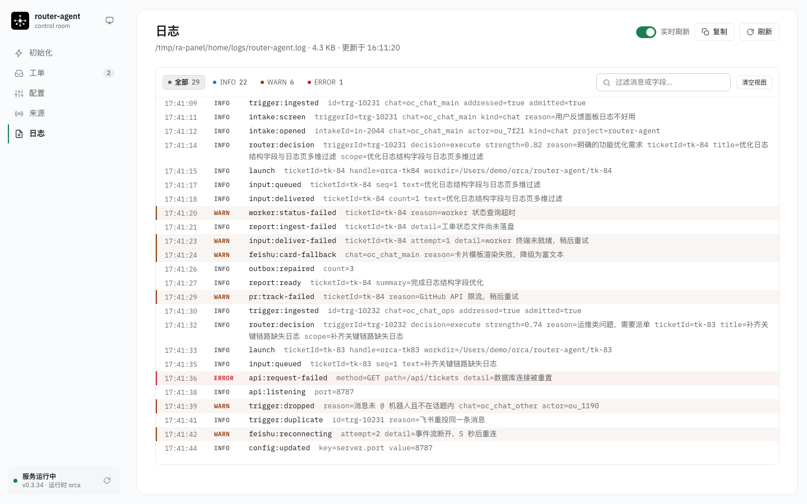
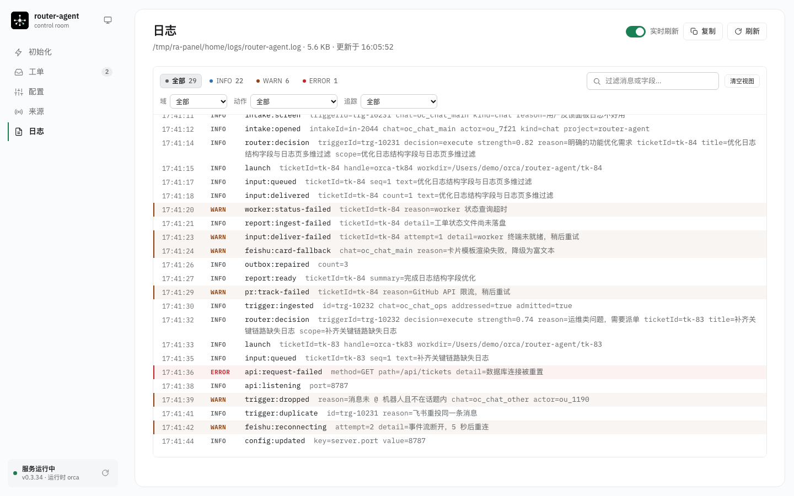
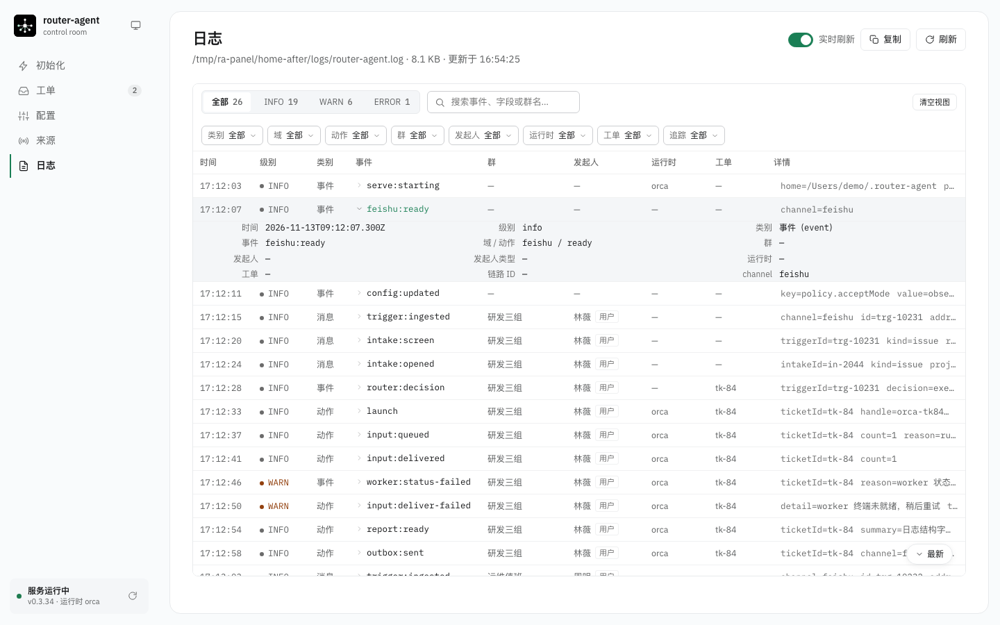
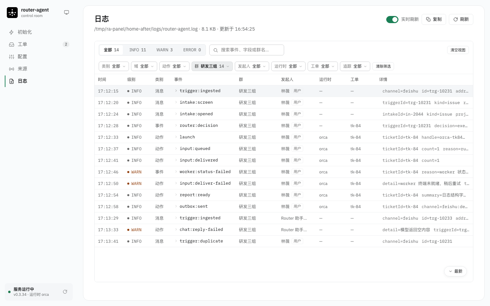
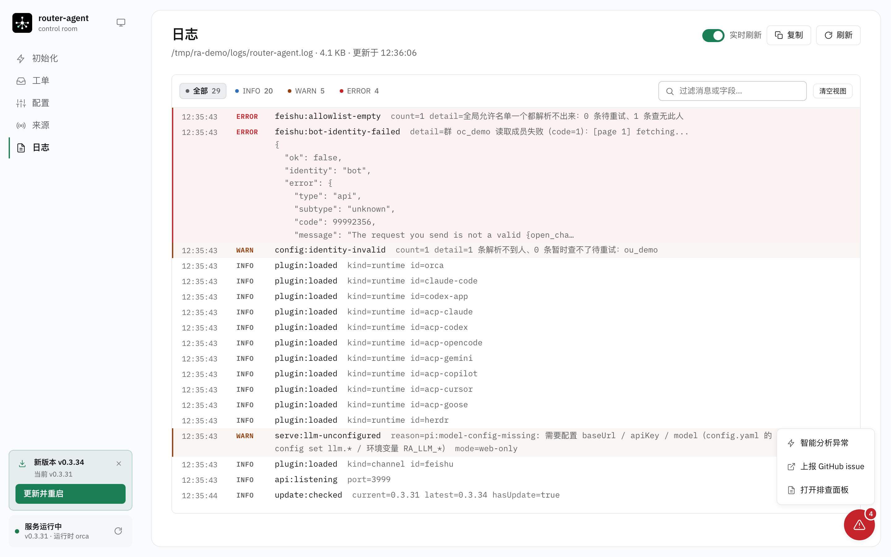
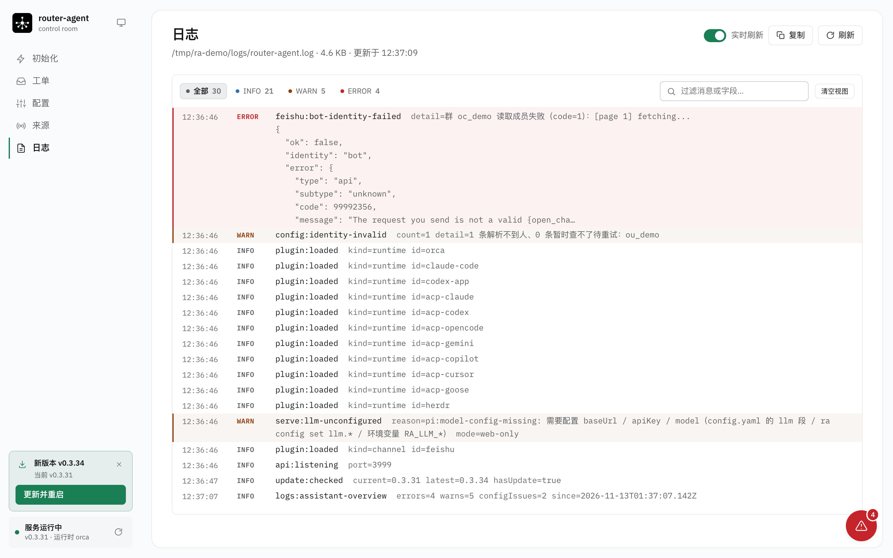
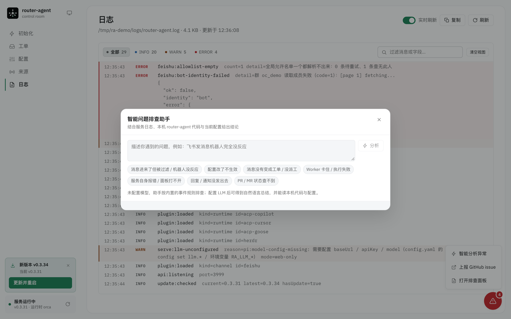
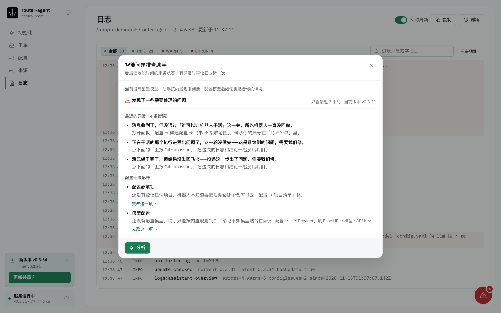
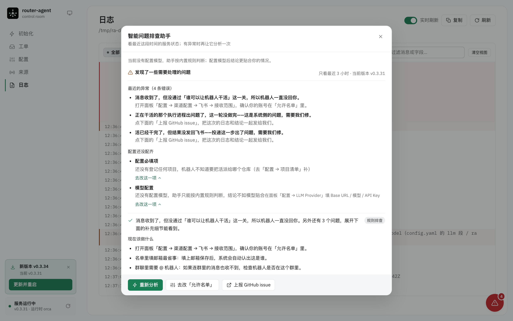
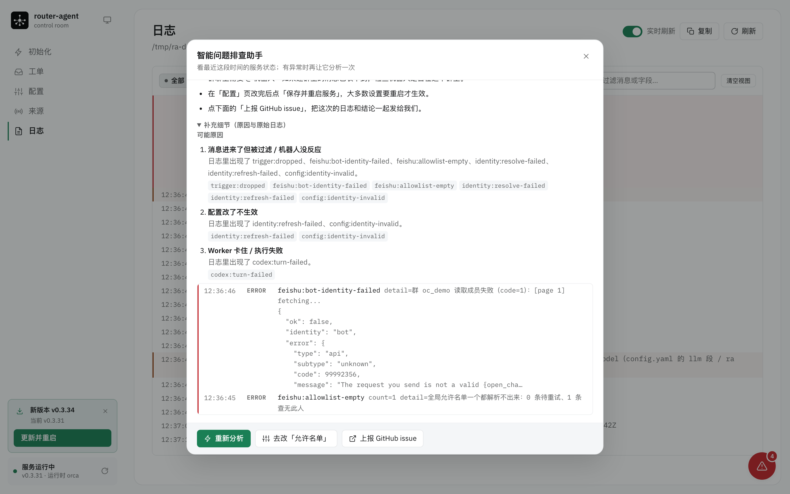

# 回复、面板、日志与已知限制

本文说明 Router 什么时候说话、怎么说话，Web 面板各页做什么，以及日志能追到哪一步。架构与派工流程见 [ARCHITECTURE.md](ARCHITECTURE.md)。

## 回复策略

Router 不做对话，只在必要时说话：

| 场景 | 行为 |
|-|-|
| **会被处理的已寻址消息**（@ / 私聊 / 全量接收群） | 收到后**立即**加一个确认表情（默认 `Typing` ⌨️），回复发出后自动取消；被准入拦截的消息不加 |
| **未 @ 但话题已绑定在办工单的消息**（名单内成员，tk-59） | 照样加确认表情；消息直接投给该工单的 worker，不新开工单，**不再发「已转给工单」文字回执**（避免追问时刷屏），进展由 worker 直接挂在同一条话题里 |
| 群里 @机器人，但只是寒暄 / 试探 | **Pi 生成**一句礼貌回复，作为**普通消息**发出；不建单 |
| 群里 @机器人，是真需求 | 只发一条**话题**消息：「工单「标题」（id）已开始执行。后续进展会在这个话题里更新。」，不再额外回「我帮你创建了工单」之类的普通消息 ack |
| 未 @ 的群消息 | 走 Pi 研判；判为闲聊则**完全静默**（不刷屏） |
| 需求识别开启的群里，普通成员反馈问题（可不 @） | 先轻量初筛：`chat` 静默；`question` / `issue` 由分析子 Agent 追问或直接答疑，信息收敛后 @管理员终审，确认后才派单 |
| 分析子 Agent 追问 / 需求单整理完成 | 回复挂在该话题：追问直接发；需求单完成后先告知发起人「已提交管理员确认」，再 @管理员给出结构化需求单与操作口令 |
| 管理员终审 | 回复「确认派单」生成正式工单；「驳回」结束；直接补充要求则重新分析一版 |
| 私聊 | 走 Pi 研判；判为闲聊时用 Pi 礼貌回复（普通消息） |
| 只发了图片 | 下载原图落盘并透传给 Worker，同时转成文字走研判；识别失败也保留原图，不再回「看不到附件内容」 |
| 只发了文件 / 语音等其它附件 | **不开单**：@ 或私聊时回一句「看不到附件内容，请用文字说明」 |
| 系统消息（建群 / 拉人 / 改群名） | 直接丢弃，不进领域 |
| 互动卡片消息 | 直接丢弃（`content` 是原始卡片 JSON，不能当需求读） |
| 研判没完成（unavailable） | 若在跟它说话，用 Pi 追问一句 |
| `acceptMode: off` 的推断候选 | 固定说明「暂不自动开工」 |
| worker 卡住 / 有结果 / PR 合并关闭 | 一律作为**话题回复**同步到原消息下 |
| worker 交付结论 | 简单单行回复走**纯文本**；带 Markdown 的以**飞书卡片**渲染（卡片内 Markdown 先归一化）回话题；有文档 / PR 链接一并展示 |
| worker 进展（`--state progress` 或 Router 主动巡检） | 上报的进展**不逐条发送**：按 `progress.syncMs` 合并成一条话题消息（追问的回答除外）；worker 静默时 Router 按 `progress.probeMs` 主动取进展（优先会话记录，其次终端屏幕），整理成语义摘要（助手文本 + 一行动作概要，过滤工具调用噪音）发到话题，同一静默期按 `progress.repeatMs` 限流 |

- 确认表情是 best-effort：失败只记 `feishu:reaction-failed`，不影响研判；只对首次入库、且是在跟它说话（@ / 私聊 / 全量接收群 / 未 @ 但话题已绑定在办工单）的消息加；被准入拦截（群白名单外、`admission: ignore`）的消息不加，避免「有表情、永远没回复」；重放不会重复加；回复发出后自动撤销（`feishu:unreact-failed` 是撤销失败的日志）。`ra config set feishu.reaction ""` 可关闭。
- 全部 emoji_type 见飞书文档「表情文案」，注意**大小写敏感**（`Typing` 不是 `TYPING`）。
- 出站按内容分流：**单行、≤200 字、不含 Markdown 语法**的回复直接用 `text` 消息；其余用飞书**互动卡片**渲染 Markdown，卡片失败自动降级为 post 富文本。分流规则：`threadId` 为空 = 普通消息，有值 = 话题回复。
- 卡片内的 Markdown 会先归一化（`normalizeCardMarkdown`），把 Card 1.0 不支持的语法降级掉：`#` 标题 → 加粗行、`>` 引用 → `▍`、表格 → 加粗表头 + 列表行、`- [x]` → ☑ / ☐、`<br>` → 换行、`` → 可点击链接；代码块内原样保留。

## Web 面板

`ra start` 自动打开、`ra web` 也可随时打开的面板分五块：

- **初始化**：只放启动必需的五件事——LLM Provider、运行时、项目、渠道接入、监控群，顶部有完成度清单；LLM Provider 的 Base URL / 模型 / API Key 三项必填（密钥只写入 `config.yaml`，保存后不回显），可选 OpenAI / Anthropic 两种接口协议，并支持从 Claude Code、CCSwitch、Pi、OpenCode、Magpie 的本地 Provider 配置一键导入；渠道那一步走渠道注册表：先选渠道（当前内置飞书），再填它的接入项（应用凭据 / 机器人与授权 / 群与绑定 + 接收私聊），App Secret 与授权也直接在本页完成（固定 `~/.router-agent-lark` profile）。新增渠道只需补一份描述与表单，初始化页不用改。逐项说明见 [README · 快速开始](../README.md#快速开始)；运行时的卡片检测与安装引导见 [RUNTIME.md](RUNTIME.md)。
- **工单**：按阶段分组 + 计数、关键字搜索（标题 / 工单号 / 仓库 / PR）、自动刷新开关与手动刷新；详情页有阶段、派工、PR、授权范围、上报时间线（含完整回复与 `humanAction`）、投递记录，可直接投递 follow-up 或停止工单。**人工停止工单会立即回收对应的 workspace**（先停 worker，再删 worktree）；而闲置超时、PR 合并等**自动关单只停 worker，workspace 会保留一段时间（默认 24 小时）后由定时任务回收**，也可以随时在「清理工作区」里手动回收。页头还有「清理工作区」入口：按 Worker 运行时分组列出仍在磁盘上的工单工作区，可勾选多个工单批量清理。清理动作按工单各自的运行时执行——Orca 关闭 worktree 并删除目录，Claude Code 删除 `claude agents` 视图与 worktree 目录，ACP 直接删除 worktree 目录；在办工单与有未提交改动的目录会被跳过，并在结果里说明原因。
- **日志**：直接看 `~/.router-agent/logs/router-agent.log`，默认 2 秒增量拉取（只读游标之后的新字节，不重复读整个文件），可开「实时刷新」。日志页是一张**表**：一行一条事件，列依次是「时间 / 级别 / 类别 / 事件 / 群 / 发起人 / 运行时 / 工单 / 详情」——群名、发起人（用户还是机器人）、运行时、消息还是事件都不用再从原始字段里猜。点事件名展开该行，能看到这条事件的全部字段与原始值。筛选按「级别 + 类别 + 域 + 动作 + 群 + 发起人 + 运行时 + 工单 + 追踪 ID + 关键字」多维取交集，每个维度都带命中条数；复制当前结果；停在底部时自动跟随新日志，往上翻后不再打断，点「最新」回到底部。文件不存在或还没写入时给出空状态提示。
- **配置**：按「LLM Provider / 运行时配置 / 渠道配置 / 项目配置 / 消息准入 / 其他设置」六层分组，每层再拆成可折叠的配置块。分组名与初始化页用词一致，按「先能跑起来、再看细节」排列：**LLM Provider**（模型接入 / 研判预算 / 人格 / 规范文件 / 会话复用）、**运行时配置**（Worker 运行时卡片 + 并发上限）、**渠道配置**（先选渠道，当前内置飞书，再配该渠道自己的「应用凭据 / 机器人与授权 / 接收范围 / 群与绑定 / 消息处理」，低频的「高级」项默认折叠）、**项目配置**（项目清单）、**消息准入**（接单方式 / 谁能叫醒机器人，立即生效）、**其他设置**（进展同步 / 闲置治理 / 工作区回收 / 服务与门禁）。渠道不是写死的分支：面板从 `GET /api/channels` 拿内核已注册的通道，按 id 与前端的渠道描述（`src/web/client/channels.ts`）合并，新增渠道只要再加一份描述与表单。每个配置块标注生效方式（立即生效 / 重启生效 / 部分立即生效），改动逐项标脏，保存前做前端 + 后端双重校验，保存后写回 `config.yaml`。「Worker 运行时」是与初始化页相同的卡片平铺组件（`orca` / `claude-code` / `codex-app` / `acp` / `acp-*`，卡片标题是首字母大写的运行时名 `Orca` / `Claude Code` / `Codex App`），已有原生运行时替代品的 `acp-claude` / `acp-codex` 不再出现在可选列表里（当前正选中的仍保留，老配置继续可用），可检测安装状态、分别跳转官方文档安装 CLI 或由 ra 安装 ACP 扩展，并做 ACP 握手试启动；项目清单按运行时隔离，切换运行时后项目清单会切换到该运行时自己的一套（清单里的 `repo` 统一是本地仓库绝对路径，Orca 侧由适配器翻译成 `path:` 选择器并在派工前自动登记成 Orca 项目）；「扫描本地项目」读本机 Claude Code / Codex / OpenCode 的会话日志列出候选目录（worktree 归并到主仓库、临时目录与非 Git 目录剔除，默认勾选最近活跃的 5 个），「添加本地项目」支持系统目录选择并自动识别 Git / 分支，「添加 Git 项目」支持填写 ssh / http(s) 地址后自动 clone 并登记。群绑定的项目只能从当前清单里选，分支自动跟随项目的默认分支，不能单独自定义。左侧导航随滚动高亮当前分组；顶部搜索框可按名称 / 路径筛配置项。
- **来源**：服务状态、监控群、接收范围概览。

侧栏品牌行末尾有全局主题切换图标：**跟随系统 / 亮色 / 暗色** 三态循环，默认跟随系统；选择只存在浏览器本地，不写入 `config.yaml`，所有页签即时生效。

发现 npm 上有新版本时，侧栏「服务运行中」状态条上方会出现更新提示：点「更新并重启」会执行 `npm install -g router-agent@latest` 并在安装成功后自动重启 daemon，页面无需刷新；点 × 只忽略当前版本，出现更高版本时会再次提示。窄屏侧栏收起后退化为右下角悬浮按钮。也可以直接在飞书里让 Router 更新版本——它会调用 `router_update` 工具安装最新版，并在回复发出后自动重启整个服务。

配置项会标注生效范围：**策略**（`acceptMode` / `maxWorkers` / `admission`）保存后立即生效；其余配置在服务启动时读入，保存后点侧栏或配置页的「重启服务」即可热重启 daemon（浏览器页面不会刷新），也可以手动 `ra stop && ra start`。面板可以在「初始化 · LLM Provider」或「配置 · LLM Provider」里填写 `llm.apiKey`，密钥只写入 `config.yaml`，保存后不会再回显（`publicConfig` 只返回 `apiKeySet`）；也可以用 CLI / 环境变量配置。保存会重写 `config.yaml`，原文件的注释会丢失。

## 日志

所有关键节点都是结构化 JSON，一行一个事件，写入 `~/.router-agent/logs/router-agent.log`。`message` 固定是事件名（`域:动作`），错误详情等文本一律用 `detail` 字段，不要占用 `message`。

一行日志的结构：

| 字段 | 含义 |
|-|-|
| `at` | 写入时间（ISO 8601） |
| `level` | `info` / `warn` / `error` |
| `domain` | 事件域，事件名的第一段（`trigger:ingested` → `trigger`） |
| `event` | 事件动作，事件名冒号后的部分（`trigger:ingested` → `ingested`） |
| `category` | 类别：`message`（用户发来的消息及其处理）/ `action`（Router / Worker 对外做过的动作）/ `event`（内部状态变化） |
| `message` | 完整事件名，保留是为了兼容 `grep '"message":"trigger:'` 这类用法 |
| `trace` | 链路 ID：按 `ticketId` → `triggerId` → `intakeId` → `inputId` → `handle` → `threadId` → `id` → `chat` 取第一个存在的可定位字段，把同一条链路的日志串起来 |
| `chat` / `chatName` | 群 / 会话 ID 与群名 |
| `actor` / `actorName` / `actorType` | 发起人 ID、名字与类型（`user` 用户 / `bot` 机器人 / `system` Router 自己） |
| `runtime` | 运行时：`orca` / `codex-app` / `claude-code` / `t3code` / `herdr` |
| 其余字段 | 业务字段，平铺在同一层 |

`domain` / `event` / `category` / `trace` 由 `createLogger` 自动补齐，业务代码不用自己写；旧日志没有这些字段时，面板读日志时会按同一套规则补出来，所以历史日志照样能按维度过滤。

**维度由谁补**：

- 消息链路（`trigger:*` / `intake:*` / `router:decision` / `chat:*`）在写日志时带上群、群名、发起人与发起人类型——「谁在哪个群说的」不用再回查别的地方。
- 工单链路（带 `ticketId` 的日志）由 `RouterService` 统一补上群、发起人与运行时；运行时适配器自己的日志也按工单补齐，不用每个调用点手写。
- 运行时适配器（`packages/runtime-*`）统一带上 `runtime`——「这是 Orca 还是 Codex 在动」一眼可辨。

| 事件 | 来源 | 关键字段 | 说明 |
|-|-|-|-|
| `feishu:ready` | 事件消费者 | — | 事件流已连上 |
| `trigger:ingested` | Source | `id` `chat` `chatName` `actor` `actorName` `actorType` `addressed` `admitted` `threadKeys` `topic` | 用户消息进入系统；`topic=true` 表示事件带了话题 ID（omt_）；`admitted=true` 表示没 @ 但因话题已绑定在办工单被放行（tk-59） |
| `trigger:dropped` | Source | `reason` `chat` `chatName` `actor` `actorName` `actorType` | 收到但被过滤 |
| `trigger:ingest-failed` | Channel Ingress | `channel` `detail` | 富化或入库抛错，消息没能进入系统；重试依赖飞书重投兜底 |
| `trigger:admitted-unaddressed` | CLI | `chat` `actor` `keys` | 已绑定工单的话题里，名单内成员没 @ 机器人也放行处理（tk-59） |
| `intake:screen` | AgentLoop | `triggerId` `chat` `chatName` `actor` `actorName` `actorType` `kind` `reason` | 需求识别初筛结论：chat / question / issue（`reason` 已截断到 120 字） |
| `intake:screen-failed` / `intake:screen-invalid` | AgentLoop | `triggerId` `detail` / `triggerId` | 初筛模型失败或输出不合法；消息按原准入规则继续处理 |
| `intake:opened` | AgentLoop | `intakeId` `chat` `chatName` `actor` `actorName` `actorType` `kind` `project` | 为一条疑似问题创建需求识别会话 |
| `intake:clarify` | AgentLoop | `intakeId` `questions` | 分析 Agent 发起追问 |
| `intake:answered` | AgentLoop | `intakeId` `chat` | 分析 Agent 直接给出结论，会话结束，不产出需求单 |
| `intake:ready` | AgentLoop | `intakeId` `chat` `title` `approvers` | 需求单整理完成，已 @管理员终审 |
| `intake:approved` | AgentLoop | `intakeId` `ticketId` `actor` `reused` | 管理员确认派单，已生成正式工单；`reused=true` 表示复用了上次已建的工单 |
| `intake:rejected` | AgentLoop | `intakeId` `actor` | 管理员驳回需求单 |
| `intake:expired` | AgentLoop | `intakeId` | 需求识别会话超过 72 小时无消息，自动放弃 |
| `intake:analysis-failed` / `intake:analysis-invalid` | AgentLoop | `intakeId` `detail` / `intakeId` `triggerId` | 分析模型失败或输出不合法；已给用户兜底回复 |
| `intake:approve-failed` | AgentLoop | `intakeId` `detail` | 终审通过后开单失败；需求单仍可再次终审 |
| `intake:requester-not-allowed` | AgentLoop | `triggerId` `chat` `actor` | 发起人不在该群白名单里，不再继续澄清（群名单是硬边界） |
| `intake:project-unbound` | AgentLoop | `chat` `triggerId` | 群没绑定项目，intake 不接管，按原准入规则处理 |
| `intake:decision-failed` | AgentLoop | `triggerId` `detail` | 落决策失败（例如同一轮已落过决定） |
| `intake:abort-failed` / `intake:dispose-failed` | IntakeEngine | `stage` `detail` | 分析会话超时中断或释放失败；已拿到的结果不受影响 |
| `intake:tool-failed` | IntakeEngine | `stage` `detail` | 只读代码工具读写失败（code_read / code_ls / code_grep）；读不到不等于没有匹配 |
| `intake:ran` | IntakeEngine | `readCode` `cwd` `chars` | 分析 Agent 完成一轮生成；`readCode` 表示这轮是否读了代码 |
| `thread:created` | Engine | `threadId` `source` `chat` | 首次见到某条线程，登记规范 ID |
| `thread:resolved` | Engine | `threadId` `rawThreadId` `triggerId` `source` | 消息自带线程标识没对上，靠别名收敛到了已有线程（排查「消息没进工单」先看这条） |
| `thread:backfilled` / `thread:backfill-failed` | CLI | `filled` `failed` / `batch` `code` `detail` | `ra migrate threads --apply` 的回填结果 |
| `thread:backfill-incomplete` | CLI | `total` `pending` | 回填后仍有线程缺话题 ID 别名，命令以非零退出 |
| `router:decision` | Engine | `triggerId` `chat` `chatName` `actor` `actorName` `actorType` `decision` `strength` `reason` `ticketId` `title` `scope` | Router 的研判结论 |
| `launch` | Service | `ticketId` `runtime` `chat` `actor` `handle` `workdir` | 派工到 Orca worktree |
| `launch:queued` | Service | `maxWorkers` `capacity` `waiting` `ticketIds` | 并发已满，工单排队等待派工 |
| `launch:queued-input` | Service | `ticketId` `pending` `maxWorkers` | 有新输入但并发满，暂不重建 worker |
| `launch:failed` | Service | `ticketId` `title` `repo` `branch` `attempt` `reason` `hint` | 派工失败，已转人工并通知发起人；`hint` 是给用户的处置建议（运行时没给就退回通用的仓库/分支兜底） |
| `input:queued` | Engine | `ticketId` `seq` `text` | Router 准备发给 worker 的内容 |
| `input:deduped` | Engine | `ticketId` `inputId` `seq` `kind` `sourceKey` | 同一条来源消息重复到达（飞书重投 / 面板再点一次），复用已有输入，没有重复投给 worker |
| `input:delivered` | Service | `ticketId` `count` `inputIds` `text` | 实际投递进 worker 终端的输入；`inputIds` 是这轮真正送出的输入 id |
| `input:deliver-failed` | Service | `ticketId` `inputId` `attempt` `message` | 投递进 worker 终端失败，按指数退避重试 |
| `input:queued` | Service | `ticketId` `inputId` `reason` | 运行时正忙（busy），这轮没投出去，退避后再投 |
| `input:unacked-timeout` | Service | `ticketId` `inputId` `waitedMs` | 已投递很久仍未 ack：只提示人工确认，不再把原文重投给 worker |
| `input:redeliver-giveup` | Service | `ticketId` `inputId` `attempt` | 同一条输入重投到上限仍未成功，已标 attention 转人工 |
| `input:rejected` | Service | `ticketId` `inputId` `reason` | 运行时明确拒绝输入，按退避重试 |
| `worker:lost` | Service | `ticketId` `handle` `reason` `lastSeq` `expired` | 执行会话已不存在；已投递未 ack 的输入标为 `expired`，不再参与重投 |
| `input:relaunch` | Service | `ticketId` `pending` | 因新消息重建 worker；同一批积压输入只触发一次 |
| `input:adopted-handle` | Service | `ticketId` `from` `to` `sessionId` | 运行时投递时接管了新会话（Claude resume fork），Assignment 已切换到新 handle |
| `worker:stop-stale` | Service | `ticketId` `handle` | 终端句柄已失效（`terminal_handle_stale`），停止动作不再重试 |
| `worker:stopped` | Service | `ticketId` `handle` | 停止 worker 成功（关单 / 清理收尾） |
| `report` | Service | `ticketId` `state` `turn` `summary` `reply` `humanAction` `pr` | worker 的 `ra report` 上报 |
| `report:evidence-missing` | Service | `ticketId` `mode` `action` `source` `reason` `missing` | UI 工单缺 Before / After 证据；`enforce` 时 action=reject，`warn` 时只记录 |
| `report:evidence-unverified` | Service | `ticketId` `mode` `unverified` `source` | 无法判断是否有证据（workdir 丢失、git / PR 查询失败），降级放行 |
| `report:ingest-failed` | Service | `ticketId` `message` | 兜底通道处理上报时的非门禁异常 |
| `report:invalid` | Service | `ticketId` `detail` | 上报载荷非法（poller 兜底通道读到坏文件） |
| `report:unknown-ticket` | Service | `ticketId` | 上报的工单不存在，忽略 |
| `report:no-assignment` | Service | `ticketId` | 工单没有派工记录，无法确认归属，忽略 |
| `report:stale-ignored` | Service | `ticketId` `incoming` `latest` | 上报时间早于最后一条已入库报告，重放被忽略 |
| `progress:synced` / `progress:dedup` | Service | `ticketId` `count` / `skipped` | 进展定时合并同步，或内容重复被跳过 |
| `progress:probed` | Service | `ticketId` `minutes` `count` `unchanged` | 主动巡检读会话记录 / 终端并把语义摘要同步到话题 |
| `progress:sync-failed` | Service | `ticketId` `detail` | 进展合并同步抛错，不影响当轮回复 |
| `progress:probe-failed` | Service | `ticketId` `detail` | 主动巡检单个工单失败 |
| `outbox:sent` / `outbox:failed` | Outbox | `key` `text` / `error` | 对外通知结果 |
| `outbox:repaired` | CLI | `count` | 启动时修复 N 条进程中断残留的 outbox 记录 |
| `api:input` / `api:stop` / `api:policy` / `api:config` | HTTP API | — | 面板 / CLI 的操作 |
| `idle:nudge` / `idle:stale` | Service | — | 空闲唤醒与失联标记 |
| `idle:transfer` | Service | `ticketId` | worker 已退出且无法恢复，转人工并通知发起人 |
| `idle:blocked` | Service | `ticketId` `detail` | worker 正在等待人工处理（权限 / 输入），已通知发起人 |
| `retention:baseline` | Service | `baselineAt` `openTickets` | 服务启动时重置闲置治理计时基线：启动前就已无进展的工单不补发提醒 |
| `retention:zombie` | Service | `ticketId` `handle` | 闲置工单的 worker 已失联，标记为僵尸待回收 |
| `retention:reminded` | Service | `ticketId` `closeAt` | 已提醒发起人工单即将自动关闭 |
| `retention:pr-urge` | Service | `ticketId` `pr` | 有未合并 PR 的闲置工单已催办 |
| `retention:closed` | Service | `ticketId` `reason` | 闲置超时自动关单 |
| `retention:sweep-failed` | Service | `ticketId` `detail` | 单个工单的闲置治理检查失败 |
| `pr:linked` / `pr:state` | Service | — | PR / MR 跟踪；PR 进入 `merged` / `closed` 只更新状态并通知发起人，工单保持开放，可继续追问 |
| `pr:track-failed` | Service | `ticketId` `prNumber` `repo` `detail` | PR / MR 状态查询无结果；同一工单 + PR 只记一次 |
| `recover:*` | Service | — | 重启对账 |
| `recover:interrupted` | Service | `ticketId` `turnId` `mode` `autoRecovered` | 发现 worker 上一轮被服务重启打断，按 `policy.interruptedRecovery` 处置 |
| `recover:auto-resume` | Service | `ticketId` `turnId` | 自动补了一条 `kind=retry` 的输入，worker 从中断处接着做 |
| `recover:auto-resume-failed` | Service | `ticketId` `turnId` `message` | 自动恢复投递失败；已提示用户回复「继续」手动接着做 |
| `recover:reattach` | Service | `ticketId` `attached` | 重启后重新接回旧 worker 会话 |
| `recover:reuse` | Service | `ticketId` `handle` `phase` | 重启后直接复用仍存活的 worker |
| `recover:relaunch` | Service | `ticketId` | 重启后发现工单没在跑，重新派工 |

消息、配置与异常三类关键链路的补充事件（都遵循同一套 `at` / `level` / `message` + 业务字段格式）：

| 事件 | 来源 | 关键字段 | 说明 |
|-|-|-|-|
| `trigger:duplicate` | Source | `id` `chat` | 重复投递的消息被入库去重，不是消息丢失 |
| `channel:not-registered` | Channel Router | `channel` `target` `key` | Outbox 里的通道没有注册，跳过发送（历史脏数据不会卡死队列） |
| `channel:duplicate-id` | Channel Registry | `channel` `kind` | 同一通道实例被重复注册，保留最后一次 |
| `channel:ack-failed` | Channel Ingress | `channel` `messageId` `detail` | 回执表情添加失败，不影响消息入库与回复 |
| `plugin:loaded` | Runtime / Channel loader | `kind` `id` | 插件创建成功并注册了实例；`kind=runtime` 时 `id` 是运行时 id，`kind=channel` 时是通道实例 id |
| `plugin:load-failed` | Plugin loader | `kind` `id` `package` `detail` | 插件包无法解析或导入（路径错、缺依赖、未安装）；服务继续启动，面板与 `/api/config` 会显示失败原因 |
| `plugin:create-failed` | Runtime / Channel loader | `kind` `id` `detail` | 插件入口已导入，但 `create()` / `createAll()` 抛错；该实例不注册，其它插件不受影响 |
| `plugin:id-mismatch` | Runtime / Channel loader | `kind` `id` `declared` `detail` | 配置里的插件 id 与插件声明的 `meta.id` 不一致；面板按配置 id 回链，提示用户统一命名 |
| `plugin:install-started` | Plugin installer | `home` `package` `version` | 开始把配置里的 npm 插件包装到 `<RA_HOME>/node_modules` |
| `api:plugin-install` | HTTP API | `kind` `id` `package` `version` | 面板「添加运行时 / 安装依赖」启动了插件 npm 安装任务；可在配置保存前按请求体里的包名启动 |
| `plugin:install-succeeded` | Plugin installer | `home` `package` `version` | npm 安装完成，且加载器按 RA_HOME 能解析到该包；重启后才会加载 |
| `plugin:id-detected` | Plugin installer | `kind` `id` `package` | 插件包安装并成功加载后，从它声明的 `meta.id` 读出运行时 / 通道 id |
| `plugin:install-failed` | Plugin installer | `home` `package` `version` `detail` | npm 退出码非零、超时、包没落盘或加载器解析不到；`detail` 是截断后的 npm 输出 |
| `channel:consumer-started` / `channel:consumer-start-failed` | CLI | `channel` / `channel` `detail` | 已加载通道的入站消费启动结果；自定义通道启动失败不会阻塞其它通道 |
| `channel:feishu-missing` | CLI | `detail` | 配置里没有可用的飞书通道；服务继续启动，但飞书消息不会入站 |
| `channel:unreact-failed` | CLI | `channel` `messageId` `detail` | 回复发送后撤销回执失败；不影响已发出的回复 |
| `chats:refreshed` | CLI | `count` | 群名目录刷新成功 |
| `session:migrated` | CLI | `sessions` `resets` | 人工执行 `ra migrate sessions --apply` 完成 |
| `session:migration-required` | CLI | `pending` | 存在未迁移的历史 sessionKey，服务拒绝启动 |
| `session:migration-incomplete` / `session:migration-verify-failed` / `session:migration-failed` | CLI | 计数与异常数 / `detail` | 迁移执行失败（已回滚）或迁移后校验未通过 |
| `session:cleanup` | Service | `removed` | 清理了 N 条超期未用的会话记录 |
| `session:cleanup:skip` / `session:cleanup:failed` | Service | `file` `root` / `file` `detail` | 会话文件越界跳过或删除失败，不影响其它清理 |
| `spec:migrated` / `spec:migration-failed` | Service | `source` `spec` / `detail` | 旧版 `router.soul` 规范迁移结果 |
| `feishu:reconnecting` | Source | `attempt` `delayMs` | 事件消费者断开，已安排退避重连 |
| `feishu:spawn-failed` | Source | `detail` | lark-cli 无法拉起（未安装 / 无权限），会继续重试 |
| `feishu:card-fallback` | Sender | `target` `key` `code` `detail` | 互动卡片发送失败，已自动降级为富文本 |
| `feishu:quote-fetch-failed` / `feishu:quote-parse-failed` | Source | `messageId` `detail` | 引用消息回查失败，按原消息继续 |
| `feishu:bus-conflict` | CLI | `detail` | 事件总线冲突：同一机器人被多个消费者占用，停止重连 |
| `feishu:error` | CLI | `detail` | 事件消费传输级错误（stderr / 非法 JSON 等），已安排重连 |
| `feishu:image-vision-disabled` | CLI | `detail` | 图片转文本的视觉模型装配失败，图片退回纯附件 |
| `feishu:image-mget-failed` | Source | `id` `code` `detail` | 消息图片 key 列表拉取失败，按纯附件处理 |
| `feishu:image-download-failed` | Source | `id` `key` `code` `detail` | 图片下载失败，按纯附件处理 |
| `feishu:image-read-failed` | Source | `id` `key` `path` | 已落盘的图片读不到，按纯附件处理 |
| `feishu:image-transcribe-failed` | Source | `id` `key` `detail` | 图片转文字失败，原图仍透传 |
| `chats:refresh-failed` / `chats:parse-failed` / `chats:cache-invalid` | Source | `code` / `detail` / `path` | 群名目录刷新失败或缓存损坏，旧值继续可用 |
| `identity:resolved` | Identity | `entry`(掩码) `actor` `name` | 允许名单条目（邮箱 / open_id）解析成 open_id 与显示名 |
| `identity:resolve-failed` | Identity | `entry`(掩码) `detail` | 条目确认解析不出来（格式不对 / 查无此人 / open_id 跨应用），该条目被丢弃 |
| `identity:resolve-deferred` | Identity | `entry`(掩码) `detail` | 暂时查不了（权限缺失 / lark-cli 不可用 / 超时），条目**保留**待重试，不清空名单 |
| `identity:cache-failed` | Identity | `kind` `detail` | 身份解析缓存读写失败，本次降级为直接查通讯录 |
| `identity:refresh-failed` | HTTP API | `detail` | 面板保存后重新解析允许名单失败；保存照样成功，名单先按上一次的结果继续用 |
| `identity:retry-resolved` | CLI | `round` `pending` | 启动时的后台重试解析成功，名单已恢复并重建策略 |
| `identity:retry-deferred` | CLI | `round` `pending` `bot` | 后台重试后仍有待重试条目或机器人未识别，继续退避 |
| `identity:retry-failed` | CLI | `round` `detail` | 后台重试本身失败（接口 / 网络），下一轮再试 |
| `identity:retry-exhausted` | CLI | `attempts` | 后台重试次数用完仍没解析全，需要重启或重新保存来触发 |
| `config:identity-invalid` | Identity | `count` `detail` | 允许名单里有条目解析不到人（或暂时查不了待重试），名单已生效但可见性问题已告警 |
| `feishu:allowlist-empty` | Identity | `count` `detail` | 全局允许名单一个都没解析出来（`detail` 区分「待重试」与「查无此人」），等于暂时谁都不许 |
| `config:identity-resolve-failed` | CLI | `detail` | 启动时的身份装配整体失败，已降级为按原始配置启动 |
| `feishu:bot-identity-resolved` | Identity | `bot` `name` | 机器人身份自动识别成功（按 `app_id` 匹配群成员），或使用了手动填写的身份 |
| `feishu:bot-identity-failed` | Identity | `detail` | 机器人身份识别失败，`mode: mention` 的群会丢消息，需人工确认 |
| `feishu:chat-allowlist-empty` | Identity | `chat` `name` `count` | 群级允许名单配了却一个都解析不出来，该群按「拒绝所有人」处理 |
| `feishu:intake-approver-empty` | Identity | `chat` `name` `count` | 需求分析助手的终审管理员配了却一个都解析不出来，该群没有人能终审（不会退回全局名单） |
| `loop:trigger-failed` | Agent Loop | `triggerId` `chat` `detail` | 单条消息处理异常，同批其它消息不受影响 |
| `loop:error` | Service | `detail` | 内部定时任务回调抛出的未预期异常，不影响主循环 |
| `decision:audit` / `decision:audit-write-failed` | CLI | `engine` `triggerId` `durationMs` `tokens` `toolCalls` `decision` / `detail` | 每次研判的审计记录写入 `decisions.jsonl`；写盘失败不影响研判 |
| `decision:engine-failed` | Agent Loop | `triggerId` `detail` | 研判引擎调用失败（没额度 / 限流 / 超时 / 鉴权失败等），按 unavailable 处理并留下原因；用户侧会收到对应的失败原因文案 |
| `chat:reply-failed` | Agent Loop | `triggerId` `chat` `reason` `detail` | 回复模型失败（抛错或返回空内容），已按真实原因回话，不再退回「没看出要做什么」这类统一话术 |
| `session:transcript-failed` / `session:reset-failed` | Agent Loop | `key` `detail` | 会话转录 / `/new` 重置失败，不影响当轮回复 |
| `config:created` | Config | `path` | 首次启动写入了默认 `config.yaml` |
| `config:parse-failed` | Config | `path` `detail` | YAML 解析失败，已降级为默认配置启动 |
| `config:legacy-backend` | Config | `path` | 旧版 `backend` 段已兼容映射到 `runtime` |
| `config:intake-migrated` | Config | `chats` `enabled` `maxQuestions` | 旧版全局 `intake:` 段已迁移到群级配置（`chats` 是被迁移的群） |
| `config:invalid-security-override` | Config | `runtime` `keys` | `runtime.options` 试图覆盖安全参数，启动被拒绝 |
| `config:updated` | CLI | `changed` | 面板保存配置落盘成功并生效 |
| `policy:updated` | CLI | `version` `acceptMode` | 面板保存后策略版本变化 |
| `config:patch-rejected` / `config:write-failed` | HTTP API | `errors` / `detail` | 面板保存的配置校验失败或落盘失败 |
| `api:config` | HTTP API | `changed` `policyChanged` `restartRequired` `identityEffective` | 配置保存成功、是否需要重启、允许名单是否已即时生效 |
| `api:listening` | CLI | `port` | HTTP API 已监听 |
| `api:report` | HTTP API | `ticketId` `state` `turn` | HTTP 通道收到的 worker 上报 |
| `api:spec` | HTTP API | `spec` `action` | 人格 / 规范文本保存或重置 |
| `api:workspace-cleanup` | HTTP API | `requested` `runtimeId` `removed` `skipped` | 面板批量清理工作区成功 |
| `api:workspace-cleanup-failed` | HTTP API | `requested` `runtimeId` `detail` | 面板批量清理工作区失败 |
| `api:channels` | HTTP API | `count` | 面板读取已注册的消息通道（渠道配置的渠道列表来源） |
| `api:request-failed` | HTTP API | `method` `path` `detail` | 请求级未预期异常（客户端会收到 500） |
| `logs:assistant-overview` | Log Assistant | `errors` `warns` `configIssues` `since` `version` | 排查面板打开时给出的现状摘要：窗口内的错误 / 警告条数与配置问题数，`since` / `version` 是本次排查用的时间窗口与版本 |
| `logs:assistant-answered` | Log Assistant | `question` `evidence` `errors` `source` `tools` | 排查助手给出结论；`source` 为 `llm`（模型总结）或 `rules`（规则降级），`errors` 是证据里的错误条数，`tools` 是这次用到的工具名 |
| `logs:assistant-model-failed` | Log Assistant | `question` `detail` | 模型总结失败，已退回规则式排查，结论里会写明降级原因 |
| `api:log-assistant-failed` | HTTP API | `question` `detail` | 排查请求本身失败（客户端会收到 500） |
| `issue:created` | Issue Reporter | `repo` `number` `title` | 排查结论已上报成 GitHub issue |
| `issue:create-failed` | Issue Reporter | `repo` `code` `detail` | issue 创建失败（`gh` 未登录、仓库不存在等），面板上会提示失败原因 |
| `api:issue` | HTTP API | `number` `url` | 面板触发的一键上报成功 |
| `api:issue-create-failed` | HTTP API | `detail` | 一键上报失败（客户端会收到 500） |
| `ticket:resume-failed` | HTTP API | `ticketId` `detail` | 工单详情里的恢复命令生成失败，详情页仍可打开 |
| `ticket:closed` | Engine | `ticketId` `by` `reason` `stage` | 工单被关闭（人工停止 / 自动关单） |
| `effect:done` / `effect:failed` | Effects | `kind` `key` / `error` | 派工、停止、清理等内部动作的执行结果 |
| `cleanup:stop-failed` | Service | `ticketId` `handle` `detail` | 回收工作区前停 worker 失败 |
| `worker:stop-queued` | Service | `ticketId` `source` | 自动关单（`idle`）后排队停 worker，workspace 保留给定时任务回收；同 key 已存在时不重复记录 |
| `cleanup:queued` | Service | `ticketId` `source` | 排队回收 workspace：人工停止（`stop`）与派工半成功（`launch-failed`）；同 key 已存在时不重复记录 |
| `workspace:sweep` / `workspace:sweep-failed` | Service | `due` `removed` `skipped` `keepHours` / `message` | 定时任务回收已关闭工单残留工作区的汇总；扫描失败只记一次，不影响主流程 |
| `cleanup:worktree-removed` / `cleanup:worktree-skipped` / `cleanup:no-remove-capability` | Service | `ticketId` `workdir` / `reason` `attempts` | 自动回收 workspace 的结果；脏目录或不可重试的失败只记录一次并通知发起人 |
| `workspace:bulk-removed` / `workspace:bulk-skip` / `workspace:bulk-cleanup` | Service | `ticketId` `workdir` / `reason` / `requested` `removed` `skipped` | 面板「清理工作区」逐项回收结果与汇总 |
| `workspace:bulk-stop-failed` | Service | `runtimeId` `ticketId` `handle` `detail` | 批量清理前停 worker 失败，该项跳过 |
| `outbox:sent` / `outbox:failed` | Outbox | `key` `channel` `text` / `error` | 对外消息的最终投递结果 |
| `worker:status-failed` | Service | `ticketId` `handle` `runtime` `detail` | 运行时活性查询失败，按未知状态处理 |
| `worker:event-log-failed` | Service | `ticketId` `kind` `detail` | 工单 `events.log` 写入失败，不影响主流程 |
| `pr:inspect-failed` / `pr:repo-slug-failed` | Service | `ticketId` `handle` `detail` | PR 线索获取失败，等待 gh 兜底 |
| `cursor:invalid` | Service | `key` `detail` | 游标 JSON 损坏，按无游标处理 |
| `llm:model-config-failed` | CLI | `detail` | 启动时模型配置缺失或不可解析 |
| `runtime:detected` / `runtime:detect-failed` | CLI | `ready` `unavailable` / `detail` | 启动时后台探测可用运行时 |
| `runtime:check-failed` / `runtime:probe-failed` | HTTP API | `runtimeId` `detail` | 面板点「试启动」（完整 ACP 握手）或「检测」（命令 / 版本 / 依赖探测）失败 |
| `llm:import-applied` | HTTP API | `source` `name` `api` `baseUrl` `changed` | 从本地 Claude Code / CCSwitch / Pi / OpenCode / Magpie 配置导入 Provider，已写回 `config.yaml` |
| `api:llm-import` | HTTP API | `source` `model` `changed` | 面板触发的本地 Provider 导入成功（不记录密钥） |
| `llm:import-missing` / `llm:import-rejected` / `llm:import-scan-failed` / `llm:import-write-failed` | HTTP API / Import | `id` / `errors` / `detail` | 候选已失效、校验失败、扫描失败或落盘失败（不记录密钥） |
| `update:checked` | Update | `current` `latest` `hasUpdate` | 每 6 小时的版本检查结果 |
| `update:check-failed` / `update:skipped` | Update | `detail` / `reason` `root` | registry 不可达，或源码运行时跳过全局安装 |
| `update:upgrade-started` / `update:upgraded` / `update:upgrade-failed` | Update | `from` `to` `durationMs` / `code` `detail` | npm 全局安装的开始、成功与失败 |
| `update:service-restarted` / `update:service-stop-failed` / `update:restart-failed` | CLI | `pid` / `pid` `reason` `detail` | `ra update` 自动重启的结果 |
| `update:restart-scheduled` | Router Tool | `delayMs` | 飞书里让 Router 更新版本后，安排在回复发出后重启服务 |
| `api:update` | HTTP API | `phase` `from` `to` `reason` | 面板触发的更新结果 |
| `serve:starting` | CLI | `home` `projects` `runtime` `chats` `decisionEngine` | 服务启动参数快照 |
| `serve:llm-unconfigured` | CLI | `detail` `mode` | LLM 未配置，只启动 Web 配置面板，Router 不收消息 |
| `serve:restarting` / `serve:restarted` / `serve:restart-failed` | CLI | `pid` / `pid` / `detail` | 面板触发的服务重启结果 |
| `serve:stopping` | CLI | — | 服务收到停止信号 |
| `codex:binary-resolved` | Codex runtime | `ticketId` `source` `path` `version` | 实际使用的 Codex 可执行文件（App 内置 / 环境变量 / PATH） |
| `codex:codex-home` | Codex runtime | `ticketId` `codexHome` | 子进程使用的 `CODEX_HOME`；与桌面端不一致时桌面端看不到 thread |
| `codex:full-access` | Codex runtime | `ticketId` `approvalPolicy` `sandboxMode` | Worker 以 full access 运行；没有人工审批闸门 |
| `codex:thread-started` | Codex runtime | `ticketId` `threadId` `cwd` `sandboxMode` `approvalPolicy` | `thread/start` 成功，threadId 写入 Assignment |
| `codex:thread-name-failed` | Codex runtime | `ticketId` `threadId` `reason` | `thread/name/set` 失败；不影响工单，只是桌面端标题退回默认摘要 |
| `codex:turn-started` | Codex runtime | `ticketId` `threadId` `turnId` `inputIds` `preview` | 新 turn 开始；追问也会走这里 |
| `codex:turn-completed` | Codex runtime | `ticketId` `threadId` `turnId` `status` `durationMs` | turn 正常结束 |
| `codex:turn-failed` | Codex runtime | `ticketId` `threadId` `turnId` `reason` | turn 失败，转人工 |
| `codex:turn-start-failed` | Codex runtime | `ticketId` `threadId` `reason` | 新一轮启动失败，转人工 |
| `codex:turn-steered` / `codex:steer-failed` | Codex runtime | `ticketId` `threadId` `turnId` `inputId` / `reason` | 执行中追加输入成功或失败（失败会排队） |
| `codex:approval` | Codex runtime | `ticketId` `threadId` `kind` `decision` `command` | 审批请求的处理结果（full + never 下通常不出现） |
| `codex:resumed` / `codex:resume-failed` | Codex runtime | `ticketId` `threadId` / `reason` | 重启后 `thread/resume` 接回成功或失败 |
| `codex:process-exit` | Codex runtime | `ticketId` `threadId` `code` `signal` `reason` | app-server 子进程退出 |
| `codex:interrupted-turn-check-failed` | Codex runtime | `ticketId` `threadId` `reason` | `thread/turns/list` 读不回轮次状态；判定不了有没有被中断，不触发恢复动作 |
| `codex:error` | Codex runtime | `ticketId` `threadId` `reason` | Codex 返回的警告/错误事件 |
| `codex:launch-failed` | Codex runtime | `workdir` `branch` `reason` | 派工启动失败 |
| `claude:workspace-trusted` | Claude Code runtime | `ticketId` `workdir` `added` `configPath` | 启动前补齐 Claude 的目录信任与「跳过权限确认」免责提示；`--bg` 缺这两项会直接退出 |
| `claude:workspace-untrusted` | Claude Code runtime | `ticketId` `workdir` `reason` `configPath` | 补写失败（Claude 配置损坏或不可写）；仍会尝试启动，失败时按 CLI 的提示转人工 |
| `project:scanned` | Web 面板 | `count` | 「扫描本地项目」扫出的候选项目数量（读 Claude Code / Codex / OpenCode 的会话日志） |
| `project:scan-failed` | Web 面板 | `detail` | 扫描本地项目失败；面板弹出错误，配置不受影响 |
| `orca:project-registered` | Orca runtime | `ticketId` `path` `displayName` | 派工前把项目路径登记成 Orca 项目（`orca repo add`，已登记时 Orca 返回原项目） |
| `orca:project-register-failed` | Orca runtime | `ticketId` `path` `reason` | 自动登记 Orca 项目失败；不阻断派工，真正的失败由 `worktree create` 报出来 |
| `orca:codex-update-dismissed` | Orca runtime | `ticketId` `version` `path` | 启动 Codex 前把版本更新提示记成已忽略，等价于用户选「Skip until next version」 |
| `orca:codex-update-dismiss-failed` | Orca runtime | `ticketId` `reason` `path` | 版本缓存读不到 / 写不进；Codex 仍可能弹更新浮层，随后由 `orca:agent-prompt-blocked` 转人工 |
| `orca:agent-prompt-blocked` | Orca runtime | `handle` `inputId` `reason` | Agent 停在交互式提示上（Codex 版本更新浮层、权限确认等），Orca 拒收输入；Router 代答不了，转人工 |
| `input:prompt-blocked` | Router | `ticketId` `reason` `attempt` `detail` | 投递被交互式提示挡住：已转人工并通知话题，不再静默重投 |
| `claude:resume-forked` | Claude Code runtime | `handle` `sessionId` `copy` `detail` | 后台 worker 被 resume 成副本，已 stop 副本并把本轮输入退避重投回原会话（5 次后转人工） |
| `claude:inject-skipped` | Claude Code runtime | `handle` `reason` | 轮内插话未注入成功，退回排队等本轮结束 |
| `claude:stop-original-failed` | Claude Code runtime | `handle` `code` `detail` | 处理副本前停掉原会话失败 |
| `herdr:agent-launched` | Herdr runtime | `ticketId` `paneId` `agent` `model`（可选） | Herdr 按 `runtime.options.herdr.agent` 选中并拉起 Agent；日志里的 `agent` 就是实际传给 `--kind` 的值 |
| `t3code:thread-started` | T3 Code runtime | `ticketId` `threadId` `workdir` `branch` | `t3 thread start` 成功，threadId 写入 Assignment |
| `t3code:input-delivered` | T3 Code runtime | `ticketId` `threadId` `delivery` | 追问已投进线程（`started`=已开跑，`queued`=线程忙排队中） |
| `t3code:server-down` | T3 Code runtime | `ticketId` / `threadId` `reason` | T3 服务端没起或中途掉了；追问转排队，巡检读不到状态 |
| `t3code:server-unavailable` | T3 Code runtime | `reason` | 派工前拉不起 T3 服务端（`t3 serve` 失败或超时）；派工中止 |
| `t3code:send-failed` | T3 Code runtime | `ticketId` `threadId` `reason` | 追问投递失败；已转排队，下一轮重投 |
| `t3code:show-failed` | T3 Code runtime | `threadId` `reason` | 读线程状态失败；巡检跳过这一路 |
| `t3code:stop-no-cancel` | T3 Code runtime | `ticketId` `threadId` `reason` | T3 CLI 没有中止线程的命令；停止只登记本地状态，正在跑的那一轮会跑完 |
| `t3code:project-remove-failed` | T3 Code runtime | `workdir` `reason` | T3 侧项目删除失败；不影响 worktree 回收 |

worker 终端里的原始输出**不进日志**（避免把 TUI 文本当状态）；主动巡检优先读 Agent 自己的会话记录（Claude / Codex，见 [RUNTIME.md](RUNTIME.md#运行时选项各运行时自己声明)），其次才把终端里的语义摘要（助手文本 + 动作概要）发到话题，不逐条回放工具调用。要看它做了什么，读 `report` 的 `summary` 与 `~/.router-agent/workers/<ticketId>/events.log`。

> 话题内直接发言时，飞书会把 `reply_to` 自动填成话题根消息。Source 只在 `reply_to` 与 `root_id` 不同时才当作用户引用，否则记 `raw.quoteIgnored` 并跳过回查，避免每条话题回复都拼上根消息正文（tk-51）。

### 查看与排查

```bash
ra logs                                  # 最近 50 行
ra logs --follow                         # 实时跟随
grep '"message":"trigger:' ~/.router-agent/logs/router-agent.log
```

面板「日志」页支持多维过滤，维度之间取交集：

| 维度 | 说明 |
|-|-|
| 级别 | 全部 / INFO / WARN / ERROR / TEXT（TEXT 是非 JSON 的旧行） |
| 类别 | 消息 / 事件 / 动作，按 `category` 过滤 |
| 域 | 事件域，按 `domain` 过滤；下拉里带每条链路的条数 |
| 动作 | 事件动作，按 `event` 过滤；跟着选中的域级联，只列该域里出现的动作 |
| 群 | 按 `chat` 过滤，下拉里显示群名 |
| 发起人 | 按 `actor` 过滤，下拉里显示名字 |
| 运行时 | 按 `runtime` 过滤（Orca / Codex App / …） |
| 工单 | 按 `ticketId` 过滤 |
| 追踪 | 链路 ID，按 `trace` 过滤；选一个工单 ID 就能只看这条链路的日志 |
| 关键字 | 命中事件名、维度与任一业务字段 |

各维度上的计数是**分面计数**：只受其它维度影响，不受自身影响——选中 `tk-84` 后，级别上的「全部」是这条链路的条数，而不是缓冲区总数。

带 `ticketId` 的事件（`launch` / `input:*` / `worker:*` / `report:*` / `cleanup:*` / `retention:*` 等）由 `RouterService` 自动补上 `runtime`、群与发起人；运行时适配器写的日志（`orca:*` / `codex:*` / `claude:*` / `herdr:*` / `t3code:*`）自动补上 `runtime`。这两类补齐由日志器统一完成，调用点只写自己知道的事。

#### 日志页改版前后对比

同一场景、同一视口（1440×900）、同一主题、同一批事件。基线是 `origin/main`，改动是本工单。

| | 改版前 | 改版后 |
|-|-|-|
| 日志页形态 | 一行行原始字段，维度全挤在文本里<br> | **一张表**：时间 / 级别 / 类别 / 事件 / 群 / 发起人 / 运行时 / 工单 / 详情<br> |
| 看得见的维度 | 群是 `oc_rd_team`，发起人是 `ou_7f21`，看不出是用户还是机器人，也看不出是 Orca 还是 Codex | 群显示「研发三组」，发起人显示「林薇 · 用户」，运行时显示 `orca` / `codex-app` |
| 消息还是事件 | 只能从事件名猜 | 「类别」列直接给「消息 / 事件 / 动作」 |
| 字段明细 | 详情全部挤在一行里，长字段被截断 | 点事件名展开这一行，标签右对齐、值左对齐，全部字段与原始值都能看<br> |
| 筛选维度 | 级别 + 关键字 | 级别 / 类别 / 域 / 动作 / 群 / 发起人 / 运行时 / 工单 / 追踪 ID / 关键字，维度之间取交集<br> |

深色主题的同场景对比见 [assets/tk-84](assets/tk-84/README.md)。

### 智能问题排查助手

面板右下角常驻一个**智能排查助手悬浮按钮**，不用切到「日志」页也能用。它只有一个动作：**打开排查面板**。

> 设计背景见 [DIAGNOSIS-REDESIGN.md](DIAGNOSIS-REDESIGN.md)（tk-78）；本节描述的是当前已落地的行为。

1. 按钮在最近有错误日志时变红并带上错误条数，没有错误时是普通状态。
2. 点开就是面板，**不需要先描述问题、也不会自动开始分析**。面板一打开就先摆出现状：
   - 状态摘要：「一切正常」或「发现了一些需要处理的问题」，并注明看的是最近 3 小时、当前版本；
   - 最近的异常：把窗口内的错误翻成人话（命中已知问题模式时用知识库的说法），并给出下一步；
   - 配置还没配齐：来自 `ra doctor` 的配置自检（不联网的那部分），缺什么、错在哪、点「去改这一项」直接跳到配置页对应分组。
3. 用户看完现状，点「分析」才发起**一次**分析；结论出来后主区只说「发生了什么」与「现在该做什么」，可能原因与原始日志收进「补充细节」的折叠区。

结论的形态是**结构化**的：模型输出「结论 / 引导动作 / 补充细节」三段，由面板渲染，不会把模型的原始文本直接甩给用户。

- 有配置模型时由模型总结，结论里会标注「模型总结」；没配模型或模型调用失败时自动退回**规则式排查**（内置「事件名 → 症状」知识库），结论标注「规则排查」，降级原因写在结论下方。
- 助手只读日志，不改配置、不动工单；所有动作仍要走面板或 CLI。
- 发给模型前，日志里的正文类字段（`text` / `reply` / `summary` / `content` 等）会被替换成「（内容已省略）」：排查用不到用户消息正文，没必要把它送到外部模型。面板上看到的证据仍是完整内容。

#### 改版前后对比

同一场景、同一视口（1440×900）、同一主题（亮色）、同一份演示日志。基线是 tk-7 的版本，改动是本工单。

| | 改版前 | 改版后 |
|-|-|-|
| 悬浮按钮 | 悬停展开三个快捷项（智能分析异常 / 上报 GitHub issue / 打开排查面板） | **只有一个动作**：点开就是排查面板，不自动分析<br><br> |
| 面板打开 | 先要你描述问题，还给一排常见问题快捷入口<br> | **直接给现状**：状态摘要 + 最近的异常 + 配置还没配齐（带「去改这一项」入口）<br> |
| 分析结论 | 可能原因、建议、证据日志平铺在主区 | 主区只说「发生了什么」「现在该做什么」；原因与原始日志收进折叠的补充细节<br><br> |

#### 排查窗口：只看最近 3 小时、只看当前版本

排查助手不拿整个日志文件下手，只看一个**窗口**：

- **时间**：最近 3 小时（`DEFAULT_WINDOW_MS`）。三小时前的旧问题不是「现在的问题」，用户点「分析」时不该看到它们。
- **版本**：服务日志每行都记着写入时的 `version`（router-agent 版本号）。**版本对不上的日志视为已修复，排除掉**——用户升级过之后，旧版本报的错不该继续出现在排查结论里。

两个条件都判断不了的日志按「保留」处理：时间解析不出来（老日志、raw 行）或没有版本号（升级前写的旧日志），都留在窗口内。宁可多给一条，也不要漏掉真正的错误——漏一条会让结论直接变成错的。

日志里没有版本号的历史文件不需要迁移：升级后第一次写日志就带上了版本号，助手按「无法判断」保留旧行直到它们滑出 3 小时窗口。

#### 模型能看本机代码与配置

配了模型时，助手是一个带工具的 Agent，可以调用四个**只读**工具核实判断：

| 工具 | 作用 |
|-|-|
| `read_config` | 读取当前生效的配置（密钥已脱敏）与配置文件路径 |
| `list_code` | 列出 router-agent 安装目录下的文件与子目录 |
| `read_code` | 读取安装目录内的文本文件（可指定行号区间） |
| `search_code` | 在安装目录里搜关键字，返回 `文件:行号:内容` |

安全边界（硬约束，不要为了方便放宽）：**只读**（没有写、删、执行命令的能力）、**路径封闭**（所有路径必须在安装目录内，`..` 越界一律拒绝）、**限量**（单次读文件 400 行 / 20000 字符，搜索最多 30 条命中）。结论里会列出这次用到的工具，用户知道判断依据是什么。

#### 上报 GitHub issue

判定为缺陷 / 体验问题时，弹窗底部会出现「上报 GitHub issue」按钮，把**排查结论 + 可能原因 + 建议 + 证据日志**拼成一条 issue 发到 `blankPen/router-agent`（仓库可用环境变量 `RA_ISSUE_REPO` 覆盖）。走 `gh` CLI，与 PR 跟踪共用同一套登录态，用户不用额外配置。issue 正文里的日志就是面板上看到的那批证据。

上报**永远由用户点一下才发出**，没有任何自动提交的入口。结论若是「配置没生效」，用户看完可以直接不上报。配置类与缺陷类同时命中时，**「去配置页修改」与「上报 GitHub issue」两个按钮都给出**——只给配置引导的话，缺陷就报不上去。

issue 正文分四段：**问题描述**、**排查结论**（可能原因 + 建议的下一步）、**错误日志**、**证据日志**。其中「错误日志」段把 `error` 级的条目单独提到最前面——用户上报 issue 就是冲着错误来的，混在几十条 `info` 里等于没有。助手回看日志的窗口也比面板大（5000 行 / 4MB），避免服务一忙、错误被后来的 `info` 挤出窗口。

> 排查助手判断「配置类 / 缺陷类」时，只有真正的失败事件才算症状。消息进线（`trigger:ingested`）、建单（`thread:created`）、研判（`router:decision`）、派工（`launch`）、保存配置（`api:config`）这些**正常事件不算命中**，否则服务正常运行时也会被判成问题、进而挡住上报入口。

#### 上报失败会看到什么

`gh` 没装、没登录、没权限时，面板会显示具体原因和下一步动作（不是裸的英文报错）：

| 情况 | 面板提示 |
|-|-|
| 没装 `gh` | 未找到 gh 命令，请先安装 GitHub CLI（brew install gh）后重试 |
| 没登录 | gh 未登录，请先执行 gh auth login 登录 GitHub |
| 凭据失效 | GitHub 凭据无效，请重新执行 gh auth login 登录 |
| 对仓库无权限 | 当前账号没有该仓库的创建权限，请换用有权限的账号或改 `RA_ISSUE_REPO` |
| 仓库不存在 | 仓库不存在或无权访问，请检查 `RA_ISSUE_REPO` 配置 |

失败同时会记到服务日志：`issue:create-failed`（带 `code` 与 `detail`）与 `api:issue-create-failed`。

> **同一机器人只能有一个事件总线在跑。** 如果 `ra logs` 出现 `another event bus is already connected`，先停掉其它占用该应用的消费者；建议给 router-agent 使用独立的自建应用，避免与其它 agent 抢同一个机器人。

## 数据迁移

历史 sessionKey 从 `chat:<chatId>:...` 迁移到 `channel:feishu:chat:<chatId>:...`，**只由人手动执行**，启动时不会自动写库：

```bash
ra stop

# 备份（WAL 先 checkpoint，生成一致性快照）
sqlite3 ~/.router-agent/state.db "PRAGMA wal_checkpoint(TRUNCATE);"
sqlite3 ~/.router-agent/state.db \
  "VACUUM INTO '$HOME/.router-agent/state.db.bak-$(date +%Y%m%d%H%M%S)';"

ra migrate sessions --dry-run    # 只读：待迁移数 / 异常 key / 映射样例
ra migrate sessions --apply      # 交互确认后执行，事务内完成，幂等
ra migrate sessions --verify     # 总数、格式、审计表、异常检查

ra start
```

- 迁移只改 `chat_sessions` 与 `chat_session_resets` 的 `session_key`、`id`，会话文件与内容不动。
- 异常 key（既不是 `chat:` 也不是 `channel:`）不会被修改，`--dry-run` 会列出来，需要人工确认后单独处理。
- 非交互环境执行 `--apply` 必须显式加 `--yes`；不提供 `--force`。
- 迁移失败时事务整体回滚；回滚版本请恢复上一步的备份文件。
- 手工 SQL 兜底：`scripts/migrations/2026-11-session-key-channel.sql`（同样由人确认后执行）。

## 线程别名回填（话题 ID）

飞书在老线程上只给根消息 ID（`om_`），但「在话题面板里直接发言」时事件只带话题 ID（`omt_`）。
Router 靠 `thread_aliases` 把两者收敛到同一条线程，见 `Store.resolveThread`。

存量线程需要一次性补上话题 ID，否则这类消息仍然匹配不上已有工单：

```bash
ra stop
ra migrate threads --dry-run    # 只读：线程总数 / 待回填数 / 样例
ra migrate threads --apply      # 回查话题 ID 并登记别名，幂等
ra migrate threads --verify     # 仍缺少话题 ID 的线程数
ra start
```

- 规范线程 ID 的尾段始终是可回复的消息 ID（`om_`）——`+messages-reply --message-id` 只接受 `om_`。
- 同一消息带多个标识时，按「话题 ID > 根消息 ID > 消息自身 ID」的顺序解析，与登记时间无关。
- 查询失败的线程（消息已删除 / 无权限）如实报告，仍需按根消息 ID 归并；`--apply` 退出码为 1。

## 已知限制

- 第一版只支持 macOS（Orca 运行时在 Linux 上裸 `orca` 会撞 GNOME 屏幕阅读器，需要 `orca-ide`）。
- 不做自动合并 PR / MR，只跟踪与通知。
- GitHub / GitLab Source 只用于 PR / MR 状态跟踪，不消费 Issue / 评论。
- 上报走 `ra report`，`state.json` 只作为服务不可达时的兜底通道。
- 图片会下载并落盘到 `/tmp/ra-images/`，原图路径透传给 Worker（可直接查看）；同时用多模态模型转成文字供研判。文件 / 语音等其它附件只识别到「这是一条附件消息」，需要内容时请用文字描述。
- 图片转文本依赖模型支持 image 输入；主模型不支持时请在 `llm.imageModel` 单独配置视觉模型。单张转写失败时原图仍会落盘并透传，研判只能看到占位说明；`feishu.images.enabled: false` 则整条图片链路关闭。
- 实测 Orca 的 `lastOutputAt` 是毫秒数字、且 CLI 创建的终端可能 `orphaned=true` 但依然可用；适配层已分别做归一化与「只有 `connected=false` 才判死」的处理。
- 所有运行时的项目清单里 `repo` 统一是本地仓库绝对路径（`/abs`，兼容 `path:/abs` 写法）；Orca 的历史 `name:` / `id:` 选择器不再接受，配置里仍能读，但保存时会被校验拒绝。Orca 运行时派工前会自动 `orca repo add` 把路径登记成 Orca 项目，登记失败只记 `orca:project-register-failed`，不阻断派工。
- Claude Code 运行时用 `git worktree`，项目清单与 Orca 隔离（`runtime.projects.claude-code`）；`ra init` 在 `runtime.default: claude-code` 时会直接问路径。切换运行时后，没有对应清单项目的工单会先追问。
- Claude Code 运行时启动时带 `--dangerously-skip-permissions`，正常情况下不会因权限确认阻塞；若仍进入 `blocked`（例如等待人工输入），只转人工，不自动 resume。追问在当前轮结束后生效（与 TUI 输入排队一致）；需要轮内实时插话时要改用 `stream-json` 或 SDK/ACP。
- Claude Code 的追问遵循「一个话题 = 一个会话」：本轮还在跑（`state=working`）时通过 `claude attach <id>` 把输入插进当前轮，agent 会像 TUI 里那样在处理中途收到这句话；本轮已结束（`done/stopped`）则先 `claude stop <id>`（会话与对话都保留），再用 `--bg --resume <完整 sessionId>` 原地续跑同一会话。**必须传 `claude agents --json` 里打印的完整 session id**（传 short id 会被 CLI 判成另开一个会话），也不能带新 flag。
- Claude Code 轮内插话走的是 TUI 输入框（attach），不是官方接口：注入后必须用会话记录里的 `input-<id>` 标记校验，没落盘就退回排队、等本轮结束再 resume；同一条输入按 meta 水位线幂等，不会因为 Router 重投而重复插话。`blocked`（等权限/人工）不插话，只转人工。
- Claude Code 的后台 worker 在本轮结束后仍然存活，此时直接 `--bg --resume` 会被 CLI 判成「already running in the background」并复制出一个副本——这才是 fork 的真正来源（不是 `--` 分隔符）。适配器已经先 stop 再 resume；万一仍出现副本，会 `claude stop` 掉副本、保留原会话不变，并把本轮输入退避重投回原会话（`claude:resume-forked`），5 次后转人工。
- Claude Code 副本路径刻意不用 `claude rm`：部分版本会连带删掉工单的 worktree。
- 输入按「来源标识」幂等：飞书消息用 trigger 的外部 id 做 `source_key`；跨来源重复（飞书 + 面板各插一条同文本）按 120 秒窗口去重。已 ack / expired 的输入不参与去重，用户可以再发一遍同样的话。
- 回收检出时 `git worktree remove` 会带上源仓库作为 cwd（拿不到就退回检出目录自己），否则进程 cwd 不在仓库里会报 `fatal: not a git repository`，检出与分支会残留在磁盘上。
- 自动升级的 npm 安装默认超时 300 秒；超时会被 SIGKILL，日志记 `update:upgrade-failed` 且带 `timedOut` / `signal` / `timeoutMs`，不再退化成看不出原因的「npm 退出码 1」。
- Claude Code 依赖 `claude agents --json --all` 的字段（本仓库实测 `2.1.318`）；升级后字段变化时状态会退化为 `null`，需要按版本适配。
- 派工草稿按「群 + 同一个人」保存，30 分钟有效；同一个群里的多个未补齐请求会互相覆盖（后一次追问覆盖前一次）。
- Pi SDK 仍在演进，本仓库锁定 `@earendil-works/pi-coding-agent@1.5.0`，升级前先跑 `RA_PI_VERIFY=1` 的真实环境验证。
- Pi 是唯一研判引擎，没有回退到旧实现的开关；Pi 不可用时候选会按 `unavailable` 落库，不会静默重试。
