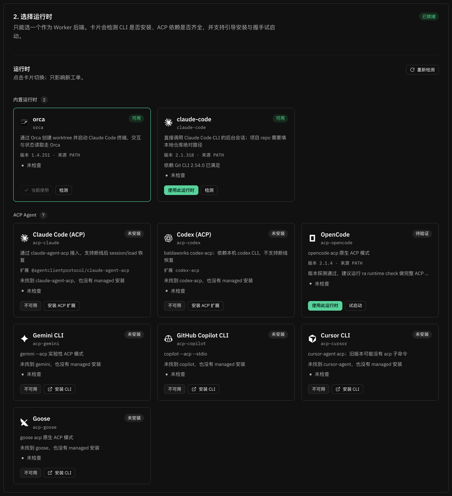

# Worker 运行时

Worker 不在 Router 进程里跑。每张工单开工时，Router 按 `runtime.default` 选一个 **WorkerRuntime** 适配器，由它负责：创建隔离 workspace、拉起 Agent、投递工单、读取状态、接住追问。内核与 Router 只依赖 `WorkerRuntime` 端口，换运行时不需要改业务代码。

一份配置只有一个默认运行时，但**项目清单按运行时分开维护**：Orca 用仓库选择器（`name:` / `id:` / `path:`），Claude Code 与 ACP 用本地仓库绝对路径。切换运行时不会把 Orca 的选择器当成文件路径；旧工单也不会被新的默认运行时接管，而是继续用 Assignment 里记录的运行时。

## 内置运行时

| runtime id | 拉起方式 | workspace | 状态读取 | 追问 / 恢复 | 适用场景 |
|-|-|-|-|-|-|
| `orca`（默认） | Orca 创建 worktree + Claude Code 终端 | `orca worktree create --repo … --base-branch …` | Orca `AgentStatus`（`connected` / `orphaned` / `lastOutputAt`） | 终端常驻，追问直接投递；巡检优先读 Claude 会话记录 | 本机已用 Orca 管仓库，想同时看到终端 |
| `claude-code` | `git worktree` + `claude --bg` 后台会话 | 本地 git 仓库绝对路径 | `claude agents --json --all` | 会话结束后用 `claude --bg --resume <sessionId>` 追问；进程退出不自动 resume | 不用 Orca，直接跑 Claude Code |
| `codex-app` | `git worktree` + `codex app-server --stdio` | 本地 git 仓库绝对路径 | Codex `thread/status/changed`、`turn/*`、`item/*` 事件 | `thread/resume` 接回；执行中 `turn/steer`；停止用 `turn/interrupt` | 想用 Codex，且希望 Router 创建的 thread 能在 Codex 桌面端看到 |
| `acp` / `acp-*` | ACP 子进程：`initialize` → `session/new` → `session/prompt` | `git worktree`（本地绝对路径） | ACP `session/update` | Agent 声明 `loadSession` 时用 `session/load` 恢复 | 想接 Codex / Gemini / OpenCode 等 |

`acp` 是自定义命令入口；`acp-*` 是内置 ACP Agent，共用同一套 `AcpRuntime`。

## 在 Web 面板里选（推荐）

「初始化 → 2. 选择运行时」与「配置 → 派工与服务 → Worker 运行时」是同一组卡片：

- 自动检测 CLI 是否安装、版本、来源（PATH / ra 托管）、ACP 扩展依赖与登录状态；
- **安装 CLI** 跳转该 Agent 的官方安装页；**安装 ACP 扩展** 由 ra 把 npm 适配包装到 `~/.router-agent/runtimes/<agent>`；
- **检测 / 试启动** 做一次真实 ACP 握手（`initialize` + `session/new`），避免只看版本号；
- 点卡片即切换 `runtime.default`，只影响新工单；已开工的工单保留原运行时。



## 用 CLI 选

```bash
ra config set runtime.default claude-code
ra runtime list                    # 本机 ACP Agent 状态、版本、来源
ra runtime install acp-claude      # 装到 ~/.router-agent/runtimes/claude
ra runtime check acp-claude        # 完整 initialize + session/new 握手
ra runtime login acp-codex         # 交互式登录
ra runtime uninstall acp-codex     # 卸载 ra 托管的适配器
```

## 运行时配置

```yaml
runtime:
  default: acp-codex        # orca | claude-code | codex-app | acp | acp-*
  # 运行时专属的非安全参数
  options:
    claude-code:
      model: claude-sonnet-5-5
    codex-app:
      permissions: full        # full=danger-full-access；workspace=workspace-write
      approvalPolicy: never    # never / on-request / untrusted
      network: true
    acp:                    # 自定义 ACP 命令
      command: opencode
      args: [acp]
      env: {}
  # 非 orca 运行时使用独立项目清单，和顶层 projects 互不影响
  projects:
    claude-code:
      - name: router-agent
        repo: /Users/me/router-agent   # 本地仓库绝对路径
        defaultBranch: main
    acp-codex:
      - name: router-agent
        repo: /Users/me/router-agent
        defaultBranch: main
```

`allowedTools` / `permissionMode` / `sandbox` / `shellAllow` / `allowNetwork` / `fileAccess` 这些安全字段不允许写在 `runtime.options` 里，写了会直接启动失败。Worker 权限统一由 `worker.tools` 与 adapter 内置基线决定。

## Codex App Server 运行时（`codex-app`）

`codex-app` 直接启动 `codex app-server --stdio`，用 Codex 原生 JSON-RPC 承载工单：

- `thread/start` + `turn/start` 首轮；`thread/resume` 重启后接回；`turn/steer` 执行中追加输入；`turn/interrupt` 停止；
- 原生处理 `item/commandExecution/requestApproval`、`item/fileChange/requestApproval`、`item/permissions/requestApproval` 等审批请求；
- threadId 同时写入 `meta.handle` / `meta.sessionId`，Web 面板会显示「Codex 打开」按钮，用 `codex://threads/<threadId>` 在 Codex 桌面端打开同一 thread。

### 重启后被中断的任务怎么恢复

`codex-app` 的 app-server 是 Router 的子进程，**Router 重启会把正在跑的那一轮一起带走**。
会话上下文不会丢（Codex 从磁盘 rollout 重建），但**任务本身停住了**，需要恢复动作接着做。

Router 用 `thread/turns/list` 读回最后一轮的状态：被打断的那轮状态是 `interrupted`，
这是一个精确信号，不需要靠时间窗口猜。恢复策略由 `policy.interruptedRecovery` 控制：

| 值 | 行为 |
| --- | --- |
| `auto`（默认） | 发中断提示后，自动补一条 `kind=retry` 的输入，让 worker 检查现场并接着做完；同时发恢复提示 |
| `notify` | 只发中断提示，等用户回复「继续」才恢复 |
| `off` | 不处理 |

`policy.maxAutoRecover` 限制同一工单的自动恢复次数，超出后自动降级为 `notify`。
中断提示里会带上被中断那一轮的执行摘要（`thread/turns/list` 的 `itemsView=full`），
worker 能据此判断哪些步骤需要重做，避免重复写入只写了一半的文件。

> 只有 worker 进程随 Router 一起死的运行时需要这套机制
> （`capabilities.agent.processExit=true`，即 `codex-app` / `acp-*`）。
> `orca` / `claude-code` 的 worker 活在自己的常驻服务里，Router 重启期间照常干活，不受影响。

### 二进制发现（优先 Codex App 内置）

按以下顺序探测，取第一个既能跑 `codex --version`、又支持 `codex app-server` 的版本：

1. `runtime.options.codex-app.command` 显式配置；
2. `RA_CODEX_BIN` / `CODEX_BIN` / `CODEX_CLI_PATH`；
3. Codex App bundle（macOS）：
   - `/Applications/ChatGPT.app/Contents/Resources/codex-cli/bin/codex`
   - `/Applications/ChatGPT.app/Contents/Resources/codex-cli/CodexCLI.app/Contents/MacOS/codex`
   - `/Applications/ChatGPT.app/Contents/Resources/codex`
   - `/Applications/Codex.app/Contents/Resources/codex`
   - 以及 `~/Applications/...` 下的同名布局；
4. `PATH` 里的 `codex`。

都找不到时，`start` 报 `runtime:unavailable`，`ra doctor` / `ra runtime list` 会提示安装 Codex App 或 Codex CLI，并给出 https://chatgpt.com/codex 。`ra runtime check codex-app` 会真正做一次 `initialize` 握手。

### 权限与审批

默认按工单要求使用 **full access + 不审批**：

```yaml
runtime:
  default: codex-app
  options:
    codex-app:
      permissions: full          # full=danger-full-access；workspace=workspace-write
      approvalPolicy: never      # never / on-request / untrusted
      network: true              # 仅 workspace 模式生效
      model: gpt-6.1-sol         # 可选；缺省用 Codex 自己的配置
      modelProvider: ep          # 可选
      # command: /Applications/ChatGPT.app/Contents/Resources/codex-cli/bin/codex
      # env:                      # 可选；传给 codex 子进程的额外环境变量
      #   CODEX_HOME: /Users/you/.codex
```

`full + never` 不会产生审批请求；`workspace + never` 允许在工作区与 `~/.router-agent/workers/<ticket>` 写文件、允许联网，但系统级操作受限。只有把 `approvalPolicy` 改成 `on-request` / `untrusted` 时，才按 `worker.tools.shell` / `shellAllow` 逐条放行或拒绝**触发审批的**命令。

> Codex 的 sandbox 允许的命令不会逐条走审批，因此 `shellAllow` 不能替代 sandbox 的命令级白名单；真正要限制“哪些命令能跑”，需要 Codex execpolicy/rules 或更窄的 sandbox。`codex-app` 映射的是 `worker.tools` 的审批决策，不是完整的命令过滤器。

> `full + never` 没有人工闸门；请只对 Router 创建的 worktree 使用，不要对不可信仓库默认开启。运行时会打 `codex:full-access` 日志。

### 桌面端可见性

Router 与 Codex 桌面 App 默认共用 `~/.codex`。要让桌面端侧边栏自然列出 Router 创建的 thread，需要同时满足：

- 同一个 `CODEX_HOME`、同一个登录；
- thread 至少完成一个 turn，`preview` 非空；
- thread 的 `source` 属于交互式来源（`codex-app` 外部客户端默认是 `vscode`）；
- 桌面端当前 `model provider` 与 thread 的 `modelProvider` 一致；
- Codex CLI / Codex App 版本兼容（见 `docs/RUNTIME.md` 的版本说明）。

跨进程默认不是实时同步：桌面端看到的是落盘后的 thread；要实时收同一份事件，需要连同一个 app-server / daemon。Router 重启后会用 `thread/resume` 接回；关闭 Router 不会关闭桌面 App。

#### CODEX_HOME

`codex-app` 启动子进程时**固定**把 `CODEX_HOME` 设为 `~/.codex`，与桌面端一致；服务自身继承的 `CODEX_HOME`（例如从别的工具的隔离 HOME 启动）会被忽略，否则 thread 会落在桌面端读不到的目录，侧边栏永远看不到。

需要指向别处时，在 `runtime.options.codex-app.env.CODEX_HOME` 显式配置：

```yaml
runtime:
  options:
    codex-app:
      env:
        CODEX_HOME: /Users/you/.codex
```

实际生效的路径会打在 `codex:codex-home` 事件里，排查「桌面端看不到 thread」时先看这条。

## ACP Agent 目录

任何实现了 [Agent Client Protocol](https://agentclientprotocol.com) 的 Agent，都可以用同一套 `AcpRuntime` 接入。ra 启动后自动探测本机可用的 ACP Agent，未安装 / 版本不兼容 / 未登录的项会在面板里置灰并给出原因。

| runtime id | Agent | 启动方式 | 可在线安装 | 断线恢复 | 说明 |
|-|-|-|-|-|-|
| `acp-claude` | Claude Code | `claude-agent-acp` | ✅ | ✅ `session/load` | 需先登录 Claude Code |
| `acp-codex` | Codex | `codex-acp` | ✅ | ❌ | 需本机 `codex` CLI；先 `codex-acp login`；默认带 `--message-streaming` |
| `acp-opencode` | OpenCode | `opencode acp` | ❌ | ✅ | 本机安装后自动识别，建议先 `ra runtime check` |
| `acp-gemini` | Gemini CLI | `gemini --acp` | ❌ | — | 实验性 ACP 模式 |
| `acp-copilot` | GitHub Copilot CLI | `copilot --acp --stdio` | ❌ | — | |
| `acp-cursor` | Cursor CLI | `cursor-agent acp` | ❌ | — | 旧版本可能没有 `acp` 子命令 |
| `acp-goose` | Goose | `goose acp` | ❌ | — | |

`AcpRuntime` 负责：spawn Agent 子进程 → `initialize` → `session/new` → `session/prompt`；从 `session/update` 读取助手文本与工具调用；把 Agent 的 `session/request_permission` 按 `worker.tools` 策略自动放行或拒绝；进程退出后，若 Agent 声明 `loadSession`，追问时会用 `session/load` 恢复会话。

当前不做客户端侧的 `fs/*` 与 `terminal/*` 代理：`initialize` 里声明不支持，Agent 需使用自己的文件 / 命令工具。Agent 必须预先完成登录（ACP 的 `auth_required` 会以启动失败上报）。

## Worker 工具策略

`worker.tools` 是派给 worker 的工具基线（默认读写 + 白名单 shell）：

| 字段 | 取值 | 说明 |
|-|-|-|
| `fileAccess` | `read-only` / `read-write` | 只读时只给 `Read` / `Glob` / `Grep`，读写再加 `Write` / `Edit` |
| `shell` | `deny` / `allowlist` / `allow` | `allowlist` 时按 `shellAllow` 的命令前缀放行（如 `git` 放行 `git ...`） |
| `shellAllow` | 命令前缀数组 | 仅在 `shell: allowlist` 时生效 |
| `allowNetwork` | `true` / `false` | 预留字段：当前只解析，未用于收窄网络 |

`worker.tools` 对 `claude-code` 生效（映射成 Claude 的 `allowedTools`）；`acp-*` 运行时的 `session/request_permission` 也按同一策略自动放行或拒绝；`codex-app` 在 `approvalPolicy: on-request` / `untrusted` 时按同一策略处理命令审批，`approvalPolicy: never` 时不再逐条审批；`orca` 运行时里 worker 的权限由 Orca 启动的 Claude Code 自身决定。安全字段只能由这里和 adapter 内置基线决定，`runtime.options` 写了同名键会直接启动失败。

## UI 证据门禁

`worker.evidence.ui` 控制 Worker 报 `ready` 时是否检查 PR / MR 里的 UI 对比证据：

| 档位 | 行为 |
|-|-|
| `off` | 不检查 |
| `warn`（默认） | 缺证据时记 `report:evidence-missing`，仍然放行 |
| `enforce` | 缺证据时返回 422，`ra report` 退出码 1，Worker 必须补证据或改报 `blocked` |

- **只拦 `ready`**：`progress` / `waiting` / `blocked` / `failed` / `dropped` 一律放行；拿不到截图时 Worker 应报 `blocked` 并在 `--human-action` 说明限制。
- **UI 工单判定**：Worker 用 `--ui-change` 显式声明（`true` / `false`）；不声明时 Router 用 `git merge-base` 找到改动文件，命中前端扩展名或常见前端目录即视为 UI 改动。
- **证据规则**：PR / MR 描述里必须同时出现 Before 和 After 标识，且至少有 2 个截图 / 录屏链接；只有 After 不算完整。
- **无法判断时放行**：workdir 丢失、git 查询失败、`gh` / `glab` 查询失败或拿不到描述正文时，记 `report:evidence-unverified` 后放行，避免把「验证不了」误判成「缺证据」。
- **兜底通道**：服务不可达时 Worker 写 `state.json`，poller 走同一门禁；命中拒绝时无法回 422，Router 会置 attention 并通知发起人，要求补齐或确认接受。
- 修改档位后需要重启服务生效。

## Worker 规范注入

Worker 手册（`worker/spec/prompt-mode.md`）会拼进启动 prompt；非 Orca 运行时使用运行时中立的 `worker/spec/contract.md`。两者都不改项目自己的 `CLAUDE.md`。

这些规范 markdown 统一存放在状态目录的 `specs/` 下，可在 Web 面板「配置 → 规范文件」直接编辑或恢复默认；保存后对之后派出的新工单生效。
