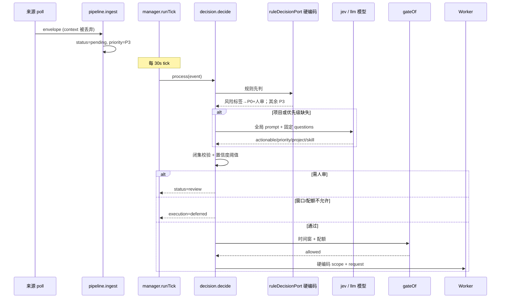
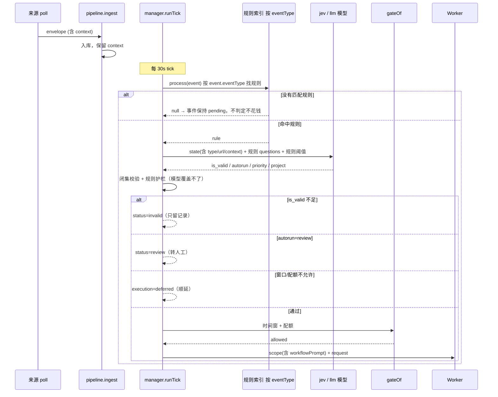

# 事件决策规则重构方案（自然语言 → 决策配置）

> 目标：把「事件总线」从**一份全局 prompt 决定一切**，改成**按事件类型各自配置、各自判定**。
> 本方案已落地实现；代码、配置、面板、测试与运维文档同步更新。
> **后续变更**：方案里 4.2 节的「全局 prompt 降级为兜底」兼容策略已被撤销——
> `events.decision.prompt` 与 `events.decision.fallbackToPrompt` 已彻底删除，
> 判定依据只有规则一处，未匹配规则的事件一律保持未判定。
> 现状基线：`main` @ `48ae6c9`
> 关联现状文档：[CONFIGURATION.md](../CONFIGURATION.md)（事件总线配置）、[OPERATIONS.md](../OPERATIONS.md)（日志事件表）

---

## 0. 结论先行

### 0.1 对原始需求的判定

原始需求的方向是对的，但**把手段当成了目标**。真正要解决的不是「怎么让 LLM 把自然语言翻译成 Jev 参数」，而是：

> **让「哪类事件值得让系统动手」这件事，从代码里搬到配置里。**

围绕这个真目标，逐条判定原始需求：

| # | 原始需求 | 判定 | 理由 |
|---|---|---|---|
| 1 | 无配置时只收集、不判定 | **采纳，且升级为「默认安全」** | 这是整套设计的地基。但要注意：无规则 ≠ 无判定成本，无规则应当**直接跳过模型调用**，而不是「判了但判为不处理」 |
| 2 | 删除所有内置决策判断条件 | **部分采纳** | 「删除内置的**业务判断**」采纳；「删除内置的**安全护栏**」不采纳。风险标签强制人审是最后一道防线，与「谁来定业务规则」无关 |
| 3 | 每条规则指定 eventType | **采纳，但需修正匹配语义** | eventType 是**判定时的过滤器**，不是订阅时的过滤器 —— 这点用户已经说对了，但实现上容易做成「订阅过滤」，需要明确 |
| 4 | 自然语言 → LLM 提炼成 Jev 参数 | **采纳，但要做「可编辑的结构化草稿」** | 直接让 LLM 写配置，用户无法审核。应该是：LLM 产出**草稿**，面板上**可改**，改完才落盘生效 |
| 5 | state 在判定时拼接，不在保存时生成 | **采纳，完全正确** | 这是本方案里最重要的一条设计约束 |
| 6 | questions 字段固定，判定方法由模板 + 用户输入合成 | **采纳** | 但当前 `JevClient` **不支持 `choice` 类型**（见 §2.3），需要先补能力 |
| 7 | workflowPrompt 由用户输入解析，最终拼给 Worker | **采纳** | 当前 Worker 载荷是硬编码模板（`scopeOf`/`requestOf`），确实需要打通 |
| 8 | 没配置的事件默认不处理，保持待处理 | **采纳** | 与第 1 条是同一件事的两面 |

### 0.2 三个被漏掉的真问题

原始需求聚焦在「判定怎么配」，但当前实现有三个更底层的问题，**不先解决，配得再好的规则也不会生效**：

**问题一：事件的上下文在入库时被丢掉了。**

`packages/event/src/port.ts` 定义了 `EventEnvelope.context`（`Record<string, string>`），GitHub 来源也确实写了（`src/events/sources/github.ts:352` 写了 `repo` / `actor` / `reviewState`，`:397` 写了 `repo` / `branch`）。
但 `src/events/pipeline.ts:85` 的 `ingest()` **完全没有读取 `envelope.context`**，`EventRecord` 里也没有对应字段。
后果：模型判「这条 PR 属于哪个项目」时，看不到仓库名，只能靠 `source.repo`（订阅配置里的字符串）兜底 —— 而 `source.repo` 只有 GitHub 来源有，插件来源没有。

**问题二：喂给 Jev 的 `state` 里没有事件类型和链接。**

`src/events/decision-model.ts:131` 的 `stateOf()` 只给 `title` / `body` / `source` / `rules` / `projects` / `skills`。
没有 `eventType`、没有 `url`、没有 `repo`。
后果：模型看到的是一段文字，**分不清「PR 失败」和「Issue 评论」**。用户想在规则里写「github.workflow_run.failure 才处理」，但模型根本不知道当前事件的类型是什么。

**问题三：规则的匹配是硬编码字符串，不是按事件类型分流的。**

`src/events/decision.ts:253` 的 `ruleDecisionPort` 里，风险标签是硬编码的 `RISK_LABELS` 数组（`src/events/decision.ts:15`）。
而「规则先判、模型兜底」这个顺序，是**全局**的 —— 所有事件走同一条规则端口、同一份 prompt、同一套阈值。
后果：用户配了 5 条不同事件类型的规则，系统仍然只用**其中一条**（或干脆哪条都不用）。

### 0.3 最终方案一句话

> **把「判定」从一个函数，改成一组按事件类型索引的规则。**
> 每条规则自带：适用事件类型、判定问题（questions）、判定状态（state）、工作流提示（workflowPrompt）、护栏。
> 事件入队后按自己的 `eventType` 找到唯一一条规则，**只跑这一条**，跑完得出「处理 / 不处理 / 要人审」，再由统一管线决定派工还是留队。
> **没有规则的 eventType，事件只入库、不判定、不花钱。**

---

## 1. 现状调研（代码位置）

### 1.1 当前判定链

```text
来源 poll
  └─ pipeline.ingest()                      src/events/pipeline.ts:85
       ├─ status='pending' priority='P3' eventType=envelope.eventType
       └─ 入库（UNIQUE(source_id, external_id) 幂等）
  └─ manager.runTick() → pipeline.tick()      src/events/pipeline.ts:130
       ├─ store.claimPendingEvents(limit)      条件：status='pending' AND decided_at IS NULL
       │    └─ pipeline.process(event)          src/events/pipeline.ts:203
       │         ├─ decision.decide(input)     src/events/decision.ts:85
       │         │    ├─ ruleDecisionPort.decide()   ← 硬编码规则（风险标签 → P0 + 强制人审）
       │         │    └─ model.decide()               ← needsModel() 时才调：项目/优先级缺一才问
       │         │         ├─ jev: questions = {actionable, priority, needsReview, project:*, skill:*}
       │         │         └─ llm: system/user prompt → JSON
       │         │    └─ validate()              闭集校验：项目/skill/置信度 → 兜底转人工
       │         ├─ !actionable → status='invalid'（标记无效，不处理）
       │         ├─ !decided → status='pending'（留队重试，最多 5 次）
       │         ├─ needsReview → status='review'（转人工）
       │         ├─ gateOf() → 时间窗 + 每日配额 → execution='deferred'（顺延）
       │         └─ dispatch()                  src/events/pipeline.ts:312
       │              ├─ triggerOf() → 合成 Trigger
       │              ├─ engine.decide() → 开 Ticket + Mandate
       │              └─ scopeOf()/requestOf() → 硬编码模板拼给 Worker
       └─ store.listDecidedUndispatched(limit)  已判定未派出的，只重跑闸门不重判
```

### 1.2 关键事实表

| 事实 | 代码位置 | 对重构的影响 |
|---|---|---|
| `events.decision` 是**全局单份**配置（provider / prompt / confidenceThreshold / fallback） | `src/config.ts:303` `EventDecisionConfig` | 必须改成「全局兜底 + 按 eventType 的规则集」两层 |
| 决策 prompt 只有一段自然语言，`state.rules` 是它的全文 | `src/events/decision-model.ts:131` | 需要把 prompt 从「一段话」升级为「结构化 rules 对象」 |
| `JevQuestion.type` 只支持 `'noul' \| 'score'` | `packages/infra/src/decision/jev-client.ts:18` | **需求里的 `choice` 类型当前不支持**，必须先扩 JevClient |
| Jev 分数阈值 `0.4`（选中项目/skill）、`0.5`（actionable/needsReview）全部硬编码 | `src/events/decision-model.ts:19,58-60` | 阈值必须下沉到规则里，否则「按事件类型定制」名不副实 |
| 风险标签 `RISK_LABELS` 硬编码，且规则命中后模型无法覆盖 `needsReview` | `src/events/decision.ts:15,237` | 护栏要保留，但标签集合可配置 |
| 优先级档位 `PRIORITY_CRITERIA = ['P4','P3','P2','P1','P0']` 硬编码 | `src/events/decision-model.ts:16` | 规则里的 `priority.criteria` 要能覆盖它 |
| `envelope.context` 被来源写入，但 `ingest()` 从不读取 | `packages/event/src/port.ts`、`src/events/pipeline.ts:85` | **必须补**：context 要入库并进 state |
| Jev `state` 不含 eventType / url / repo | `src/events/decision-model.ts:131` | **必须补**：模型需要知道事件类型 |
| 归属项目有「按订阅仓库名」兜底 | `src/events/decision.ts:147,274` | 兜底只覆盖 GitHub；插件来源无此路径 |
| Worker 载荷由 `scopeOf()` / `requestOf()` 硬编码模板拼成 | `src/events/pipeline.ts:478,490` | workflowPrompt 要在这里接入 |
| `events.decision.prompt` 改动时 prompt 版本号 +1 | `src/cli/index.ts:1746` | 规则改动也要版本化，否则历史判定不可回放 |
| `events.*` 属于热配置前缀，保存即生效 | `src/config.ts:1526` | 规则集改动同样要热生效 |
| 事件状态只有 4 种：`pending` / `review` / `done` / `invalid` | `packages/core/src/event.ts:15` | 「没配规则」需要一个新的表达方式（见 §4.3） |
| `claimPendingEvents` 的条件是 `decided_at IS NULL` | `src/store/db.ts:829` | 未判定的规则外事件必须能被这条 SQL 排除 |
| 配置列表字段目前只有 `projects` / `feishu.chats` 走整段替换 | `src/config.ts:2055` `LIST_PATHS` | 规则集是列表，需要新增一条整段替换路径 |

### 1.3 当前 Jev 判定实际问了什么

`src/events/decision-model.ts:56`：

```ts
const questions: Record<string, JevQuestion> = {
  actionable: { type: 'noul', instructions: '这个事件是否需要处理？与项目无关的噪声回答 0。' },
  priority:   { type: 'score', instructions: '这个事件有多急？', criteria: PRIORITY_CRITERIA },
  needsReview:{ type: 'noul', instructions: '这个事件是否需要人工先看一眼再动手？高风险、信息不足或归属不明时回答 1。' },
}
// 每个候选项目一个 noul：project:<name>
// 每个候选 skill 一个 noul：skill:<id>
```

即：**问题本身是硬编码的，只有「答案」受 prompt 影响**。用户写在面板上的 prompt 只能进入 `state.rules`，让模型自由心证 —— 它无法改变「问哪几个问题」「每个问题的判定标准」「阈值是多少」。
这就是为什么用户觉得「配了 prompt 好像没起作用」。

### 1.4 面板现状

| 区域 | 现状 | 文件 |
|---|---|---|
| 配置 → 事件总线 → 决策策略 | 一个 `provider` 下拉 + 一段 `prompt` textarea + 阈值 + 兜底 | `src/web/client/fields.ts:366-401` |
| 配置 → 事件总线 → 事件来源 | 来源卡片 + GitHub 仓库订阅弹窗 | `src/web/client/events-config.tsx` |
| 收件箱（事件面板） | 只做查看与审核，**不显示也不改判定配置** | `src/web/client/events-panel.tsx` |
| API | `GET /api/events` 返回 `decision: { provider, prompt, confidenceThreshold, fallback, version }` | `src/router/api.ts:100,330` |

**面板上目前完全没有「按事件类型配规则」的入口** —— 用户的需求 1 明确要求新增。

---

## 2. 需求 review：真问题在哪

### 2.1 症状 vs 原因

用户描述的症状是「我想按事件类型分别配置判定条件，但做不到」。
真原因有三层：

1. **表层**：判定输入里没有「当前事件是什么类型」，所以任何按类型分流的规则都无从匹配。
2. **中层**：判定问题、阈值、闭集全是硬编码的，prompt 只能在答案层面施加影响。
3. **深层**：判定是**全局单例**，而不是**按事件类型索引的规则集**。

只做第 1 层（把 eventType 塞进 state）能让模型「看见」类型，但用户依然只能有一段全局 prompt —— 因为所有事件仍然问同样的问题、用同样的阈值。**不够。**

### 2.2 手段 vs 目标

需求里的手段是「用 LLM 把自然语言翻译成 Jev 参数」。
目标是「让业务判定规则可配置、可按类型分流、可审计」。

手段的问题：

| 问题 | 说明 |
|---|---|
| **LLM 提炼会漂移** | 同一段自然语言，两次提炼出的 `instructions` 可能不同。规则变成了不可复现的东西 |
| **用户无法审核** | 用户写「所有 github action error 事件全都需要处理」，LLM 提炼成什么用户看不到、也改不了 |
| **保存即生效 = 未经验证生效** | 提炼结果直接进生产，判错没有拦截点 |
| **提炼本身要花钱、要模型** | 为省一次判定调用，先付一次提炼调用 |

**目标导向的做法**：LLM 提炼只作为**「把用户的话变成可编辑草稿」的辅助**，最终落盘的是**结构化、可读、可人工修改**的规则对象。规则存的是「怎么判」，不是「判出来的结果」。

这正好与需求第 5 条一致：**`state` 不是保存时生成的，而是在触发判定时基于事件本身的参数拼接出来的**。同一条道理适用于整个规则：**配置的是判定方法，不是判定结论。**

### 2.3 一个必须先解决的技术前提

需求给的 `questions` 结构用了三种类型：`noul` / `choice` / `score`。
**当前 `JevClient` 只支持 `noul` 与 `score`**（`packages/infra/src/decision/jev-client.ts:18`），`extractAnswers` 也只解析 `raw.noul` 与 `raw.score`（`:98-112`）。

`choice` 的语义是「从固定选项里选一个」，返回值应该是一个**选项标识**，不是 0~1 的概率 —— 与现有 `JevAnswers = Record<string, number>` 的类型不兼容。

所以引入 `choice` 之前必须先做两件事：

1. **扩 `JevQuestion.type`**：加 `'choice'`，并让 `criteria` 在 `choice` 下表示**选项列表**（而不是 score 的档位下标）。
2. **扩答案类型**：`JevAnswers` 不能再是 `Record<string, number>`，需要能同时容纳概率、档位分和选项标识。

这个改动落在 `packages/infra`，属于**基础设施能力补齐**，是本方案的前置依赖。

### 2.4 另一个被忽略的前提：Jev 单次请求的成本

现在的 Jev 调用，questions 的数量是 `3 + 候选项目数 + 候选 skill 数`。
项目一多、skill 一多，questions 就会膨胀。

改造成「每条规则自带自己的 questions」之后，规则里的 `project` 问题很可能就是**闭集选择题**（在候选项目里选一个），而不是每个项目一个 noul。
这正是 `choice` 的价值 —— **questions 数量从 O(项目数) 降到 O(1)**。
这是把 `choice` 引入进来的**第二个、也是更重要的**理由：它不只是表达力问题，是成本问题。

### 2.5 用户需求里一个含糊点：「决策开关」

需求 1 说「默认情况下……等于决策开关没有启用，只做事件的收集」。

这里有两种可能的实现：

| 实现 | 行为 | 评价 |
|---|---|---|
| A. 全局 `events.decision.enabled` 开关 | 关掉时所有事件都不判定 | 简单，但粒度太粗 —— 用户可能想「Issue 判定、PR 不判定」 |
| B. **没有匹配到规则 = 不判定** | 每个 eventType 独立决定要不要判定 | **粒度天然正确**，且与需求 8（「没配置的事件默认属于不处理」）完全一致 |

**方案 B 严格优于 A，且不需要新增开关。** 因为「配了规则」本身就是「开了这个类型的决策」。
这让配置模型更简洁：**规则集就是决策开关**。

> 注：当前已有的全局开关 `events.enabled`（事件总线总开关）保留 —— 它管的是「采不采集」，与「判不判定」是两件事，不要混。

---

## 3. 方案设计

### 3.1 核心概念：规则（Rule）

一条规则 = 一个事件类型的一整套判定契约。

```ts
/** 一条事件决策规则：按 eventType 索引，一个 eventType 至多一条规则。 */
export interface EventRule {
  /** 规则 id（面板显示与日志追踪用）。 */
  id: string
  /** 适用的事件类型，如 github.workflow_run.failure。全局唯一。 */
  eventType: string
  /** 用户写的那段自然语言（保留原文，便于回看「我当时是怎么说的」）。 */
  intent: string
  /** 判定问题：怎么问模型。 */
  questions: EventRuleQuestions
  /** 工作流提示：最终拼给 Worker 的执行口径。 */
  workflowPrompt: string
  /** 护栏：模型说了不算。 */
  guardrails: EventRuleGuardrails
  /** 判定与派发的阈值。 */
  thresholds: EventRuleThresholds
  /** 规则版本，每次保存 +1，历史判定可回放。 */
  version: number
}
```

### 3.2 questions：固定骨架 + 模板合成

需求第 6 条说「question 中的几个关键字段是固定的字段，但判定方法基于内置模板 + 用户输入生成」。这个设计是对的，落地如下：

**固定骨架（4 个必答问题，id 与语义永远不变）：**

| 问题 id | 类型 | 语义 | 缺省判定标准 |
|---|---|---|---|
| `is_valid` | `noul` | 这条事件是否**属于本规则要处理的那一类** | 「只有明确属于 {eventType} 且需要处理时才判定为有效」 |
| `autorun` | `choice` | 可以自动执行，还是需要人审 | `auto` / `review` 两个选项 |
| `priority` | `score` | 处理优先级 | 四象限模板：低 / 中 / 高 / 紧急 |
| `project` | `choice` | 归属哪个项目 | 候选项目闭集 + `unknown` |

**用户输入参与合成的方式：**

用户写：「所有的 github action error 事件全都需要进行处理，并且自动执行。执行流程：根据事件的上下文背景分析报错原因，并且执行修复，提交 PR」

提炼结果：

```ts
{
  eventType: 'github.workflow_run.failure',
  intent: '<用户原文>',
  questions: {
    is_valid: {
      type: 'noul',
      // ← 内置模板 + 用户输入里的「全都是需要处理」
      instructions: '该事件是否为有效的 GitHub Action 错误事件？只有明确属于需要处理的 GitHub Action 错误时才判定为有效。',
    },
    autorun: {
      type: 'choice',
      instructions: '该事件是否可以自动执行？',
      criteria: {
        auto: '可以自动执行，不需要人工确认。',
        review: '不能安全地完全自动执行，需要人工 review。',
      },
      // ← 用户输入里的「并且自动执行」把 auto 的描述改得更具体
    },
    priority: {
      type: 'score',
      instructions: '评估该事件的处理优先级和重要程度。',
      criteria: ['低优先级：…', '中优先级：…', '高优先级：…', '紧急：…'],
      // ← 内置四象限模板，用户输入基本不改（用户很少说清优先级）
    },
    project: {
      type: 'choice',
      instructions: '根据事件内容判断它归属于哪个项目。',
      criteria: { router_agent: '…', customer_service: '…', unknown: '…' },
      // ← 候选项目是运行时事实，不是用户写的
    },
  },
  workflowPrompt: '请按照下述流程修复这个 github action 错误，并且提交 PR',
}
```

**关键设计点：模板与用户输入的分工是固定的，不是模型自由发挥。**

| 字段 | 内置模板负责 | 用户输入负责 |
|---|---|---|
| `is_valid` | 判定标准的**句式骨架** | 要不要收紧/放宽 |
| `autorun` | 选项**集合**（auto / review） | 每个选项的**描述** |
| `priority` | **四象限模板**（几乎不改） | 极少干预 |
| `project` | **候选项目闭集**（运行时事实） | 不干预 |

这样提炼出来的规则是**稳定且可读的**：用户看到 `is_valid` 的 instructions，能明确知道「什么叫有效」；看到 `autorun` 的两个选项，能明确知道「什么情况会要人审」。

### 3.3 state：判定时拼接，不是保存时生成

需求第 5 条完全正确。落地形态：

```ts
/** 判定时的 state：由事件本身 + 规则上下文拼出来。 */
function buildState(event: EventRecord, rule: EventRule): EventState {
  return {
    // 事件的上下文背景
    background: `${event.title}\n${event.body}`.trim(),
    // 事件的相关参数
    payload: {
      type: event.eventType,
      source: event.sourceKind,
      repo: event.repo ?? '',
      branch: event.branch ?? '',
      url: event.url ?? '',
      ...event.context,          // ← 来源给的上下文（repo/actor/branch/reviewState…）
    },
    // 规则上下文
    rule: {
      intent: rule.intent,
      workflowPrompt: rule.workflowPrompt,
    },
  }
}
```

**相比现状的三处改进**（直接对应 §1.2 的问题一、二）：

1. `payload.type` —— 模型终于知道这是 `github.workflow_run.failure` 还是 `github.issues.commented`。
2. `payload.url` —— 模型能引用原始链接。
3. `event.context` —— 来源提供的仓库 / 触发者 / 分支 / 评审状态，**入库时保留**（现在被丢掉了）。

### 3.4 workflowPrompt：打通到 Worker

当前 Worker 载荷由两段硬编码模板拼成（`src/events/pipeline.ts:478,490`）：

```ts
// scopeOf：授权范围
`处理事件「${event.title}」（${verdict.eventType} / ${verdict.priority}）。`
`归属项目：${verdict.project || '（未指定）'}。`
`处理方式：${skill.name}（${skill.id}）——${skill.hint}。`
`授权范围：只处理本事件范围内的事；不改本仓库以外的代码；不碰生产环境与对外发布。`

// requestOf：原始请求
`事件标题：${event.title}` / `事件正文：…` / `事件类型：…` / `判定理由：…`
```

改造后，`workflowPrompt` 成为**执行口径的主体**，硬编码部分退化为**护栏**：

```ts
// scopeOf 新形态
`处理事件「${event.title}」（${verdict.eventType} / ${verdict.priority}）。`
`归属项目：${verdict.project || '（未指定）'}。`
// ← 规则的 workflowPrompt 插在这里：这是「按这条规则该怎么处理」
rule?.workflowPrompt ? `执行流程：${rule.workflowPrompt}` : ''
// ← 硬编码护栏保留：这是「无论什么规则都不能越过」
`授权范围：只处理本事件范围内的事；不改本仓库以外的代码；不碰生产环境与对外发布。`
```

**为什么护栏不能由 workflowPrompt 覆盖**：workflowPrompt 是 LLM 提炼出来的，可能被写成「直接推到 main」「绕过 review」。护栏必须由宿主硬编码兜住。

### 3.5 判定链：改造前后时序对比

#### 改造前（现状）



**现状的问题在时序图上一眼可见**：模型拿到的 `state` 里没有事件类型；questions 全世界一样；Worker 收到的执行口径与「用户想怎么处理」无关。

#### 改造后



**关键差异**：

| 维度 | 改造前 | 改造后 |
|---|---|---|
| 规则查找 | 全局一份 prompt | 按 `eventType` 精确匹配，**一条规则只管一类事件** |
| 无规则时 | 照样调模型（花钱） | **直接跳过判定**，事件留队不花钱 |
| state 内容 | title/body/source/rules/projects/skills | + `payload.type` / `payload.url` / `payload.context` |
| questions | 全局固定 6+ 个 | **每条规则自带**，且 `choice` 让数量与项目数解耦 |
| 阈值 | 硬编码 0.4 / 0.5 | **规则级可配** |
| Worker 口径 | 硬编码模板 | 规则的 `workflowPrompt` + 宿主护栏 |
| 护栏 | 硬编码风险标签，模型不可覆盖 | 保留并下沉到规则，**模型同样不可覆盖** |

### 3.6 判定结果：四个问题的语义收敛

新骨架把「要做什么」收敛成四个正交的问题：

| 问题 | 回答的是 | 落点 |
|---|---|---|
| `is_valid` | 这条事件**该不该管** | 不足 → `status='invalid'`，只留记录不再处理 |
| `autorun` | 该管的话，**能不能自己动手** | `review` → `status='review'`，转人工 |
| `priority` | 该管的话，**多急** | 决定时间窗闸门与配额排序 |
| `project` | 该管的话，**归谁** | 决定派工仓库与分支 |

对比现状的 `actionable` / `needsReview` / `priority` / `project` / `skill`：语义基本一一对应，但**新增了 `is_valid` 与「判定未完成」的区分**。

这一点很重要：现状里 `actionable=false` 和「模型没给出结论」都可能导致事件被标成无效或留队，语义混在一起。新设计里：

- `is_valid` 不足 → **确定无效**（invalid，只留记录）
- 模型调用失败 → **判定未完成**（pending，留队重试，最多 5 次）
- 两者在事件记录里必须能区分开

### 3.7 护栏：不可配置的部分也要分清

需求说「删除所有内置的决策判断条件」。这里必须分清两类：

| 类型 | 例子 | 归属 | 可否配置 |
|---|---|---|---|
| **业务判断** | 「workflow_run.failure 要处理」 | 规则 | 可配置 |
| **安全护栏** | 「命中 release 标签必须人审」 | 宿主硬编码 | 模型不可覆盖 |
| **结构性约束** | 「闭集外的项目/技能一律转人工」 | 宿主硬编码 | 不可绕过 |
| **成本闸门** | 「时间窗 + 每日配额」 | `events.policy` | 单独配，**不动它** |

**「删除内置决策判断条件」应理解为：删除内置的**业务判断**（那段 `DEFAULT_EVENT_DECISION_PROMPT` 里写死的「bug 类用 bug-triage」「提到客服归 customer-service」等）。**
安全护栏与结构性约束必须保留 —— 否则用户一句「直接推到 main」就能把护栏写进 workflowPrompt。

风险标签集合本身可以做成配置（`events.policy.riskLabels`），但**「命中即强制人审」这条规则不可配置**。

---

## 4. 配置文件结构

### 4.1 YAML 形态

```yaml
events:
  enabled: true
  sources:
    github-1:
      enabled: true
      kind: github
      repo: blankPen/router-agent
      events: [pull_request.opened, workflow_run.failure]

  # 规则集：按 eventType 索引，一个类型至多一条
  rules:
    - id: rule-github-action-error
      eventType: github.workflow_run.failure
      intent: |-
        所有的 github action error 事件全都需要进行处理，并且自动执行。
        执行流程：根据事件的上下文背景分析报错原因，并且执行修复，提交 PR
      questions:
        is_valid:
          type: noul
          instructions: 该事件是否为有效的 GitHub Action 错误事件？只有明确属于需要处理的 GitHub Action 错误时才判定为有效。
        autorun:
          type: choice
          instructions: 该事件是否可以自动执行？
          criteria:
            auto: 可以自动执行，不需要人工确认。
            review: 不能安全地完全自动执行，需要人工 review。
        priority:
          type: score
          instructions: 评估该事件的处理优先级和重要程度。
          criteria:
            - 低优先级：影响范围小，不影响核心流程，可以延后处理。
            - 中优先级：影响部分功能或部分用户，需要在近期处理。
            - 高优先级：影响核心功能、较多用户或持续性较强，需要优先处理。
            - 紧急：核心业务大范围中断、存在数据风险，或需要立即处理。
        project:
          type: choice
          instructions: 根据事件内容判断它归属于哪个项目。
          criteria:
            router_agent: 项目 router-agent：router-agent 自身的开发与维护。
            customer_service: 项目 customer-service：客服与退款相关。
            unknown: 无法根据事件内容可靠识别项目归属。
      workflowPrompt: 请按照下述流程修复这个 github action 错误，并且提交 PR
      guardrails:
        riskLabels: [security, prod, production, incident, payment, release]
      thresholds:
        isValid: 0.5
        autoRun: 0.5
        projectPick: 0.4
      version: 1

  decision:
    provider: jev              # jev | llm
    confidenceThreshold: 0.6   # 全局兜底阈值（规则未覆盖时用）
    fallback: review           # review | pending
  # policy: ... 不变
```

### 4.2 与现状的兼容策略

`events.decision.prompt` 字段**保留但降级**：

| 情况 | 行为 |
|---|---|
| 没有任何规则（升级后的默认状态） | `decision.prompt` 作为**全局兜底规则**使用，作用于所有事件类型（等价于现状行为） |
| 有规则 | `decision.prompt` 仅在**没有匹配到规则**时作为兜底；**但默认建议改成「不判定」** |

这里有一个重要的取舍。需求 1 说「默认情况下不判定」。
但**直接把 `decision.prompt` 删掉会让现有用户的行为突变**（原来配的 prompt 失效）。

**建议方案：**

- 保留 `decision.prompt` 字段，语义变为「全局兜底规则」。
- **新增一个显式开关** `decision.fallbackToPrompt: false`（默认 false）。
  - `false`（默认，符合需求 1）：没有匹配规则 → 不判定，事件留队。
  - `true`（兼容老用户）：没有匹配规则 → 用全局 prompt 判定。
- 升级时**读取旧配置的 `decision.prompt` 自动生成一条兜底规则**，并把 `fallbackToPrompt` 设为 `true`，**老用户行为完全不变**。
- 面板上明确提示：「当前有 1 条全局兜底规则，所有未单独配置的事件类型都会走它」。

这样既满足需求 1（新装机器默认不判定），又不破坏存量（老用户升级后行为一致）。

### 4.3 「没配规则」的状态表达

需求 8：「没有进行配置的事件默认就属于不处理的事件，始终保持待处理的状态」。

当前 `EventStatus` 只有 4 种（`packages/core/src/event.ts:15`）：`pending` / `review` / `done` / `invalid`。

「保持待处理」= `status='pending'`。但这里有个陷阱：

`claimPendingEvents` 的 SQL 条件是 `status='pending' AND decided_at IS NULL`（`src/store/db.ts:829`）。
判定失败留队的事件也是 `status='pending'` + `decided_at IS NULL`（`src/events/pipeline.ts` 的 `waiting` 分支把 `decidedAt: undefined`）。

**两者状态完全一样，无法区分。** 结果就是：没配规则的事件，每 30 秒会被反复领取一次，永远重试。

**方案：新增一个事件状态 `undecided`（未判定）。**

| 状态 | 含义 | 是否被 `claimPendingEvents` 领取 |
|---|---|---|
| `undecided` | 没有匹配规则，**没有尝试判定过** | 不领取 |
| `pending` | 判定中 / 判定失败待重试 | 领取 |
| `review` | 待人工审核 | 不领取 |
| `done` | 已完成 | 不领取 |
| `invalid` | 判定为无效 | 不领取 |

这样做的好处：

1. **不花钱**：没配规则的事件不进入判定循环，永远不调模型。
2. **可观测**：面板能一眼看出「这条事件因为没有匹配规则而躺在这里」，而不是笼统的「待处理」。
3. **不丢**：用户随时配好规则，这些事件就能被判定。

实现上需要改：

- `packages/core/src/event.ts`：`EventStatus` 加 `'undecided'`，`normalizeEventStatus` 同步。
- `src/store/db.ts`：`claimPendingEvents` 查的是 `status='pending'`，入队时状态写成 `undecided` 就自动排除了。
- `src/events/pipeline.ts`：`ingest()` 时**先查规则索引**，有匹配 → `pending`；无匹配 → `undecided`。
- 配好规则后，需要把 `undecided` 的事件**重新激活**成 `pending`（见 §4.4）。

> 更细的做法：也可以不新增状态，用 `decided_at IS NULL AND basis = ''` 区分。但新增状态更清晰、更好过滤、面板可读性更好。**推荐新增状态。**

### 4.4 规则变更后的重新判定

这是二阶影响里**最容易漏掉**的一点。

用户配好一条新规则后，队列里那些 `undecided` 的事件**不会自动被处理** —— 它们躺在库里，没人触发。

必须有一个「规则变更 → 重新激活」的通路：

| 时机 | 动作 | 理由 |
|---|---|---|
| 新增规则 | 把 `eventType` 匹配该规则、且 `status='undecided'` 的事件改成 `pending` | 让历史积压的事件立刻能被判定 |
| 修改规则 | 同样重新激活（`decided_at IS NULL` 的那批） | 未判定的事件本来就还没判过 |
| 删除规则 | 已判定的**不动**（保留历史结论与工单）；`undecided` 的**不动**（继续躺着） | 已开出去的工单不能因为删规则就失效 |

实现上这是一个 `store.activateUndecidedEvents(eventType)` 的调用点，挂在配置保存回调里（`src/cli/index.ts` 的 `onConfigChange`，与现有 `reloadSources()` 并列）。

**注意**：已判定但因时间窗顺延（`execution='deferred'`）的事件，**不应该**因为规则改了而重新判定 —— 需求里「判定只跑一次」的现有语义是对的，保留。

---

## 5. 面板改造

### 5.1 配置页：新增「决策规则」区块

位置：`配置 → 事件总线`，在「事件来源」与「成本与时间窗」之间。

**现状：**

```text
┌─ 事件总线 ────────────────────────────────────┐
│  [ 启用事件总线                          ( ● ) ] │
├─ 事件来源 ────────────────────────────────────┤
│  ┌ GitHub 仓库订阅 ─────── [设置] ┐            │
│  └ 飞书 (暂未开放) ───────────────┘            │
├─ 决策策略 ────────────────────────────────────┤
│  判定方式    [ jev · 决策模型打分 ▾ ]           │
│  判定 prompt [ 多行文本 .................... ] │
│  置信度阈值  [ 0.6 ]                            │
│  判定失败兜底[ review · 转人工审核 ▾ ]          │
├─ 成本与时间窗 (折叠) ─────────────────────────┤
└──────────────────────────────────────────────┘
```

**改造后：**

```text
┌─ 事件总线 ────────────────────────────────────┐
│  [ 启用事件总线                          ( ● ) ] │
├─ 事件来源 ────────────────────────────────────┤
│  ┌ GitHub 仓库订阅 ─────── [设置] ┐            │
│  └ 飞书 (暂未开放) ───────────────┘            │
├─ 决策规则 ──────────────────────── [+ 添加规则]│
│  ┌──────────────────────────────────────────┐ │
│  │ github.workflow_run.failure   ● 已启用  │ │
│  │ 判定 4 项 · 自动执行 · 优先级 4 档       │ │
│  │ 「所有 action error 都处理并自动执行」   │ │
│  │                          [编辑] [删除]   │ │
│  └──────────────────────────────────────────┘ │
│  ┌──────────────────────────────────────────┐ │
│  │ github.issues.opened        ○ 未启用     │ │
│  │                          [编辑] [删除]   │ │
│  └──────────────────────────────────────────┘ │
│  ⓘ 1 条全局兜底规则生效中，未单独配置的事件类型都会走它  │
├─ 判定方式 ────────────────────────────────────┤
│  provider      [ jev · 决策模型打分 ▾ ]         │
│  全局兜底规则  [ 折叠展开 ▾ ]                   │
│  置信度阈值    [ 0.6 ]                          │
│  判定失败兜底  [ review · 转人工审核 ▾ ]        │
├─ 成本与时间窗 (折叠) ─────────────────────────┤
└──────────────────────────────────────────────┘
```

**要点：**

1. 规则列表是**主入口**，「判定方式 / 兜底 / 阈值」降级为全局设置（折叠）。
2. 每条规则**展示摘要**：问题数、autorun 结论、优先级档数 —— 让用户不看编辑器也知道规则长什么样。
3. 「全局兜底规则生效中」提示条很关键，否则用户会疑惑「为什么这条事件没按我的规则走」。

### 5.2 规则编辑弹窗

**填写态（用户视角）：**

```text
┌─ 决策规则 ────────────────────────────────────────┐
│                                                  │
│  事件类型  [ github.workflow_run.failure      ▾ ]  │  ← 下拉，按来源分组
│                                                  │
│  你的意图                                        │
│  ┌────────────────────────────────────────────┐  │
│  │ 所有的 github action error 事件全都需要处理 │  │
│  │ 并且自动执行。执行流程：根据事件的上下文背景 │  │
│  │ 分析报错原因，并且执行修复，提交 PR          │  │
│  └────────────────────────────────────────────┘  │
│                                                  │
│  [✨ 解析成判定规则]                              │  ← 提炼按钮
│                                                  │
│  ── 解析结果（可编辑）──────────────────────────  │
│  判定问题                                        │
│  ┌────────────────────────────────────────────┐  │
│  │ 事件是否有效？  [noul ▾]                   │  │
│  │ 该事件是否为有效的 GitHub Action 错误事件？ │  │
│  │                                             │  │
│  │ 是否可自动执行 [choice ▾]                 │  │
│  │  ○ auto   可以自动执行，不需要人工确认     │  │
│  │  ○ review 不能安全地完全自动执行           │  │
│  │                                             │  │
│  │ 优先级       [score ▾]                    │  │
│  │  低 / 中 / 高 / 紧急                        │  │
│  │                                             │  │
│  │ 归属项目     [choice ▾]                    │  │
│  │  ○ router_agent ○ customer_service ○ unknown│  │
│  └────────────────────────────────────────────┘  │
│                                                  │
│  执行流程（拼给 Worker）                          │
│  ┌────────────────────────────────────────────┐  │
│  │ 请按照下述流程修复这个 github action 错误   │  │
│  │ 并且提交 PR                                 │  │
│  └────────────────────────────────────────────┘  │
│                                                  │
│  护栏与阈值                                      │
│  风险标签 [security, prod, ...]                  │
│  置信度阈值 [0.5] [0.5] [0.4]                    │
│                                                  │
│           [取消]  [保存规则]                     │
└──────────────────────────────────────────────────┘
```

**关键交互决策：**

| 决策 | 理由 |
|---|---|
| 「解析」是**按钮**不是自动 | 用户点一下才提炼，避免每次输入都花钱 |
| 解析结果**可编辑** | LLM 提炼只是草稿，最终以用户改过的为准 |
| 解析结果**默认值**就是内置模板 | 用户不点解析也能保存 —— 模板本身就是完整可用的 |
| eventType 用**下拉**而不是自由输入 | 防止拼错类型导致规则永不命中；来源类型目录已有（`packages/core/src/github-events.ts`） |
| 保存后**不立刻生效判定** | 规则改动只影响**之后**的判定；已在队的按 §4.4 处理 |

**「解析」按钮的失败处理**：提炼失败时**保留用户原文**，不阻断保存 —— 用户可以纯手工填解析结果。提炼只是辅助，不是必经之路。

### 5.3 收件箱（事件面板）：新增「未判定」筛选与提示

现状收件箱（事件面板）有 4 个状态筛选（`src/web/client/events-panel.tsx:44`）：待审核 / 待处理 / 已完成 / 无效。

**改造后加一项：**

| 筛选项 | 含义 |
|---|---|
| **未判定** | 事件已入队，但没有匹配任何规则 —— **配置规则后会立刻处理这批** |
| 待处理 | 判定中 / 判定失败待重试 |

事件行上，未判定的行要显示**原因**：「未匹配到决策规则」。

这直接对应需求 8「始终保持待处理的状态」—— 用户能看见这些事件卡在哪、为什么不动。

### 5.4 前后对比一览

| 维度 | 改造前 | 改造后 |
|---|---|---|
| 规则数量 | 1 段全局 prompt | N 条按 eventType 索引的规则 |
| 新增规则的入口 | 无 | 配置页「决策规则」区块 → 添加规则 |
| 规则表达 | 自然语言，模型自由心证 | 自然语言 + **结构化可编辑**判定参数 |
| 事件类型过滤 | 无 | 每条规则绑定 eventType，判定时精确匹配 |
| 事件类型下拉 | 无 | 复用 `GITHUB_EVENT_TYPES` 目录，分组展示 |
| 无规则时 | 照常判定（花钱） | 不判定，状态 `undecided`，面板可见 |
| 判定问题 | 全局固定 | 规则自带，骨架固定 + 内容可配 |
| 阈值 | 硬编码 0.4/0.5 | 规则级可配 |
| 派工口径 | 硬编码模板 | 规则 `workflowPrompt` + 宿主护栏 |
| 规则变更后 | 无此概念 | 未判定事件重新激活 |

---

## 6. 代码改造清单

### 6.1 新增文件

| 文件 | 职责 |
|---|---|
| `src/events/rules.ts` | 规则类型定义、规则索引（eventType → rule）、规则校验、模板合成 |
| `src/events/rule-compile.ts` | 自然语言 → 规则草稿的提炼（调 LLM），含失败降级 |
| `src/web/client/event-rules.tsx` | 规则列表 + 编辑弹窗组件 |
| `src/web/client/event-rules-model.ts` | 面板侧的纯函数（摘要生成、校验、diff） |

### 6.2 修改文件

| 文件 | 改动 |
|---|---|
| `packages/core/src/event.ts` | `EventStatus` 加 `'undecided'`；`normalizeEventStatus` 同步 |
| `packages/core/src/event.ts` | `EventRecord` 加 `context?: Record<string, string>` |
| `packages/infra/src/decision/jev-client.ts` | `JevQuestion.type` 加 `'choice'`；`JevAnswers` 支持选项值；`extractAnswers` 解析 choice |
| `src/config.ts` | `EventsSettings` 加 `rules: EventRuleConfig[]`；`EventDecisionConfig` 删 `prompt`（保留兼容读取）、加 `fallbackToPrompt`；解析与校验 |
| `src/config.ts` | `LIST_PATHS` 加 `events.rules`（整段替换） |
| `src/events/decision.ts` | 规则端口改为「按 eventType 查规则」；阈值下沉到规则；护栏下沉到规则 |
| `src/events/decision-model.ts` | `stateOf()` 加 payload（type/url/context）；questions 来自规则；`choice` 解析；project/skill 用 choice |
| `src/events/pipeline.ts` | `ingest()` 保留 `envelope.context`；按规则命中决定 `pending` / `undecided`；`scopeOf()` 接入 `workflowPrompt` |
| `src/events/manager.ts` | 无匹配规则 → 跳过判定 |
| `src/store/db.ts` | `insertEvent` 支持 `context` 字段（新增列 + 迁移）；`activateUndecidedEvents(eventType)` |
| `src/cli/index.ts` | `onConfigChange`：规则变更 → 重新激活未判定事件 + 版本号递增 |
| `src/router/api.ts` | `GET /api/events` 返回规则集；`POST /api/events/rules/compile`（提炼）；规则 CRUD |
| `src/web/client/fields.ts` | 「决策策略」块改为「判定方式 + 兜底」；新增 `events-rules` 渲染块 |
| `src/web/client/app.tsx` | 渲染 `events-rules` 块 |
| `src/web/client/events-panel.tsx` | 新增「未判定」筛选与状态标签 |
| `src/events/skills.ts` | `EVENT_SKILLS` 从「全局闭集」调整为「可按规则覆写」 |

### 6.3 数据库迁移

```sql
-- events 表新增两列
ALTER TABLE events ADD COLUMN context TEXT;        -- JSON 字符串
ALTER TABLE events ADD COLUMN rule_id TEXT;         -- 命中的规则 id
```

迁移写在 `src/store/db.ts` 的 `migrate()` 里（沿用现有 `PRAGMA table_info` + `ALTER TABLE` 模式）。

`rule_id` 用于**回放**：判定记录能看出「当时是哪条规则、哪个版本判的」。

### 6.4 日志事件（新增，须同步 `docs/OPERATIONS.md`）

| 事件名 | 级别 | 关键字段 | 含义 |
|---|---|---|---|
| `event:rule-matched` | info | `eventId` `ruleId` `eventType` `ruleVersion` | 事件命中了规则 |
| `event:rule-unmatched` | info | `eventId` `eventType` | 事件没有匹配规则，保持未判定（**不调模型**） |
| `event:rule-compiled` | info | `ruleId` `eventType` | 自然语言提炼成功 |
| `event:rule-compile-failed` | warn | `ruleId` `detail` | 提炼失败，保留用户原文，可手工填 |
| `event:rule-activated` | info | `ruleId` `activated` | 规则变更后重新激活了多少条未判定事件 |
| `event:decision-incomplete` | warn | `eventId` `ruleId` `reason` | 判定未完成（模型失败），留队重试 |

---

## 7. 二阶影响推演

### 7.1 对其它模块的影响

| 模块 | 影响 | 应对 |
|---|---|---|
| **Router 决策层**（`packages/core/src/decision.ts`） | 无直接耦合 —— 那是**消息链路**的决策，事件链路独立 | 不动。但**概念要统一**：两处都叫「决策」，容易混淆。建议在文档里明确「事件决策规则」vs「消息研判」 |
| **Worker 契约**（`packages/runtime/src/spec/index.ts`） | `workflowPrompt` 通过 `mandate.scope` 进入 Worker brief，**不需要改契约** | 复用现有 `scope` 通道。仅当 workflowPrompt 很长时才需考虑独立字段 |
| **飞书消息链路** | 完全不受影响 | 事件链路是旁路 |
| **GitHub 来源**（`src/events/sources/github.ts`） | `context` 里已有 repo/actor/branch，要确保入库不丢 | 补 `context` 字段落库 |
| **自定义来源插件**（`packages/event/src/port.ts`） | 插件作者可以自带 `context`，会进判定 state | 在插件文档里写明 `context` 会进模型输入 |
| **配额统计**（`countDispatchedEventsSince`） | 规则化后自动执行的事件变多（因为规则可以明确「自动执行」） | 配额闸门不变，但建议面板上把「今日已自动执行 N 条」显性化 |
| **回写**（`publish`） | 不变 | — |
| **配置热生效**（`HOT_CONFIG_PREFIXES` 含 `events.`） | 规则改动立即生效 | 但**正在进行的判定**用旧规则 —— 需在事件记录里记 `rule_version` |

### 7.2 对用户行为的影响

| 变化 | 正面 | 负面 / 需缓解 |
|---|---|---|
| 新装机器不判定 | 安全，不会误开单 | 用户可能以为「坏了」→ **面板必须明确提示「未匹配规则，事件只收集不判定」** |
| 老用户升级 | 行为不变（自动生成兜底规则） | 但面板会多出一条「全局兜底规则」，需要说明 |
| 规则可配后 | 用户能精确控制「什么自动动手」 | **配置错误的后果放大** —— 原来一段 prompt 影响所有事件，现在一条规则影响一类事件，但**影响更精准** |
| 提炼功能 | 省去手写结构化配置 | 提炼结果需要审核 → **提炼后必须展示 diff，不能静默替换** |
| 未判定事件可见 | 用户知道积压了什么 | 面板要能按 eventType 过滤未判定事件，否则积压多了看不过来 |

### 7.3 对系统复杂度的影响

**新增的复杂度：**

1. 规则索引 + 匹配（O(1) 查表，可忽略）
2. 规则 → questions → Jev 的组装（每次判定一次，构造即可）
3. 提炼流程（一次 LLM 调用 + 解析 + 校验）
4. 规则版本与回放（`rule_id` + `rule_version`）
5. 规则变更 → 重新激活

**降低的复杂度：**

1. `DEFAULT_EVENT_DECISION_PROMPT` 里的隐式业务规则消失（那段 prompt 本来就很难维护）
2. 全局单一 prompt 的「改了影响所有事件类型」的风险消失
3. 阈值、护栏从代码常量变成数据，代码里不再散落魔法数

**净评估：中等增加。** 主要增量在「提炼」与「版本回放」两块。

### 7.4 长期维护成本

| 维度 | 影响 |
|---|---|
| **规则数量增长** | 规则是「按事件类型」组织的，类型多了规则也多。需要**规则列表的搜索/筛选**。但规则数天然受限于事件类型数（GitHub 22 种 + 其它来源），量级可控 |
| **规则质量衰减** | 规则是自然语言 + 结构化，模型理解会漂移。**需要「规则最近命中率 / 判定结果分布」的可观测性**，否则半年后没人知道哪条规则在起作用 |
| **模板演进** | 内置模板（尤其 priority 四象限）会演进。需要**模板版本号**，规则记录用的哪个模板版本 |
| **提炼质量** | 提炼是 LLM 产物，可能有幻觉。**必须落盘为可编辑草稿 + 用户确认**，不能自动生效 |
| **配置膨胀** | `events.rules` 会让 config.yaml 变长。建议面板可编辑，YAML 手改仍支持 |

### 7.5 一个必须警惕的二阶效应：规则的「自我实现」偏差

这是本方案**最需要警惕**的一点，原始需求没有提及。

如果 `workflowPrompt` 是「根据事件的上下文背景分析报错原因，并且执行修复，提交 PR」，
而 `is_valid` 的 instructions 是「只有明确属于需要处理的 GitHub Action 错误时才判定为有效」——

那么**模型判「有效」时，会倾向于把规则描述得越像的那个事件判为有效**。
规则写得越具体（「所有 action error 都处理」），模型的判定就越接近「照着规则说的做」，而不是「独立判断这件事该不该做」。

**后果：规则会退化成「关键词匹配器」，丧失发现意外事件的能力。**

**缓解手段：**

1. **`is_valid` 的 instructions 里保留「反例」**。模板不只说「什么算有效」，也说「什么不算」。例如：「明确属于 GitHub Action 失败事件才判定为有效；普通的 PR 合并、Issue 评论不算。」
2. **保留独立审计**。规则判无效的事件仍留记录（`status='invalid'`），用户可以抽样回看 —— 如果规则判无效的样本里大量本该处理，说明规则写窄了。
3. **规则命中分布可观测**。每条规则判了多少条 valid / invalid / review，面板上能看到。某条规则长期 0 命中，多半是类型选错了。

### 7.6 三阶影响：规则集会变成「产品的一部分」

当规则攒到几十条、开始沉淀成团队资产时，会出现几个三阶效应：

| 三阶效应 | 应对 |
|---|---|
| **规则需要评审** —— 一条规则可能开单、改代码、提交 PR，等于给了 LLM 一份「可执行的策略文档」，需要像代码一样走评审 | 面板上记录规则的创建者与修改时间；规则导出/导入 |
| **规则需要分层** —— 全局兜底 + 具体类型两层已经够用；再往上是「组织级模板」（不同项目组有各自的默认规则） | 本期不做，但**数据模型不要堵死** —— `rules` 是列表，未来可以加 `scope` 字段 |
| **规则会取代一部分代码** —— 现在硬编码在 `DEFAULT_EVENT_DECISION_PROMPT` 里的业务知识（「提到客服归 customer-service」），最终都会变成规则 | 这是**目标**，不是风险。但要有迁移路径：旧 prompt → 兜底规则 |
| **测试策略变化** —— 现在测的是「prompt 拼对了没」；改造后要测「规则命中了没」「questions 组装对不对」「choice 解析对不对」 | 见 §8.4 |

---

## 8. 落地分期

### 8.1 P0：地基（不做这层，后面全都白搭）

| # | 改动 | 文件 |
|---|---|---|
| 1 | `EventStatus` 加 `undecided` | `packages/core/src/event.ts` |
| 2 | `EventRecord` 加 `context`，`ingest()` 保留 `envelope.context`，DB 加列 | `packages/core/src/event.ts`、`src/events/pipeline.ts`、`src/store/db.ts` |
| 3 | Jev `state` 加 `payload`（type / url / repo / branch / context） | `src/events/decision-model.ts` |
| 4 | `JevClient` 支持 `choice`；`JevAnswers` 扩类型 | `packages/infra/src/decision/jev-client.ts` |

P0 单独就有价值：**不配任何规则，事件也能正确地「只收集不判定」，且模型能看见事件类型。**

### 8.2 P1：规则集（核心）

| # | 改动 | 文件 |
|---|---|---|
| 5 | 规则类型定义 + 索引 + 校验 + 模板合成 | `src/events/rules.ts`（新增） |
| 6 | `decision.ts` 改为按 eventType 查规则；阈值下沉；护栏下沉 | `src/events/decision.ts` |
| 7 | `decision-model.ts`：questions 来自规则；choice 解析；project/skill 用 choice | `src/events/decision-model.ts` |
| 8 | `pipeline.ts`：ingest 时定 pending/undecided；`scopeOf` 接 workflowPrompt | `src/events/pipeline.ts` |
| 9 | 配置：`events.rules` 解析 / 校验 / 整段替换 | `src/config.ts` |
| 10 | 规则变更 → 重新激活未判定事件 + 版本号 | `src/cli/index.ts`、`src/store/db.ts` |
| 11 | 兼容：旧 `decision.prompt` → 兜底规则，`fallbackToPrompt` 默认 false | `src/config.ts` |

### 8.3 P2：面板与提炼

| # | 改动 | 文件 |
|---|---|---|
| 12 | 配置页「决策规则」区块 + 列表 + 编辑弹窗 | `src/web/client/event-rules.tsx`（新增）、`fields.ts`、`app.tsx` |
| 13 | 自然语言 → 规则草稿的提炼接口与 UI | `src/events/rule-compile.ts`（新增）、`src/router/api.ts` |
| 14 | 收件箱「未判定」筛选与原因展示 | `src/web/client/events-panel.tsx` |
| 15 | 规则命中分布可观测 | `src/router/api.ts`、`src/web/client/events-panel.tsx` |

### 8.4 测试要求（按 `AGENTS.md` 的 TDD 要求）

| 行为 | 测试 |
|---|---|
| 无规则的事件不调模型、保持 `undecided` | `tests/events/pipeline.test.ts` |
| `undecided` 事件不被 `claimPendingEvents` 领取 | `tests/events/pipeline.test.ts` |
| `envelope.context` 入库并在 state 里出现 | `tests/events/pipeline.test.ts`、`tests/events/decision.test.ts` |
| 规则按 eventType 精确匹配（`github.workflow_run.failure` 的规则不作用于 `github.issues.opened`） | `tests/events/decision.test.ts` |
| 阈值来自规则而非硬编码 | `tests/events/decision.test.ts` |
| `choice` 答案解析（命中 `auto` / `review`） | `tests/infra/jev-client.test.ts` |
| `project` 用 choice 时 questions 数量不随项目数增长 | `tests/events/decision.test.ts` |
| 护栏：模型给 `needsReview=false` 也覆盖不掉命中风险标签的规则 | `tests/events/decision.test.ts` |
| `workflowPrompt` 出现在 Worker 的 scope 里 | `tests/events/pipeline.test.ts` |
| 规则变更后未判定事件被重新激活 | `tests/events/pipeline.test.ts` |
| 旧配置升级后行为不变 | `tests/events/config.test.ts` |
| 面板：未判定筛选、规则摘要 | `tests/web/event-rules.test.ts` |

---

## 9. 与原始设计的差异汇总

| 原始设计 | 本方案 | 理由 |
|---|---|---|
| 「删除所有内置的决策判断条件」 | 删除**业务判断**，保留安全护栏与结构性约束 | 护栏被覆盖 = 安全漏洞 |
| 引入 `decision.enabled` 开关 | **不引入**，用「有无匹配规则」表达 | 规则集本身就是开关，粒度更对 |
| 无规则 → 判为无效 | 无规则 → `undecided`，不判定 | 需求 8 明确「始终保持待处理」；且不该花钱 |
| 提炼结果直接保存生效 | 提炼产出**可编辑草稿**，用户确认后保存 | LLM 提炼会漂移，且要能审核 |
| `questions` 用 `noul`/`choice`/`score` | 保留，但**必须先扩 `JevClient`** | 当前只支持 `noul`/`score` |
| `project` 用 choice | 采纳，且这是**成本优化**（questions 数量与项目数解耦） | 项目一多，noul 方案会膨胀 |
| 规则与决策结果拼给 Worker | `workflowPrompt` 拼进 `scope`，硬编码护栏保留 | 护栏不能被 LLM 产物覆盖 |
| 未提及 | 新增 `undecided` 状态 | 否则未配规则的事件会被无限重试 |
| 未提及 | 规则变更 → 重新激活未判定事件 | 否则新配的规则对存量无效 |
| 未提及 | 规则命中分布可观测 | 防规则静默失效 |
| 未提及 | 规则「自我实现」偏差风险与缓解 | 规则会退化成关键词匹配器 |

---

## 10. 未决问题

| # | 问题 | 建议 |
|---|---|---|
| 1 | `skill`（处理方式）是否也要按规则配？ | **本期保留为全局闭集**（`EVENT_SKILLS`），但允许规则覆写候选集合。理由：skill 决定 Worker 的执行套路，与「是否处理」是两个维度 |
| 2 | 规则能否引用其它规则 / 共享片段？ | **本期不做**。规则数量可控时，复制粘贴比引入引用机制简单 |
| 3 | 提炼用哪个模型？ | 复用 `config.llm`；不可用时降级为「只给模板，不提炼」，用户手工填 |
| 4 | 规则是否要支持「仅记录」这个显式档？ | `is_valid` 不足即等价于「仅记录」，不需要额外档位 |
| 5 | 兜底规则与具体规则的优先级 | 具体规则**优先**。若两者 eventType 匹配（兜底规则不带 eventType），取具体的 |
| 6 | 规则删除后已开出的工单怎么办 | **不动**。工单已存在，删规则不应让在办的事凭空失效 |
| 7 | 是否要让 `provider` 也能按规则配 | **不做**。provider 是部署级选择（jev 还是 llm），不是业务规则 |

---

## 11. 附：现状代码位置索引

| 关注点 | 文件:行 |
|---|---|
| 判定服务主流程 | `src/events/decision.ts:81` |
| 规则端口（硬编码风险标签） | `src/events/decision.ts:249` |
| 风险标签常量 | `src/events/decision.ts:15` |
| 闭集校验与兜底 | `src/events/decision.ts:134` |
| 模型覆盖护栏的封堵 | `src/events/decision.ts:237` |
| Jev questions（硬编码） | `src/events/decision-model.ts:56` |
| Jev state（缺 type/url） | `src/events/decision-model.ts:131` |
| Jev 硬编码阈值 | `src/events/decision-model.ts:19` |
| `JevQuestion` 类型（无 choice） | `packages/infra/src/decision/jev-client.ts:18` |
| Jev 答案解析 | `packages/infra/src/decision/jev-client.ts:90` |
| 事件入队（丢弃 context） | `src/events/pipeline.ts:85` |
| 判定与派发主流程 | `src/events/pipeline.ts:203` |
| 派工（开单） | `src/events/pipeline.ts:312` |
| Worker scope 模板 | `src/events/pipeline.ts:478` |
| Worker request 模板 | `src/events/pipeline.ts:490` |
| 时间窗与配额闸门 | `src/events/pipeline.ts:430` |
| 领取待判定事件 | `src/store/db.ts:829` |
| 领取已判定未派出 | `src/store/db.ts:870` |
| 事件状态定义 | `packages/core/src/event.ts:15` |
| `EventRecord` | `packages/core/src/event.ts:65` |
| `EventEnvelope.context`（被丢弃） | `packages/event/src/port.ts` |
| 决策配置 | `src/config.ts:303` |
| 默认决策 prompt | `src/config.ts:467` |
| 事件配置解析 | `src/config.ts:894` |
| 配置整段替换白名单 | `src/config.ts:2055` |
| 热配置前缀 | `src/config.ts:1526` |
| 事件来源端口 | `packages/event/src/port.ts` |
| GitHub 来源写 context | `src/events/sources/github.ts:352,397` |
| GitHub 事件类型目录 | `packages/core/src/github-events.ts` |
| 候选 skill 闭集 | `src/events/skills.ts:17` |
| 面板决策策略字段 | `src/web/client/fields.ts:366` |
| 面板事件来源区 | `src/web/client/events-config.tsx` |
| 面板收件箱页（事件队列） | `src/web/client/events-panel.tsx` |
| API 事件端点 | `src/router/api.ts:316` |
| 配置变更回调（版本号） | `src/cli/index.ts:1746` |
